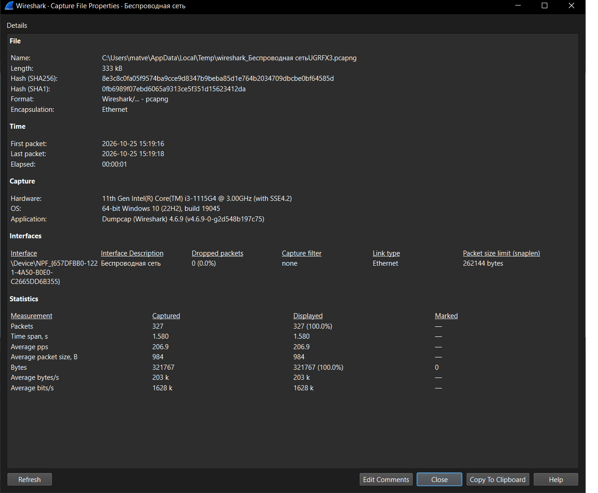
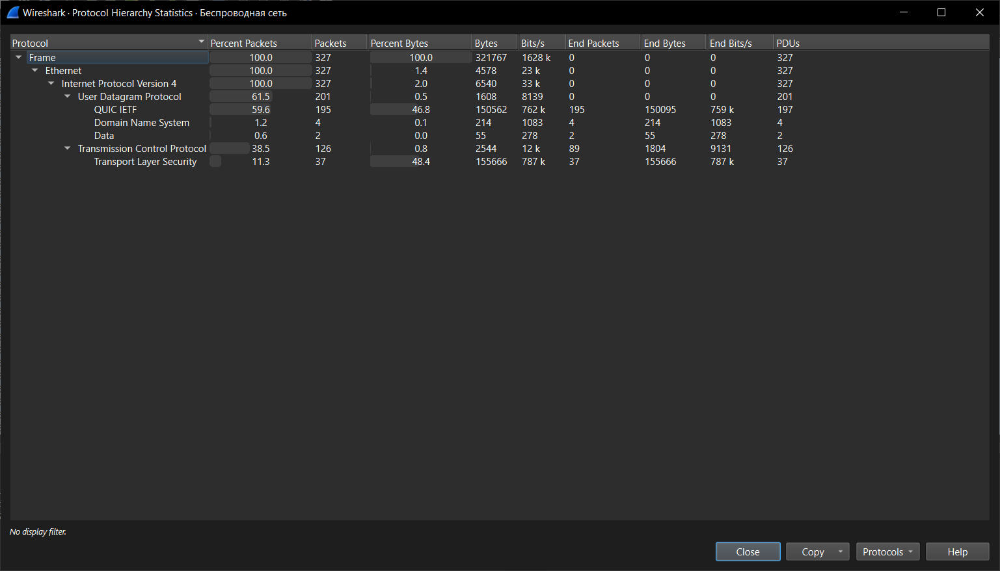
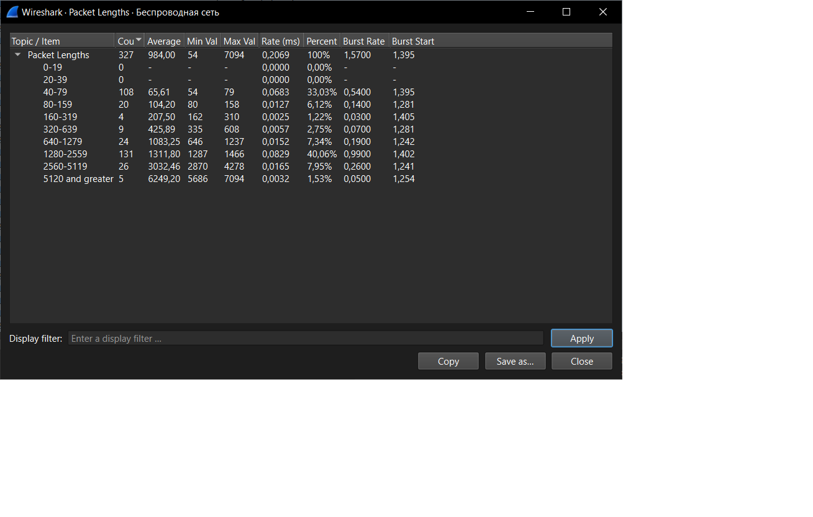
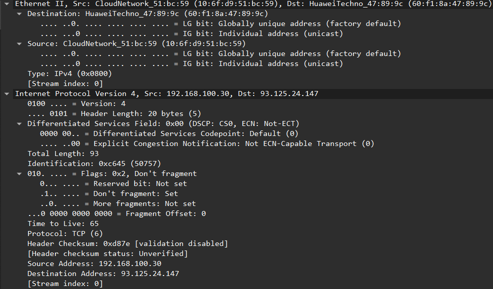
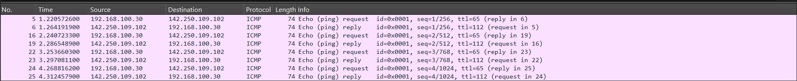
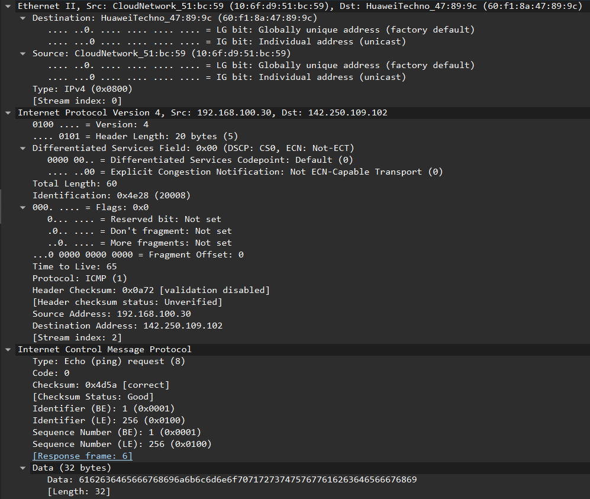
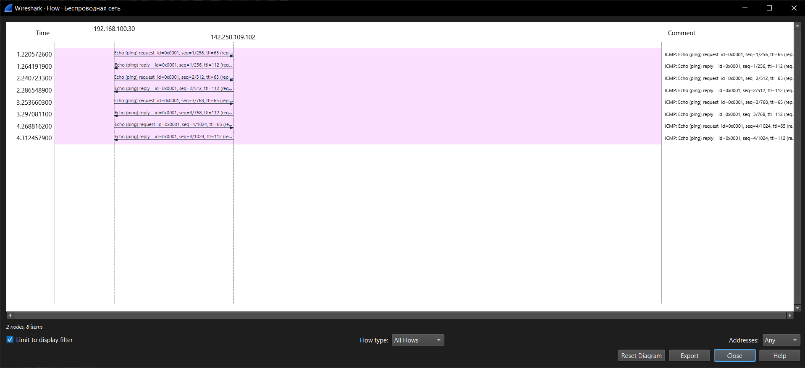
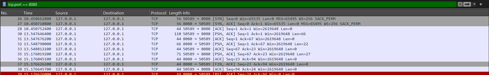
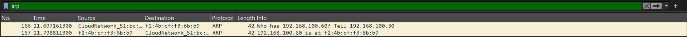
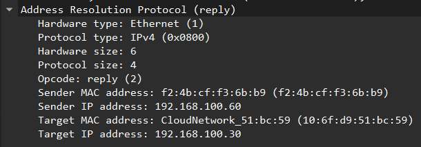

Министерство образования Республики Беларусь

Учреждение образования

“Брестский Государственный технический университет”

Кафедра ИИТ

       

Лабораторная работа №3

По дисциплине “Аппаратное и Программное обеспечение сетей”

Тема: “АНАЛИЗ СЕТЕВОГО ТРАФИКА И ПРОТОКОЛОВ НА БАЗЕ WIRESHARK”

Вариант: 7

     

Выполнил:

Студент 3 курса

Группы ИИ-27

Дорошенко М.Д.

Проверил:

Кулик А.Д.

     

Брест 2026

---

# Цель

Познакомиться с принципами работы анализатора трафика Wireshark, освоить методику захвата пакетов и разбор структуры основных сетевых протоколов.

# Ход работы

## Задание 1

---

## Задание 2

Статистические данные размеров IPv4-пакетов (минимум, максимум, среднее):

Рассмотрим один из поступиших к нам пакетов:

Для него можнно выделить следующие вещи:

Заголовок Ethernet II:

- `Destination`: 60:f1:8a:47:89:9c
- `Source`: 10:6f:d9:51:bc:59
- `Type`: 0x0800

Заголовок IPv4:

- `Version `: 4
- `Header Length`: 20
- `Total Length`: 93
- `Identification`: 0xc645
- `Flags`: 0x02
- `Time to Live`: 65
- `Protocol`: TCP (6)
- `Header checksum`: 0xd87e
- `Source Address`: 192.168.100.30
- `Destination Address`: 93.125.24.147

---

## Задание 3

### Структура расмматриваемого пакета:

Заголовок Ethernet II:

- `Destination`: 60:f1:8a:47:89:9c
- `Source`: 10:6f:d9:51:bc:59
- `Type`: 0x0800

Заголовок IPv4:

- `Version `: 4
- `Header Length`: 20
- `Total Length`: 60
- `Identification`: 0x4e28
- `Flags`: 0x00
- `Time to Live`: 65
- `Protocol`: ICMP (1)
- `Header checksum`: 0x0a72
- `Source Address`: 192.168.100.30
- `Destination Address`: 142.250.109.102

Заголовок ICMP:

- `Type`: Echo ping request (8)
- `Code`: 0
- `Checksum`: 0x4d5a
- `Identifier (BE)`: 1 (0x0001)
- `Identifier (LE)`: 256 (0x0100)
- `Sequence Number (BE)`: 1 (0x0001)
- `Sequence Number (LE)`: 256 (0x0100)

### Диаграмма взаимодействия

---

## Задание 4

**Разбор полей заголовка TCP (на примере пакета №60):**

• **Source Port:** 50651. Данный порт был динамически выделен операционной системой для TCP-клиента.
• **Destination Port:** 669. Порт, который прослушивает TCP-сервер.
• **Sequence Number:** Seq=1. Используется для правильной сборки байтового потока.
• **Acknowledgment Number:** Ack=1. Подтверждает успешный прием предыдущих байт.
• **Flags:** [PSH, ACK]. ACK — подтверждение получения. PSH — указывает на необходимость немедленной передачи данных приложению.
• **Длина данных (Len):** 48 байт.

---

## Задание 5

## User Datagram Protocol

• **Source Port:** 59013.
• **Destination Port:** 670.
• **Length:** 11. Общая длина UDP-датаграммы (заголовок + данные).
• **Checksum:** [Good Checksum: Unverified].

Пояснение по Checksum: Статус «Unverified» возникает из-за особенности работы сетевого стека Windows, который передает пакет на сетевой адаптер, оставляя вычисление контрольной суммы аппаратному обеспечению.

---

## Задание 6

**Разбор структуры ARP-запроса:**
• **Opcode:** request (1). Означает, что это ARP-запрос.
• **Sender MAC address:** ec:91:61:8d:cd:1d (MAC-адрес твоего компьютера).
• **Sender IP address:** 192.168.100.23.
• **Target MAC address:** 00:00:00:00:00:00. Поле пустое, так как MAC-адрес искомого узла неизвестен.
• **Target IP address:** 192.168.100.254. IP-адрес, который мы пытаемся найти.

---

# Вывод

В ходе работы были изучены базовые возможности программы Wireshark. Освоены методы захвата трафика, применения фильтров отображения и анализа структуры сетевых протоколов (Ethernet, IP, TCP, UDP, ICMP, ARP).