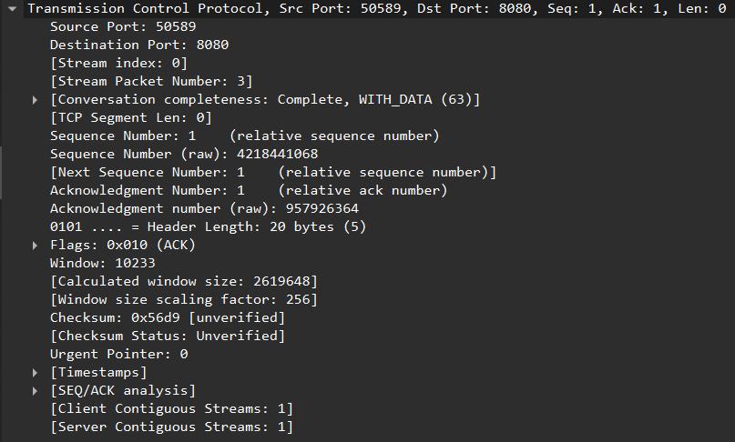
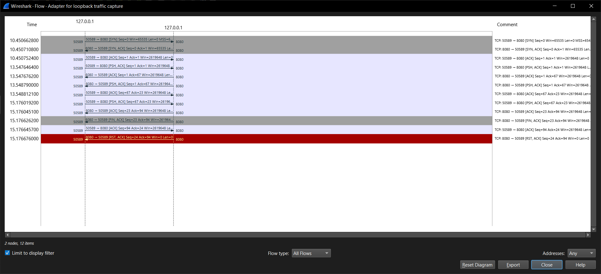
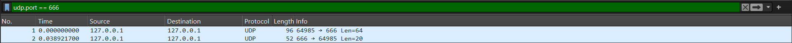
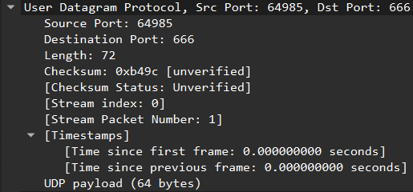
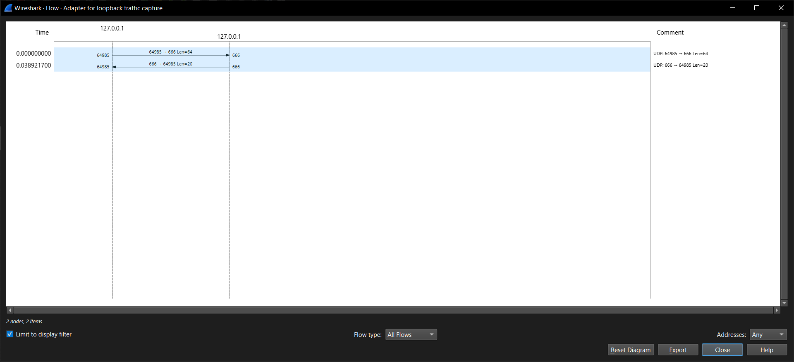

Министерство образования Республики Беларусь

Учреждение образования

“Брестский Государственный технический университет”

Кафедра ИИТ

       

Лабораторная работа №3

По дисциплине “Аппаратное и Программное обеспечение сетей”

Тема: “АНАЛИЗ СЕТЕВОГО ТРАФИКА И ПРОТОКОЛОВ НА БАЗЕ WIRESHARK”

Вариант: 7

     

Выполнил:

Студент 3 курса

Группы ИИ-27

Дорошенко М.Д.

Проверил:

Кулик А.Д.

     

Брест 2026

---

# Цель

Ознакомиться с принципами работы анализатора трафика Wireshark, разборать структуры основных сетевых протоколов.

# Ход работы

Для начала установим программу [Wireshark](https://www.wireshark.org) на нашу машину.
После небольшого ознакомления с методическикми указаниями, перейдем к выполнению лабораторной работы.

## Задание 1

---

## Задание 2

Статистические данные размеров IPv4-пакетов:

Рассмотрим один из поступиших к нам пакетов:

Для него можнно выделить следующие вещи:

**Заголовок Ethernet II**:

- `Destination`: 60:f1:8a:47:89:9c - MAC-адрес сетевого интерфейса получателя, которому предназначен кадр на локальном уровне.
- `Source`: 10:6f:d9:51:bc:59 - MAC-адрес интерфейса отправителя, позволяющий получателю и коммутаторам идентифицировать источник кадра.
- `Type`: 0x0800 - указывает, протокол какого сетевого уровня (здесь IPv4, 0x0800) инкапсулирован в полезной нагрузке кадра.

**Заголовок IPv4**:

- `Version`: 4 - номер версии протокола IP (4 означает IPv4), по которому маршрутизаторы определяют формат заголовка.
- `Header Length`: 20 - длина заголовка IP в 32-битных словах (20 байт), нужная для нахождения начала полезной нагрузки.
- `Total Length`: 93 - общая длина пакета (заголовок + данные) в байтах, позволяющая выделить пакет из кадра.
- `Identification`: 0xc645 - идентификатор пакета, используемый для сборки фрагментов одного исходного пакета.
- `Flags`: 0x02 - биты управления фрагментацией (например, запрет фрагментации или признак «есть ещё фрагменты»).
- `Time to Live`: 65 - максимальное число переходов (hop limit), предотвращающее бесконечное блуждание пакета по сети.
- `Protocol`: TCP (6) -  указывает протокол следующего уровня (здесь TCP, 6), которому передаётся полезная нагрузка.
- `Header checksum`: 0xd87e - контрольная сумма заголовка для обнаружения ошибок, возникших при передаче.
- `Source Address`: 192.168.100.30 - IP-адрес отправителя, используемый для маршрутизации и идентификации источника.
- `Destination Address`: 93.125.24.147 - IP-адрес получателя, по которому маршрутизаторы определяют путь доставки пакета.

---

## Задание 3

Структура расмматриваемого пакета:

**Заголовок Ethernet II**:

- `Destination`: 60:f1:8a:47:89:9c - MAC-адрес сетевого интерфейса получателя, которому предназначен кадр на локальном уровне.
- `Source`: 10:6f:d9:51:bc:59 - MAC-адрес интерфейса отправителя, позволяющий получателю и коммутаторам идентифицировать источник кадра.
- `Type`: 0x0800 - указывает, протокол какого сетевого уровня (здесь IPv4, 0x0800) инкапсулирован в полезной нагрузке кадра.

**Заголовок IPv4**:

- `Version`: 4 - номер версии протокола IP (4 означает IPv4), по которому маршрутизаторы определяют формат заголовка.
- `Header Length`: 20 - длина заголовка IP в 32-битных словах (20 байт), нужная для нахождения начала полезной нагрузки.
- `Total Length`: 60 - общая длина пакета (заголовок + данные) в байтах, позволяющая выделить пакет из кадра.
- `Identification`: 0x4e28 - идентификатор пакета, используемый для сборки фрагментов одного исходного пакета.
- `Flags`: 0x00 - биты управления фрагментацией (например, запрет фрагментации или признак «есть ещё фрагменты»); здесь 0x00 — фрагментация разрешена, фрагментов нет.
- `Time to Live`: 65 - максимальное число переходов (hop limit), предотвращающее бесконечное блуждание пакета по сети.
- `Protocol`: ICMP (1) - указывает протокол следующего уровня (здесь ICMP, 1), которому передаётся полезная нагрузка.
- `Header checksum`: 0x0a72 - контрольная сумма заголовка для обнаружения ошибок, возникших при передаче.
- `Source Address`: 192.168.100.30 - IP-адрес отправителя, используемый для маршрутизации и идентификации источника.
- `Destination Address`: 142.250.109.102 - IP-адрес получателя, по которому маршрутизаторы определяют путь доставки пакета.

**Заголовок ICMP**:

- `Type`: Echo ping request (8) - тип ICMP-сообщения (здесь 8 — Echo Request, т.е. запрос ping), определяющий его смысл и обработку получателем.
- `Code`: 0 - уточняющий подтип сообщения внутри типа (здесь 0 — единственное значение для Echo Request).
- `Checksum`: 0x4d5a - контрольная сумма ICMP-сообщения для проверки его целостности при передаче.
- `Identifier (BE)`: 1 (0x0001) - идентификатор «сеанса» ping, по которому отправитель сопоставляет ответ с конкретным запросом.
- `Identifier (LE)`: 256 (0x0100) - идентификатор «сеанса» ping, по которому отправитель сопоставляет ответ с конкретным запросом.
- `Sequence Number (BE)`: 1 (0x0001) - порядковый номер пакета в серии ping, позволяющий отслеживать потери и порядок ответов
- `Sequence Number (LE)`: 256 (0x0100) - порядковый номер пакета в серии ping, позволяющий отслеживать потери и порядок ответов

**Диаграмма взаимодействия**:

---

## Задание 4

**Заголовок TCP**:

- `Source Port`: 8080 - номер порта приложения-отправителя (здесь 8080), по которому получатель определяет, какому процессу/сокету передать данные и куда отправить ответ.
- `Destination Port`: 50589 - номер порта приложения-получателя (здесь 50589), указывающий, какому локальному процессу на принимающей стороне предназначен сегмент.
- `Sequence Number`: 23    (relative sequence number) - порядковый номер первого байта данных в сегменте (здесь относительный, 23), обеспечивающий правильный порядок сборки потока и обнаружение потерь.
- `Acknowledgment Number`: 94    (relative ack number) - номер следующего байта, который отправитель ожидает получить от собеседника (здесь относительный, 94), подтверждающий успешный приём данных.
- `Flags`: 0x011 (FIN, ACK) - биты управления соединением (здесь FIN и ACK), сигнализирующие о закрытии соединения со стороны отправителя и подтверждении ранее полученных данных.
- `Header Length`: 20 bytes (5) - длина TCP-заголовка в 32-битных словах (5, т.е. 20 байт), нужная для нахождения начала полезной нагрузки (опций в данном сегменте нет).

**Диаграмма взаимодействия**:

---

## Задание 5

**Заголовок UDP**:

- `Source Port`: 64985 - номер порта приложения-отправителя (здесь 64985), позволяющий получателю определить, какому процессу/сокету адресовать ответ.
- `Destination Port`: 666 - номер порта приложения-получателя (здесь 666), указывающий, какому локальному процессу на принимающей стороне предназначена дейтаграмма.
- `Length`: 72 - общая длина UDP-дейтаграммы (заголовок + данные) в байтах (здесь 72), нужная для выделения дейтаграммы из IP-пакета.
- `Checksum`: 0xb49c [unverified] - контрольная сумма заголовка и данных для проверки целостности (здесь 0xb49c, помечена как непроверенная — анализатор её не валидировал).

**Диаграмма взаимодействия**:

---

## Задание 6

**Заголовок ADR**:

- `Opcode`: reply (2) - код операции, указывающий тип ARP-сообщения (здесь reply, 2), то есть что это ответ на ранее полученный запрос, а не новый запрос.
- `Sender MAC address`: f2:4b:cf:f3:6b:b9 (f2:4b:cf:f3:6b:b9) - аппаратный (MAC) адрес отправителя этого ARP-ответа (здесь f2:4b:cf:f3:6b:b9), который получатель должен использовать для отправки кадров на этот IP.
- `Sender IP address`: 192.168.100.60 - IP-адрес отправителя (здесь 192.168.100.60), вместе с его MAC-адресом образует пару «IP ↔ MAC», которую получатель может занести в свою ARP-таблицу.
- `Target MAC address`: CloudNetwork_51:bc:59 (10:6f:d9:51:bc:59) - MAC-адрес получателя (здесь 10:6f:d9:51:bc:59), то есть того узла, которому адресован этот ответ и который ранее запрашивал соответствие.
- `Target IP address`: 192.168.100.30 - IP-адрес получателя (здесь 192.168.100.30), подтверждающий, что ответ предназначен именно тому узлу, который искал MAC для этого IP.

---

# Выводы

В ходе работы были изучены базовые возможности программы Wireshark. Освоены методы захвата трафика, применения фильтров отображения и анализа структуры сетевых протоколов (Ethernet, IP, TCP, UDP, ICMP, ARP).
