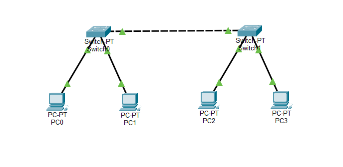
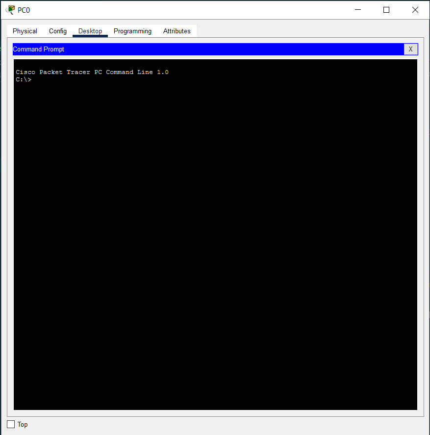
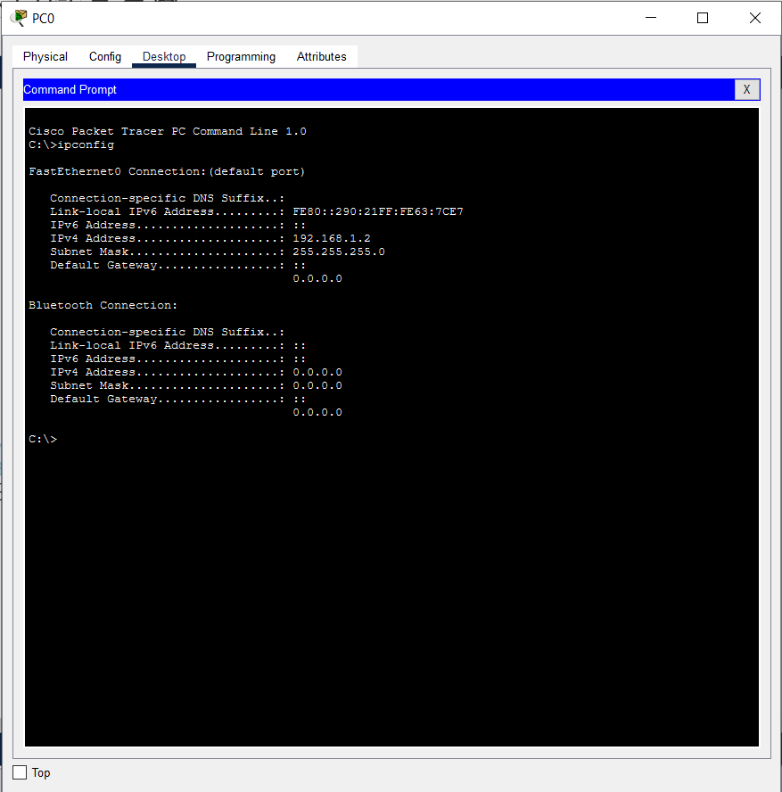
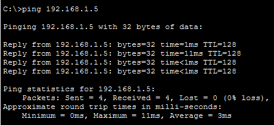
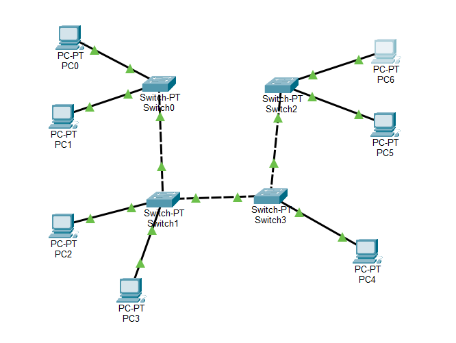
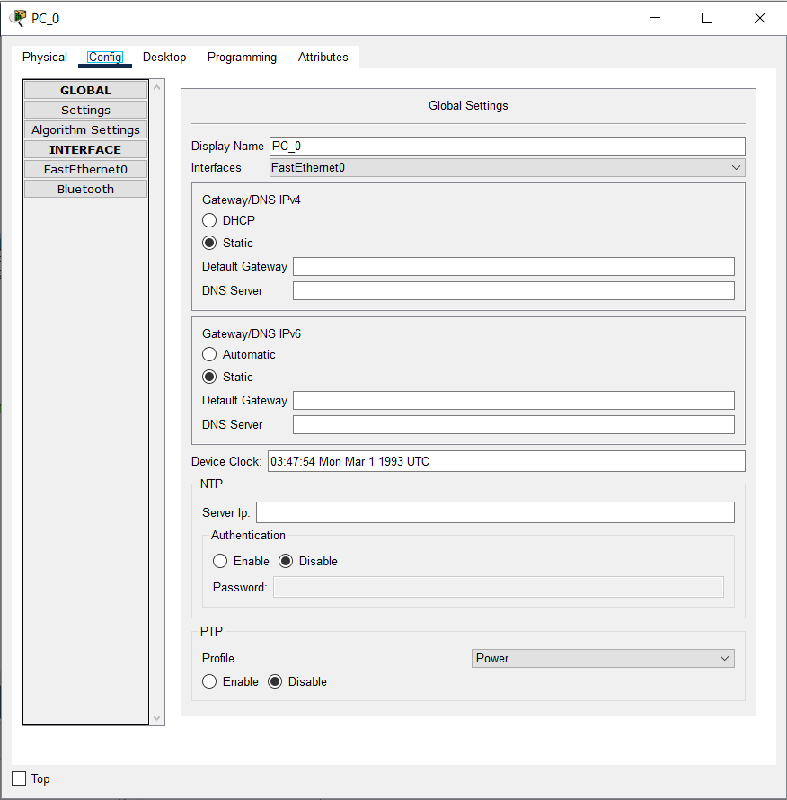
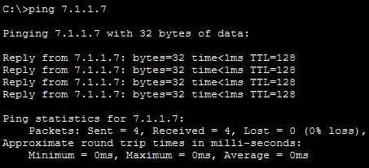

<p align="center">Министерство образования Республики Беларусь</p>
<p align="center">Учреждение образования</p>
<p align="center">“Брестский Государственный технический университет”</p>
<p align="center">Кафедра ИИТ</p>
<br><br><br><br><br><br><br>
<p align="center">Лабораторная работа №4</p>
<p align="center">По дисциплине “Аппаратное и Программное обеспечение сетей”</p>
<p align="center">Тема: “ИЗУЧЕНИЕ ПАКЕТА CISCO PACKET TRACER. НАЧАЛЬНАЯ КОНФИГУРАЦИЯ МАРШРУТИЗАТОРА CISCO”</p>
<p align="center">Вариант: 7</p>
<br><br><br><br><br>
<p align="right">Выполнил:</p>
<p align="right">Студент 3 курса</p>
<p align="right">Группы ИИ-27</p>
<p align="right">Дорошенко М.Д.</p>
<p align="right">Проверил:</p>
<p align="right">Кулик А.Д.</p>
<br><br><br><br><br>
<p align="center">Брест 2026</p>

---

# Цель

Изучить интерфейс эмулятора Cisco Packet Tracer, научиться добавлять и соединять сетевые устройства, настраивать IP-адресацию на ПК, проверять связность командой ping, а также изучить начальную конфигурацию маршрутизатора Cisco и принципы работы таблицы маршрутизации.

# Ход работы

Перед тем, как мы приступим к выполнению данной лаборатоной работы, установим программу **Cisco Packet Tracer** на нашу машинку.

После этого, ознакомимся с методическими указаниями по использованию данного ПО.

А теперь перейдем непосредственно к выполнению работы.

## Практическая часть

В данной части нам необходимо собрать сеть, состоящую из 2-х коммутаторов Switch-PC и 4-x компьютеров (PC). Каждый коммутатор будет соединен с 2-мя компьютерами и между собой.
Приведу ниже полученноую топологию:



Следующим шагом нам необходимо произвести конфигурацию для каждого ПК.

Для этого нажмем на PC0. Далее жмякаем `Desktop -> Command Prompt`.

Должно быть на подобие этого:



Здесь и для последующих PC, нам необходимо использовать следующую команду:

```ipconfig <ip_adress> <subnet_mask>```

* ip_adress - IP адресс ПК.
* subnet_mask - маска подсети.

**Вопрос дня/вечера/сегодня** - где взять данные параметры?

**Ответ** - из приведенной ниже таблицы:

| Устройство | IP Adress | Subnet Mask |
| --- | --- | --- |
| PC0 | 192.168.1.2 | 255.255.255.0 |
| PC1 | 192.168.1.3 | 255.255.255.0 |
| PC2 | 192.168.1.4 | 255.255.255.0 |
| PC3 | 192.168.1.5 | 255.255.255.0 |

А теперь, нам эти вещи, как я писал выше, нужно писать для каждого PC...

И, если вы переживаете, что команда выполнилась неправильно, то воспользуйиесь `ipconfig` без параметров - увидите конфигурацию текущего PC.

У меня, например, это выглядит следующим образом:



Живы? Отлично! Осталось совсем чуть-чуть для завершения данной части.

Теперь, нам необходимо проверить, будет ли работать наша ~~шайтан машина~~ сеть.
Для этого мы выбираем две ~~жертвы~~ PC, где с первой мы будем проверять другую.

**Вопрос2.0** - каким образом мы будем это верифицировать?

**ОТвет2.0** - используем `ping <ip_adress>`, где `ip_adress` - IP-адрес, к которому мы будем 'стучаться'.

Буду проверять PC3 PC0. Странно звучит, но что ж поделать-то.

Кликаем на PC0. Переходим в `Desktop -> Command Prompt`.
Далее вводим:

```ipconfig  192.168.1.5```

После выполнения получим следующий результат:



Поздравляю, мы выполнили первую половину лабы!

Перейдем же к другой оставшейся части.

## Часть 1

Здесь нам надо повторить те же шаги, что и в предыдущей части, так что для экономии времени и места, буду приводить название совершенного действия и скриншот к нему.
Ну что ж, попинговали!

1) Построим топологию



2) Произведем конфигурацию для каждого PC

Будем брать данные из следующей таблицы:

| Устройство | IP Adress | Subnet Mask |
| --- | --- | --- |
| PC0 | 7.1.1.1 | 255.255.255.0 |
| PC1 | 7.1.1.2 | 255.255.255.0 |
| PC2 | 7.1.1.3 | 255.255.255.0 |
| PC3 | 7.1.1.4 | 255.255.255.0 |
| PC4 | 7.1.1.5 | 255.255.255.0 |
| PC5 | 7.1.1.6 | 255.255.255.0 |
| PC6 | 7.1.1.7 | 255.255.255.0 |

PS: Т.к. у меня 7 вариант, то в записях `v.1.1.1`, ..., `v.1.1.7` v=7.

3) Назначим компьютерам разные имена



4) Проверим работоспособность сети с использованием `ping`

Введу данную команду в PC0:



На этом все.

---

# Выводы

В ходе выполнения лабораторной работы я изучил основыне возможности Cisco Packet Tracer, получил практические навыки построения и настройки локальной сети.
