<p align="center">Министерство образования Республики Беларусь</p>
<p align="center">Учреждение образования</p>
<p align="center">“Брестский Государственный технический университет”</p>
<p align="center">Кафедра ИИТ</p>
<br><br><br><br><br><br><br>
<p align="center">Лабораторная работа №5</p>
<p align="center">По дисциплине “Аппаратное и Программное обеспечение сетей”</p>
<p align="center">Тема: “НАСТРОЙКА СТАТИЧЕСКОЙ МАРШРУТИЗАЦИИ НА УСТРОЙСТВАХ CISCO.”</p>
<p align="center">Вариант: 7</p>
<br><br><br><br><br>
<p align="right">Выполнил:</p>
<p align="right">Студент 3 курса</p>
<p align="right">Группы ИИ-27</p>
<p align="right">Дорошенко М.Д.</p>
<p align="right">Проверил:</p>
<p align="right">Кулик А.Д.</p>
<br><br><br><br><br>
<p align="center">Брест 2026</p>

---

# Цель

Изучить интерфейс эмулятора Cisco Packet Tracer, научиться добавлять и соединять сетевые устройства, настраивать IP-адресацию на ПК, проверять связность командой ping, а также изучить начальную конфигурацию маршрутизатора Cisco и принципы работы таблицы маршрутизации.

# Ход работы

Для начала, нам необходимо разобраться с тем, как происходит настройка и сборка статической маршрутизации. Поэтому, предлагаю перейти к ознакомительной части.

## Ознакомительная часть

Итак, перед тем, как вводить наши команды, нам необходимо собрать топологию сети.

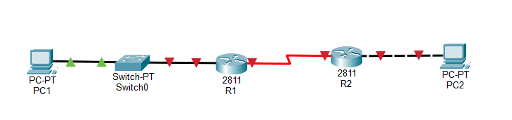

Важное замечание. При построении данной топологии, могут возникнуть некоторые вопросы, которые могут смутить. Поэтому предлагаю их рассмотреть ниже.

### Вопрос №1: Кому и куда какие кабели тянуть?

* Если у нас ПК -> Коммутатор, Коммутатор -> Роутер - Используем Copper Straight-Through.
* Если у нас ПК -> ПК, Роутер -> Роутер (через Ethernet порты), ПК -> Роутер - Используем Copper Cross-Over.
* Если у нас Роутер -> Роутер через специальные последовательные интерфейсы (WAN) - Используем Serial DCE или Serial DTE.

В нашей текущей топологии присутствуют все рассматриваемые нами кабеля.

Вопрос: Почему мы используем **Serial DTE** между двумя роутерами?

Ответ: Здесь, мы эмулируем WAN, поэтому целесообразнее использовать данный тип кабеля.

### Вопрос №2: Почему используем роутеры 2811, а не 1841?

Хороший вопрос, на который будут несколько ответов.

1) Проблема несовпадения инкапсуляции (PPP vs HDLC). [Источник](https://learningnetwork.cisco.com/s/question/0D53i00000Ksu3LCAR/any-good-practise-for-discerning-label-1-issues)
    > При соединении двух виртуальных маршрутизаторов 1841 в Packet Tracer на последовательном порту одного конца настроена инкапсуляция PPP, а на другом — HDLC. В результате интерфейс находится в состоянии up, line protocol is down (disabled).
2) Проблема типа кабеля (отсутствие Auto-MDIX). [Источник](https://community.cisco.com/t5/routing-and-sd-wan/cisco-1841-fastethernet0-is-up-line-protocol-is-down/m-p/4817667#M382443%231)
    > При соединении двух маршрутизаторов 1841 друг с другом (Router-to-Router) с использованием прямого кабеля (Straight-through) интерфейс показывает up, line protocol is down, и индикатор связи не горит.

Исходя из вышеприведенного, предпочтительней использовать другие роутеры, например 2811.

### Вопрос №3: Как подключить кабеля Serial DTE между роутерами?

Выполняйте следующие шаги:

1) Нажмите на роутер левой кнопкой мыши. У вас появится следующее диалоговое окно.
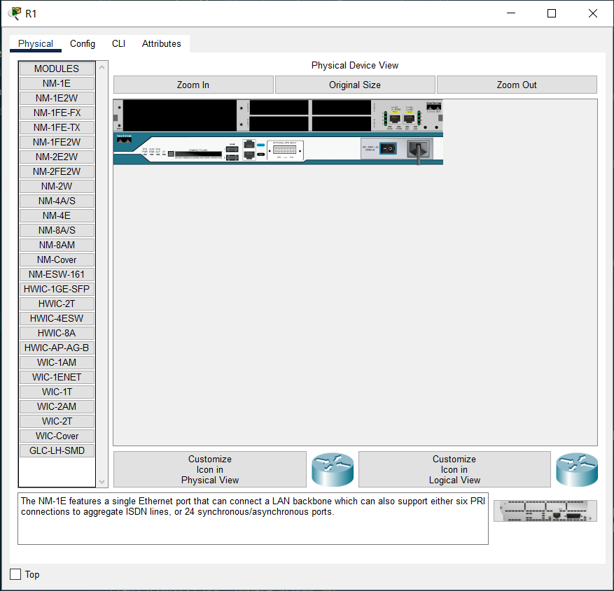

2) Найдите на роутере кнопку `-/0`. Переведите на `0`.
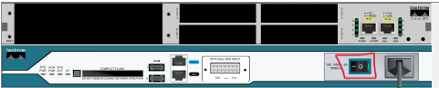

3) Переместите из левой панели на роутер модуль `WIC-1T`.
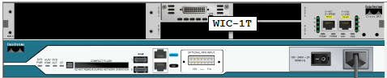

4) Переведите кнопку роутера на `-`.

Такие же операции повторите для другого роутера.

Соединим же наши роутеры:

1) Выберите кабель **Serial DTE**.
2) Нажмите на первый роутер. 
3) В контектном меню выберите Serial0/3/0.
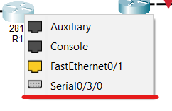
4) Нажмите на другой роутер.
5) В контектном меню выберите Serial0/3/0.

Таким образом, нам удалось соединенить два роутера. Поздравляю!

### Немного важных данных для конфигурации

После постройки топологии, нам необходимо настроить устройства. 

Приведу таблицу со всеми необходимыми параметрами.

| Device | Interface | IP Address | Mask | Default Gateway |
| :--- | :--- | :--- | :--- | :--- |
| **R1** | **Fa0/0** | 192.168.1.1 | 255.255.255.0 | N/A |
| | **S0/1/0** | 192.168.2.1 | 255.255.255.0 | N/A |
| **R2** | **Fa0/0** | 192.168.3.1 | 255.255.255.0 | N/A |
| | **S0/1/0** | 192.168.2.2 | 255.255.255.0 | N/A |
| **PC1** | N/A | 192.168.1.10 | 255.255.255.0 | 192.168.1.1 |
| **PC2** | N/A | 192.168.3.10 | 255.255.255.0 | 192.168.3.1 |

Отлично. На основании данной таблицы, перейдем к настройке каждого устройства.

### Настраиваем PC

Заходим в командную строку диалогового окна PC по следующему пути: `Dektop -> Command Prompt`.

Вводим известную нам команду из 4 лаборатной работы `ipconfig`, имеющую следующую структуру: `ipconfig <ip_address> <mask> <default_gateway>`

Произвдем настройку для каждого PC и сразу же проверим:

**PC1**:

`ipconfig 192.168.1.10 255.255.255.0 192.168.1.1`

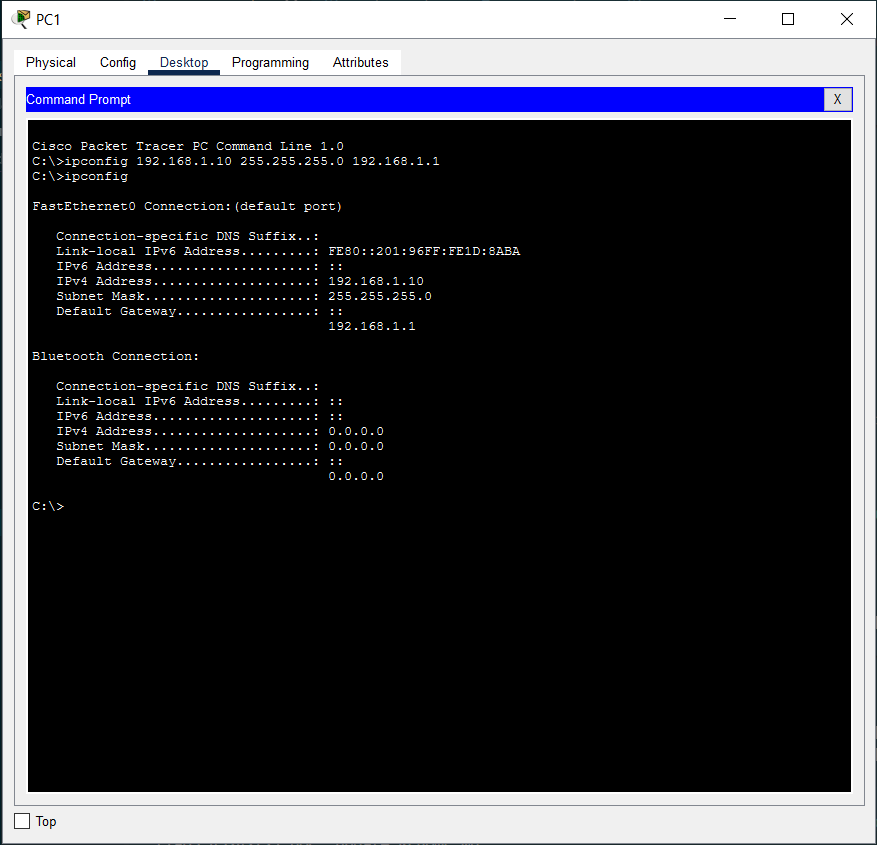

**PC2**:

`ipconfig 192.168.3.10 255.255.255.0 192.168.3.1`


### Настраиваем Router-ы

Здесь переходим в `CLI`. Для каждого роутера мы будем использовать следующие команды:
* ip address <ip_address> <mask> - Используем для настройки IP адреса и маски сети для интерфейсов.
* no shutdown - Применение новых настроек.
* ip route <ip_destination> <mask> <ip_hop> - настройка статичекой маршрутизации.
* show ip interface brief
* show ip route

**R1**:
```
enable
configure terminal

interface FastEthernet0/0
ip address 192.168.1.1 255.255.255.0
no shutdown
exit

interface Serial0/3/0
ip address 192.168.2.1 255.255.255.0
no shutdown
exit

ip route 192.168.3.0 255.255.255.0 192.168.2.2

end
```

**R2**:
```
enable
configure terminal

interface FastEthernet0/0
ip address 192.168.3.1 255.255.255.0
no shutdown
exit

interface Serial0/3/0
ip address 192.168.2.2 255.255.255.0
no shutdown
exit

ip route 192.168.1.0 255.255.255.0 192.168.2.1

end
```

После этих настроек мы получим рабочую сеть, что доказывается зелеными стрелочками от каждого роутера.

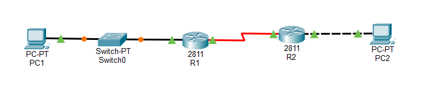

Проверим работоспособность данной сети командой ping со следующей структурой: `ping <ip_address>`.

**PC1**:

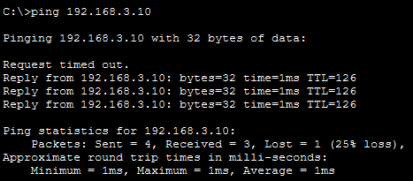

**PC2**:

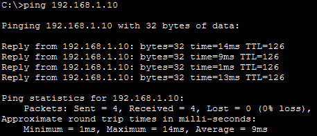

## Индивидуальное задание

Первым делом создадим топологию. У меня 7 вариант.

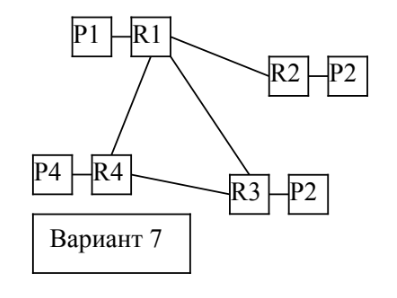

Получилась следующая топология.

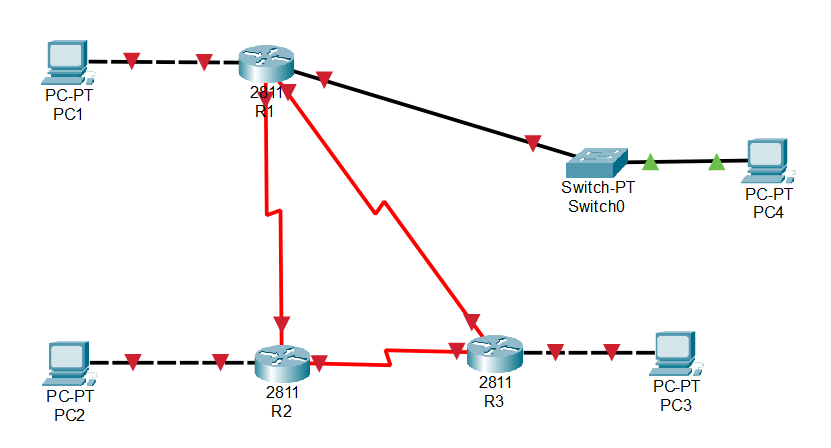

Далее посторим вспомогательную табличку.

| Device | Interface | IP Address | Mask | Default Gateway |
| --- | --- | --- | --- | --- |
| PC1 | Fa0 | 192.168.10.10 | 255.255.255.0 | 192.168.10.1 |
| PC2 | Fa0 | 192.168.20.10 | 255.255.255.0 | 192.168.20.1 |
| PC3 | Fa0 | 192.168.30.10 | 255.255.255.0 | 192.168.30.1 |
| PC4 | Fa0 | 192.168.40.10 | 255.255.255.0 | 192.168.40.1 |
|    |    |    |    |    |
| Router1 | Fa0/0 (к PC1) | 192.168.10.1 | 255.255.255.0 | N/A |
| Router1 | Fa0/1 (к Switch0) | 192.168.40.1 | 255.255.255.0 | N/A |
| Router1 | Se0/3/0 (к R2) | 10.0.12.1 | 255.255.255.252 | N/A |
| Router1 | Se0/3/1 (к R3) | 10.0.13.1 | 255.255.255.252 | N/A |
|    |    |    |    |    |
| Router2 | Fa0/0 (к PC2) | 192.168.20.1 | 255.255.255.0 | N/A |
| Router2 | Se0/3/0 (к R1) | 10.0.12.2 | 255.255.255.252 | N/A |
| Router2 | Se0/3/1 (к R3) | 10.0.23.2 | 255.255.255.252 | N/A |
|    |    |    |    |    |
| Router3 | Fa0/0 (к PC3) | 192.168.30.1 | 255.255.255.0 | N/A |
| Router3 | Se0/3/0 (к R1) | 10.0.13.2 | 255.255.255.252 | N/A |
| Router3 | Se0/3/1 (к R2) | 10.0.23.1 | 255.255.255.252 | N/A |

Настроим PC.

**PC1**:

`ipconfig 192.168.10.10 255.255.255.0 192.168.10.1`


**PC2**:

`ipconfig 192.168.20.10 255.255.255.0 192.168.20.1`


**PC3**:

`ipconfig 192.168.30.10 255.255.255.0 192.168.30.1`

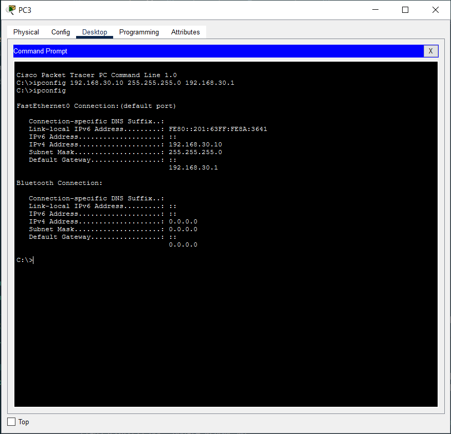

**PC4**:

`ipconfig 192.168.40.10 255.255.255.0 192.168.40.1`

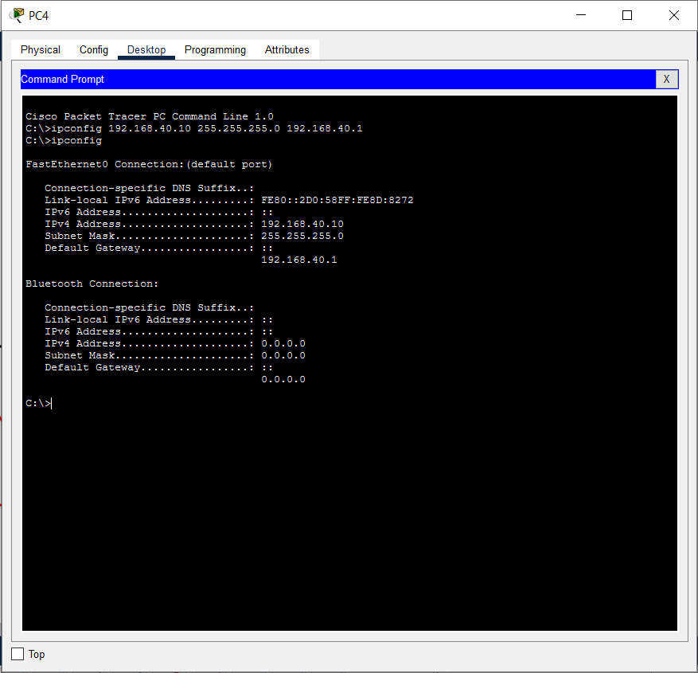


Далее настроим роутеры:

**R1**:
```
enable
configure terminal

interface FastEthernet0/0
ip address 192.168.10.1 255.255.255.0
no shutdown
exit

interface FastEthernet0/1
ip address  192.168.40.1 255.255.255.0
no shutdown
exit

interface Serial0/3/0
ip address 10.0.12.1 255.255.255.252
no shutdown
exit

interface Serial0/3/1
ip address 10.0.13.1 255.255.255.252
no shutdown
exit

ip route 192.168.20.0 255.255.255.0 10.0.12.2
ip route 192.168.30.0 255.255.255.0 10.0.13.2
ip route 10.0.23.0 255.255.255.252 10.0.12.2

end
```

**R2**:
```
enable
configure terminal

interface FastEthernet0/0
ip address 192.168.20.1 255.255.255.0
no shutdown
exit

interface Serial0/3/0
ip address 10.0.12.2 255.255.255.252
no shutdown
exit

interface Serial0/3/1
ip address 10.0.23.2 255.255.255.252
no shutdown
exit

ip route 192.168.10.0 255.255.255.0 10.0.12.1
ip route 192.168.40.0 255.255.255.0 10.0.12.1
ip route 192.168.30.0 255.255.255.0 10.0.23.1
ip route 10.0.13.0 255.255.255.252 10.0.12.1

end
```

**R3**:
```
enable
configure terminal

interface FastEthernet0/0
ip address 192.168.30.1 255.255.255.0
no shutdown
exit

interface Serial0/3/0
ip address  10.0.13.2 255.255.255.252
no shutdown
exit

interface Serial0/3/1
ip address 10.0.23.1 255.255.255.252
no shutdown
exit

ip route 192.168.10.0 255.255.255.0 10.0.13.1
ip route 192.168.40.0 255.255.255.0 10.0.13.1
ip route 192.168.20.0 255.255.255.0 10.0.23.2
ip route 10.0.12.0 255.255.255.252 10.0.13.1

end
```

После этих настроек мы получим активную сеть.

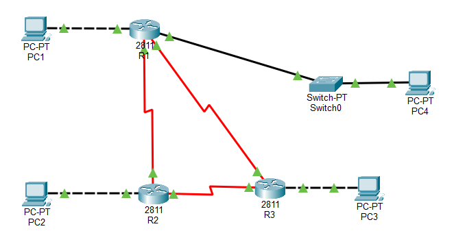

Проверим работоспособность топологии.

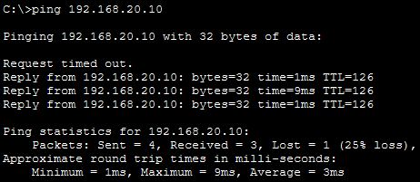

---

# Выводы

В ходе выполнения данной лабораторной работы я изучил построение статической маршрутизации в Cisco Packet Tracer.