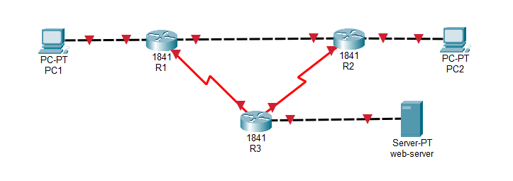
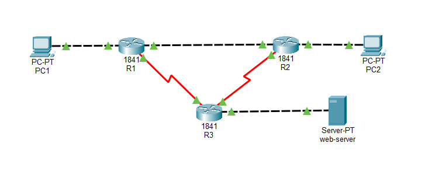
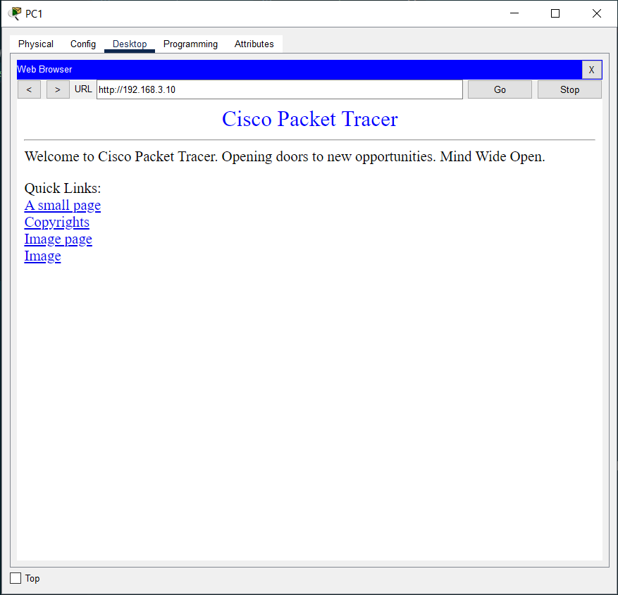
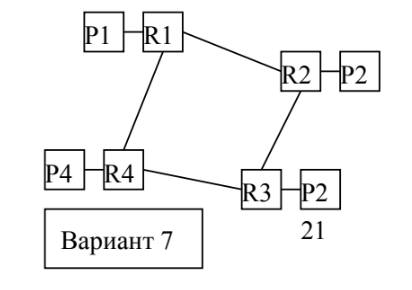
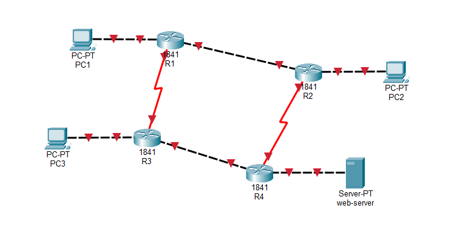
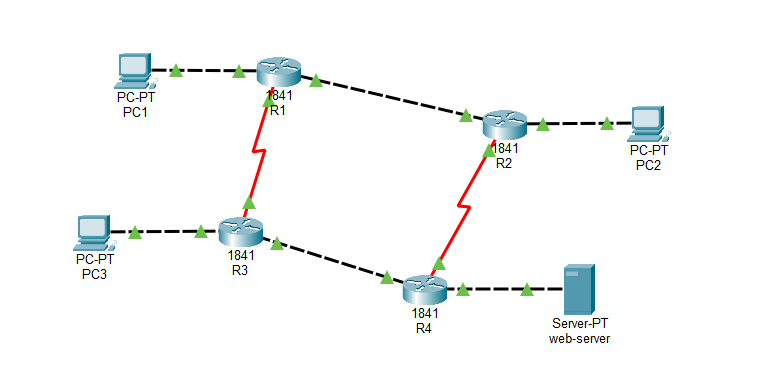

Министерство образования Республики Беларусь

Учреждение образования

“Брестский Государственный технический университет”

Кафедра ИИТ

       

Лабораторная работа №7

По дисциплине “Аппаратное и Программное обеспечение сетей”

Тема: “НАСТРОЙКА МАРШРУТИЗАЦИИ ПО УМОЛЧАНИЮ НА УСТРОЙСТВАХ CISCO”

Вариант: 7

     

Выполнил:

Студент 3 курса

Группы ИИ-27

Дорошенко М.Д.

Проверил:

Кулик А.Д.

     

Брест 2026

---

# Цель

Настроить на устройствах маршрут по умолчанию и распространить его по всей сети.

# Ход работы

## Практическая часть

Топология сети до настройки:

Вспомогательная таблица:

| Device | Interface | IP Address | Mask | Default Gateway |
| :--- | :--- | :--- | :--- | :--- |
| **R1** | **Fa0/0** | 192.168.1.1 | 255.255.255.0 | N/A |
| **R1** | **Fa0/1** | 10.0.0.1 | 255.255.255.252 | N/A |
| **R1** | **Se0/0/0** | 10.0.0.9 | 255.255.255.252 | N/A |
| | | | | |
| **R2** | **Fa0/0** | 192.168.2.1 | 255.255.255.0 | N/A |
| **R2** | **Fa0/1** | 10.0.0.2 | 255.255.255.252 | N/A |
| **R2** | **Se0/0/1** | 10.0.0.6 | 255.255.255.252 | N/A |
| | | | | |
| **R3** | **Fa0/0** | 192.168.3.1 | 255.255.255.0 | N/A |
| **R3** | **Se0/0/0** | 10.0.0.10 | 255.255.255.252 | N/A |
| **R3** | **Se0/0/1** | 10.0.0.5 | 255.255.255.252 | N/A |
| | | | | |
| **PC1** | N/A | 192.168.1.10 | 255.255.255.0 | 192.168.1.1 |
| **PC2** | N/A | 192.168.2.10 | 255.255.255.0 | 192.168.2.1 |
| **Web-server** | N/A | 192.168.3.10 | 255.255.255.0 | 192.168.3.1 |

После настройки получим:

Проверим работоспособность:

## Индивидуальное задание

Ввиду того, что у меня 7 вариант, схема топологии будет следующей:

И сама топология до настройки:

Составим вспомогательную таблицу:

| Устройство | Интерфейс | IP-адрес | Маска | Шлюз по умолчанию |
| :--- | :--- | :--- | :--- | :--- |
| **R1** | Fa0/0 | 192.168.1.1 | 255.255.255.0 | N/A |
| **R1** | Fa0/1 | 10.1.1.5 | 255.255.255.252 | N/A |
| **R1** | Se0/0/0 | 10.1.1.1 | 255.255.255.252 | N/A |
| | | | | |
| **R2** | Fa0/0 | 192.168.2.1 | 255.255.255.0 | N/A |
| **R2** | Fa0/1 | 10.1.1.6 | 255.255.255.252 | N/A |
| **R2** | Se0/0/1 | 10.1.1.9 | 255.255.255.252 | N/A |
| | | | | |
| **R3** | Fa0/0 | 192.168.3.1 | 255.255.255.0 | N/A |
| **R3** | Fa0/1 | 10.1.1.13 | 255.255.255.252 | N/A |
| **R3** | Se0/0/0 | 10.1.1.2 | 255.255.255.252 | N/A |
| | | | | |
| **R4** | Fa0/0 | 192.168.4.1 | 255.255.255.0 | N/A |
| **R4** | Fa0/1 | 10.1.1.14 | 255.255.255.252 | N/A |
| **R4** | Se0/0/0 | 10.1.1.10 | 255.255.255.252 | N/A |
| | | | | |
| **PC1** | N/A | 192.168.1.10 | 255.255.255.0 | 192.168.1.1 |
| **PC2** | N/A | 192.168.2.10 | 255.255.255.0 | 192.168.2.1 |
| **PC3** | N/A | 192.168.3.10 | 255.255.255.0 | 192.168.3.1 |
| **Web** | N/A | 192.168.4.10 | 255.255.255.0 | 192.168.4.1 |

После настройки получим:

Проверим работоспособность:

---

# Выводы

В ходе выполнения лабораторной работы я изучил возможность настраивать маршрутизацию по умолчанию в Cisco Packet Tracer.