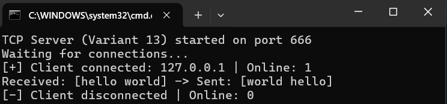
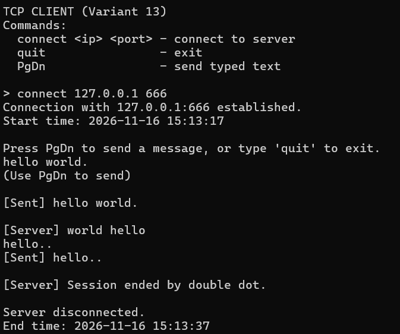

Министерство образования Республики Беларусь

Учреждение образования

“Брестский Государственный технический университет”

Кафедра ИИТ

       

Лабораторная работа №1

По дисциплине “Аппаратное и Программное обеспечение сетей”

Тема: “Организация TCP – сервера/клиента”

Вариант: 13

     

Выполнил:

Студент 3 курса

Группы ИИ-27

Хотенко В.В.

Проверил:

Кулик А.Д.

     

Брест 2026

# Цель

Реализовать на языке программирования высокого уровня Java клент-серверное взамодействие, организованной через TCP.

# Задание на выполнение

8.1 Изучить теоретический материал, функции
WinSockи листинг программы реализации TCP-сервера. Получить индивидуальное задание у преподавателя.
8.2 Используя систему Borland C++ v.5.02 (\bc5), разработать программу работы TCP-эхо-сервера, выполняющую функции согласно варианта задания (см. приложения). В качестве клиента использовать программу telnet. Выполнить проверку программы согласно методике,
приведенной в разделе 7.1. Продемонстрировать работу системы преподавателю.
8.3 Представить отчет, содержащий титульный лист, листинг программы с подробными комментариями основных фрагментов программы.
8.4 Подготовиться к защите лабораторной работы по теоретическому материалу, функциям WinSock 2, собственным результатам, полученным в ходе выполнения лабораторной работы
8.5 Изучить теоретический материал, функции WinSock и листинг программ реализации TCP-клиента.
8.6 Используя систему Borland C++ v.5.02 (\bc5), разработать программу работы TCP-клиента (см. приложения). Выполнить проверку программы с использованием разработанного в предыдущей лабораторной работе TCP-сервера. Продемонстрироватьработу системы преподавателю.
8.7 Представить отчет, содержащий титульный лист, листинг программы с подробнымикомментариями основных фрагментов программы.
8.8 Подготовиться к защите лабораторной работы по теоретическому материалу, функциям WinSock2, собственным результатам, полученным в ходе выполнения лабораторной работы.

# Структура программы

reports/Hotenkok/lab1/
├── rep/
│   └── README.md
├── src/
│   ├── client
│   │   ├── client.cpp
│   │   └── CMakeLists.txt
│   └── server
│       ├── server.cpp
│       └── CMakeLists.txt
├── client_protocol.log
├── CMakeLists.txt
├── build.bat
├── run_client.bat
└── run_server.bat

