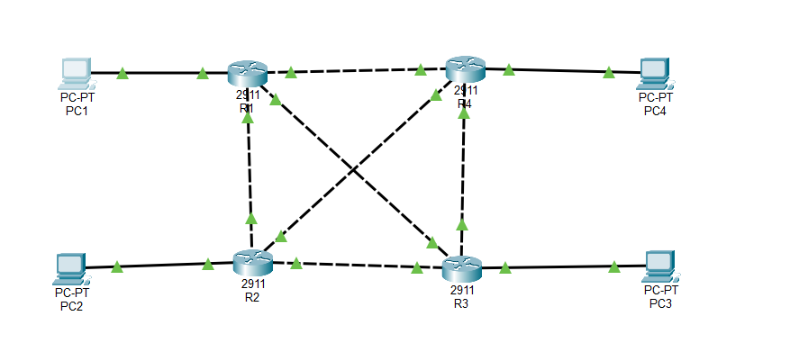

Министерство образования Республики Беларусь

Учреждение образования

“Брестский Государственный технический университет”

Кафедра ИИТ

       

Лабораторная работа №5

По дисциплине “Аппаратное и Программное обеспечение сетей”

Тема: “Настройка статической
маршрутизации на устройсвах CISCO”

Вариант: 5

     

Выполнил:

Студент 3 курса

Группы ИИ-27

Козел А.В.

Проверил:

Кулик А.Д.

     

Брест 2026

1. Схема сети

Связи (топология «полный квадрат» с диагоналями):

PC1 ↔ R1 (Gig0/0)

PC2 ↔ R2 (Gig0/0)

PC3 ↔ R3 (Gig0/0)

PC4 ↔ R4 (Gig0/0)

R1 ↔ R2 (Gig0/1)

R2 ↔ R3 (Gig0/2)

R3 ↔ R4 (Gig0/1)

R4 ↔ R1 (Gig0/2)

R1 ↔ R3 (Serial0/0/0 — DCE)

R2 ↔ R4 (Serial0/0/0 — DCE)

2. Таблица IP-адресов
Устройство	Интерфейс	IP-адрес	Маска	Шлюз
PC1	FastEthernet0	192.168.1.10	255.255.255.0	192.168.1.1
PC2	FastEthernet0	192.168.2.10	255.255.255.0	192.168.2.1
PC3	FastEthernet0	192.168.3.10	255.255.255.0	192.168.3.1
PC4	FastEthernet0	192.168.4.10	255.255.255.0	192.168.4.1
R1	GigabitEthernet0/0	192.168.1.1	255.255.255.0	—
R1	GigabitEthernet0/1	10.0.12.1	255.255.255.0	—
R1	GigabitEthernet0/2	10.0.13.1	255.255.255.0	—
R1	Serial0/0/0 (DCE)	10.0.14.1	255.255.255.0	—
R2	GigabitEthernet0/0	192.168.2.1	255.255.255.0	—
R2	GigabitEthernet0/1	10.0.12.2	255.255.255.0	—
R2	GigabitEthernet0/2	10.0.23.2	255.255.255.0	—
R2	Serial0/0/0 (DCE)	10.0.24.2	255.255.255.0	—
R3	GigabitEthernet0/0	192.168.3.1	255.255.255.0	—
R3	GigabitEthernet0/1	10.0.13.3	255.255.255.0	—
R3	GigabitEthernet0/2	10.0.23.3	255.255.255.0	—
R3	Serial0/0/0	10.0.34.3	255.255.255.0	—
R4	GigabitEthernet0/0	192.168.4.1	255.255.255.0	—
R4	GigabitEthernet0/1	10.0.14.4	255.255.255.0	—
R4	GigabitEthernet0/2	10.0.24.4	255.255.255.0	—
R4	Serial0/0/0	10.0.34.4	255.255.255.0	—
3. Ход настройки статической маршрутизации
R1:

text
R1(config)# ip route 192.168.2.0 255.255.255.0 10.0.12.2
R1(config)# ip route 192.168.3.0 255.255.255.0 10.0.13.3
R1(config)# ip route 192.168.4.0 255.255.255.0 10.0.14.4
R2:

text
R2(config)# ip route 192.168.1.0 255.255.255.0 10.0.12.1
R2(config)# ip route 192.168.3.0 255.255.255.0 10.0.23.3
R2(config)# ip route 192.168.4.0 255.255.255.0 10.0.24.4
R3:

text
R3(config)# ip route 192.168.1.0 255.255.255.0 10.0.13.1
R3(config)# ip route 192.168.2.0 255.255.255.0 10.0.23.2
R3(config)# ip route 192.168.4.0 255.255.255.0 10.0.34.4
R4:

text
R4(config)# ip route 192.168.1.0 255.255.255.0 10.0.14.1
R4(config)# ip route 192.168.2.0 255.255.255.0 10.0.24.2
R4(config)# ip route 192.168.3.0 255.255.255.0 10.0.34.3
4. Результаты проверки
Вывод команды show ip interface brief на R1:

text
Interface              IP-Address      OK? Method Status                Protocol 
GigabitEthernet0/0     192.168.1.1     YES manual up                    up 
GigabitEthernet0/1     10.0.12.1       YES manual up                    up 
GigabitEthernet0/2     10.0.13.1       YES manual up                    up 
Serial0/0/0            10.0.14.1       YES manual up                    up 
(Все интерфейсы находятся в статусе up/up, что подтверждает физическую работоспособность линий).

Вывод команды show ip route на R1:

text
Gateway of last resort is not set

C    192.168.1.0/24 is directly connected, GigabitEthernet0/0
S    192.168.2.0/24 [1/0] via 10.0.12.2
S    192.168.3.0/24 [1/0] via 10.0.13.3
S    192.168.4.0/24 [1/0] via 10.0.14.4
C    10.0.12.0/24 is directly connected, GigabitEthernet0/1
C    10.0.13.0/24 is directly connected, GigabitEthernet0/2
C    10.0.14.0/24 is directly connected, Serial0/0/0
(Буква S подтверждает наличие статических маршрутов в таблице).

Проверка связности с PC1:

Ping до PC4 (192.168.4.10):

text
Pinging 192.168.4.10 with 32 bytes of data:
Reply from 192.168.4.10: bytes=32 time<1ms TTL=126
Reply from 192.168.4.10: bytes=32 time=1ms TTL=125
Reply from 192.168.4.10: bytes=32 time<1ms TTL=126
Reply from 192.168.4.10: bytes=32 time=1ms TTL=125

Packets: Sent = 4, Received = 4, Lost = 0 (0% loss)
Ping до PC2 (192.168.2.10) и PC3 (192.168.3.10):

text
Packets: Sent = 4, Received = 4, Lost = 0 (0% loss)
5. Вывод
В ходе выполнения лабораторной работы была построена топология сети из 4 маршрутизаторов и 4 персональных компьютеров. Была выполнена базовая настройка интерфейсов и произведена настройка статической маршрутизации на устройствах Cisco. Проверка с помощью утилиты ping показала, что все конечные устройства (PC1–PC4) успешно взаимодействуют друг с другом (0% потерь пакетов). Потеря самого первого пакета при первичном ping объясняется временем, необходимым для построения ARP-таблиц и поиска маршрута. Конфигурация была сохранена в энергонезависимую память на всех устройствах командой copy running-config startup-config.

