
Министерство образования Республики Беларусь

Учреждение образования

«Брестский Государственный технический университет»

Кафедра ИИТ

Лабораторная работа №3

По дисциплине «АиПОС»

Тема: «АНАЛИЗ СЕТЕВОГО ТРАФИКА И ПРОТОКОЛОВ НА БАЗЕ WIRESHARK»

 ### Выполнил:

Студент 3 курса

Группы ИИ-27/24

Масюк А.Д.

 ### Проверил: 

Кулик А.Д.

Брест 2026

# Вариант 7

# Цель работы: 

Изучить принципы работы WireShark.

# Задания 3:
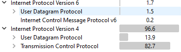

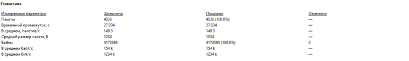

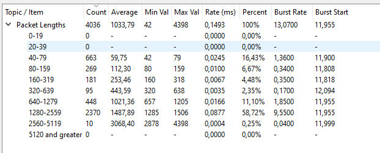

Средний битрейт равен 0,246% = (1,23 Мбит/с / 500 Мбит/с) * 100 %, где 500 Мбит/с скорость интернета

# Задание 4:

Средний/максимальный/минимальный размер пакета ip v4

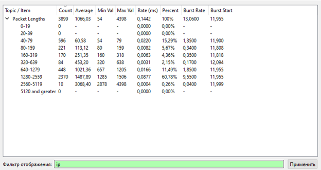 

Процент соотношения

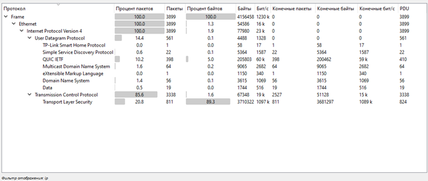 

Разбор пакета

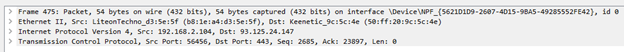

Источник: 192.168.2.104

Назначение: 93.125.24.147

Протокол: IpV 4

Полная длина пакета: 54 байта

Выравнивание полезных данных Len: 0 , что означает что это служебный пакет.

# Задание 5: 

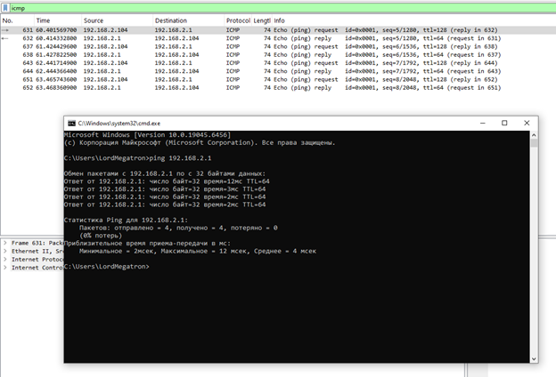 

Обмен состоял из 4 запросов и 4 ответов по протоколу ICMP. Потери пакетов составили 0% что говорит о стабильном сетевом соединении.
Запрос (Пакет №631):

• Source: 192.168.2.104 (Ваш ПК) → Destination: 192.168.2.1 (Шлюз/Роутер).
• Info: Echo (ping) request. Тип пакета в поле заголовка ICMP равен 8 (Запрос).
• Параметры контроля: id=0x0001, seq=5/1280.

• Ответ (Пакет №632):
• Source: 192.168.2.1 → Destination: 192.168.2.104.
• Info: Echo (ping) reply. Тип пакета в поле заголовка ICMP равен 0 (Ответ).
• Время жизни (ttl): ttl=64. 

#Задание 6:

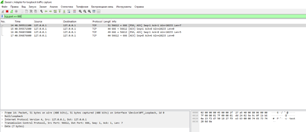 

Анализ полей TCP-заголовка (на примере пакета №14)

• Source Port (Порт источника): 56612. Это случайный свободный порт, который операционная система выделила вашему TCP-клиенту для отправки сообщения.

• Destination Port (Порт назначения): 666. Это фиксированный порт вашего TCP-сервера, который он слушает в ожидании подключений.

• Sequence Number (Порядковый номер): Seq=1. Номер последовательности для контроля порядка байтов.

• Acknowledgment Number (Номер подтверждения): Ack=1. Показывает, что клиент успешно синхронизировался с сервером и готов принимать ответные данные.

• Flags (Флаги управления): [PSH, ACK]. Активны два флага:

• ACK (Acknowledgment) — подтверждает получение предыдущих сегментов.

• PSH (Push) — заставляет операционную систему сервера не копить данные в буфере, а мгновенно передать их в ваше серверное приложение для обработки (чтобы в консоли сервера сразу вывелся текст).
• Длина полезных данных (Payload/Len): Len=7. Длина переданного сообщения составляет 7 байт (само текстовое слово, которое вы ввели, вместе со служебным символом переноса строки \n).

Анализ диаграммы взаимодействия по скриншоту

1. Пакет №14 (Клиент → Сервер): Клиент с порта 56612 отправляет 7 байт текста на порт сервера 666 ([PSH, ACK]).

2. Пакет №15 (Сервер → Клиент): Сервер подтверждает получение: Ack=8 (означает «я успешно принял твои 7 байт и жду 8-й байт»). Данных в этом пакете нет (Len=0).

3. Пакет №16 (Сервер → Клиент): Сервер отправляет ответное сообщение обратно клиенту длиной 5 байт (Len=5, флаги [PSH, ACK]).

4. Пакет №17 (Клиент → Сервер): Клиент присылает финальное подтверждение серверу, что ответ получен (Ack=6, Len=0).

# Задание 7: 

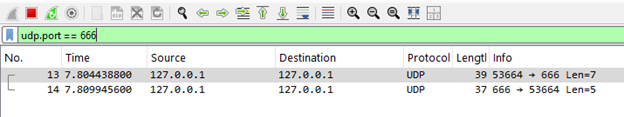 

##User Datagramma Protocol

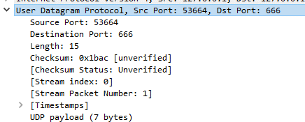 

• Source Port (Порт источника): 53664. 
• Destination Port (Порт назначения): 666. 
• Length (Длина UDP-сегмента): 15. П
• Checksum (Контрольная сумма): [Good Checksum: Unverified ].

Поле Checksum Unverified из-за того операционная система (Windows) передает пакет в сетевую карту с «пустым» или случайным значением в поле Checksum,
перекладывая эту работу на чип сетевой платы.В свою очередь Wireshark перехватывает пакет «на выходе» из операционной системы, до того, как он 
физически попал в чип сетевой карты. Поэтому он видит незаполненное поле и пишет, что проверить сумму невозможно.

# Задание 8

 

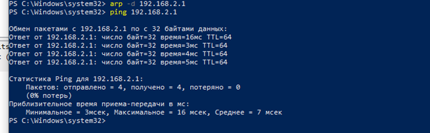 

# Вывод:
Изучили принцип работы WireShark.
