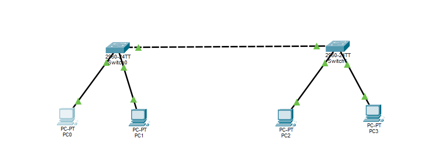
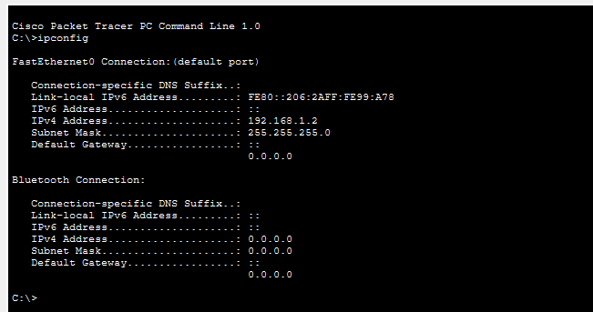
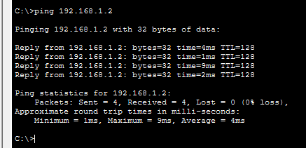
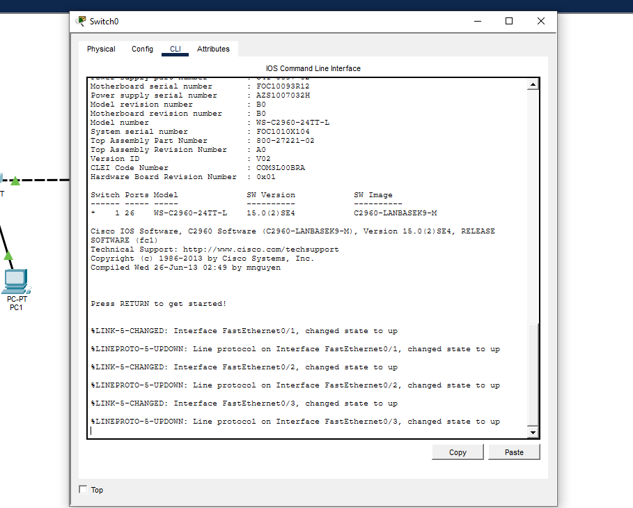
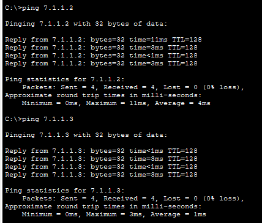

Министерство образования Республики Беларусь 
Учреждение образования «Брестский государственный технический университет» 
Кафедра ИИТ

   

<h2>Лабораторная работа №4</h2>
По дисциплине «АиПОС» 
Тема: «Изучение пакета CISCO PACKETTRACER. начальная конфигурация маршрузитора CISCO»

     

<h3>Выполнил:</h3>
Студент 3 курса 
Группы ИИ-27/24 
Масюк А.Д. 
 
<h3>Проверил:</h3>
Кулик А.Д.

   

Брест 2026

### Вариант 7

### Цель работы: 
Изучить интерфейс эмулятора Cisco Packet Tracer.

## Ход работы 
    
    Практическая часть 1

    В рабочей области Packet Tracer были добавлены два коммутатора Switch-PT (Switch0, Switch1) и четыре персональных компьютера (PC0–PC3). Устройства соединены кабелями типа Copper Straight-Through / Copper Cross-Over согласно схеме.
  

|Устройство|IP-адрес|Маска подсети|
|----------|--------|-------------|
|PC0|192.168.1.2|255.255.255.0|
|PC1|192.168.1.3|255.255.255.0|
|PC2|192.168.1.4|255.255.255.0|
|PC3|192.168.1.5|255.255.255.0|

Вывод команды ipconfig с одного  ПК:

С компьютера PC3 была выполнена проверка связи с PC0 командой ping 192.168.1.2

Работа с CLI коммутатора/маршрутизатора

    Был открыт интерфейс командной строки коммутатора через вкладку CLI. Проверен список доступных команд с помощью ?.

    Задание для самостоятельной работы

## Топология по рисунку

## Мой вариант 7 так что таблица будет выглядеть как  

|Устройство|IP-адрес|Маска подсети|
|----------|--------|-------------|
|PC0|7.1.1.1|255.255.255.0|
|PC1|7.1.1.2|255.255.255.0|
|PC2|7.1.1.3|255.255.255.0|
|PC3|7.1.1.4|255.255.255.0|
|PC4|7.1.1.5|255.255.255.0|
|PC5|7.1.1.6|255.255.255.0|
|PC6|7.1.1.7|255.255.255.0|

Проверьте работоспособность сети с использованием ping

## Вывод: В ходе лабораторной работы были изучены основные возможности эмулятора Cisco Packet Tracer.
