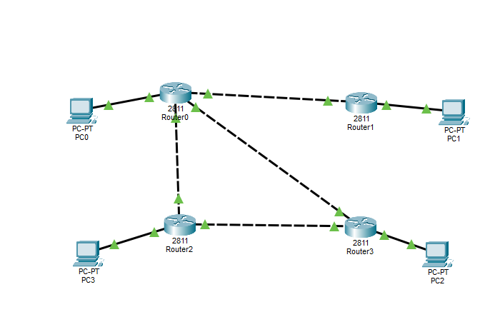
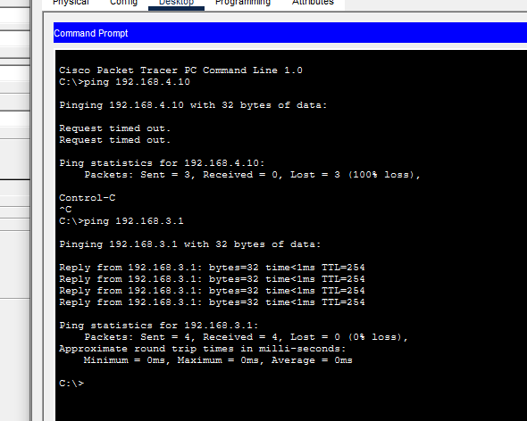
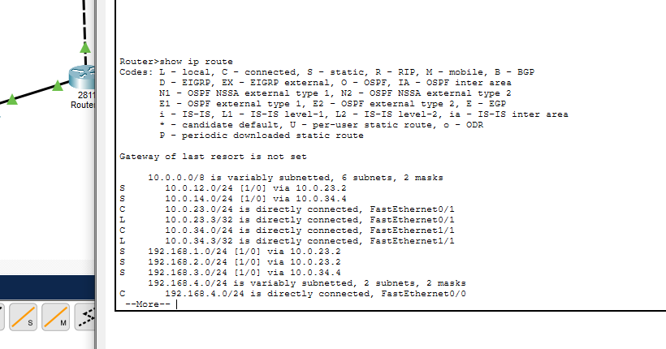

Министерство образования Республики Беларусь 
Учреждение образования «Брестский государственный технический университет» 
Кафедра ИИТ

   

<h2>Лабораторная работа №5</h2>
По дисциплине «АиПОС» 
Тема: «НАСТРОЙКА СТАТИЧЕСКОЙ МАРШРУТИЗАЦИИ НА УСТРОЙСТВАХ CISCO»

     

<h3>Выполнил:</h3>
Студент 3 курса 
Группы ИИ-27/24 
Масюк А.Д. 
 
<h3>Проверил:</h3>
Кулик А.Д.

   

Брест 2026

### Вариант 7

### Цель работы: 
Изучить истатический маршрутизатор.

## Ход работы 
   
## Таблица

|Устройство|IP-адрес|Маска подсети|
|----------|--------|-------------|
|PC0|192.168.2.10|255.255.255.0|
|PC1|192.168.3.10|255.255.255.0|
|PC2|192.168.4.10|255.255.255.0|
|PC3|192.168.1.10|255.255.255.0|
|R0|192.168.2.1|255.255.255.0|
|R1|192.168.3.1|255.255.255.0|
|R2|192.168.1.1|255.255.255.0|
|R3|192.168.4.1|255.255.255.0|

## Топология

## Тесты

## Вывод: В ходе лабораторной работы я настроил статический маршрутизатор.
