# Лабораторная работа №3
**По дисциплине:** «АиПОС»
**Тема:** «Анализ сетевого трафика и протоколов на базе Wireshark»

**Выполнил:**  
Студент 3 курса  
Группы ИИ-27/24  
Соловчук И.Г.  
**Проверил:**  
Кулик А.Д.

**Брест 2026**

---

# Цель работы: 
Познакомиться с принципами работы анализатора трафика Wireshark, освоить методику захвата пакетов и разбор структуры основных сетевых протоколов.

---

# Задания 3:

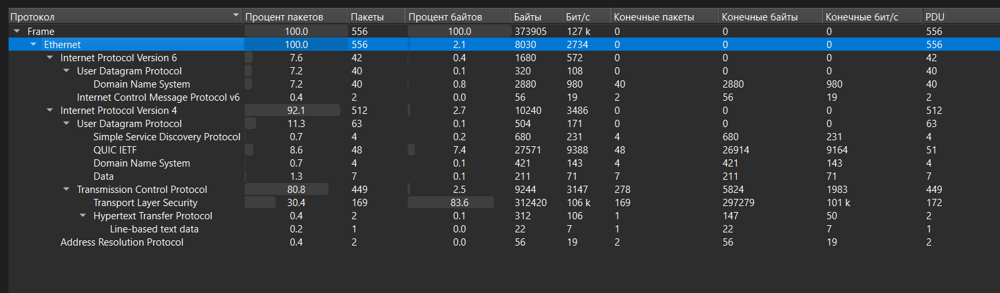

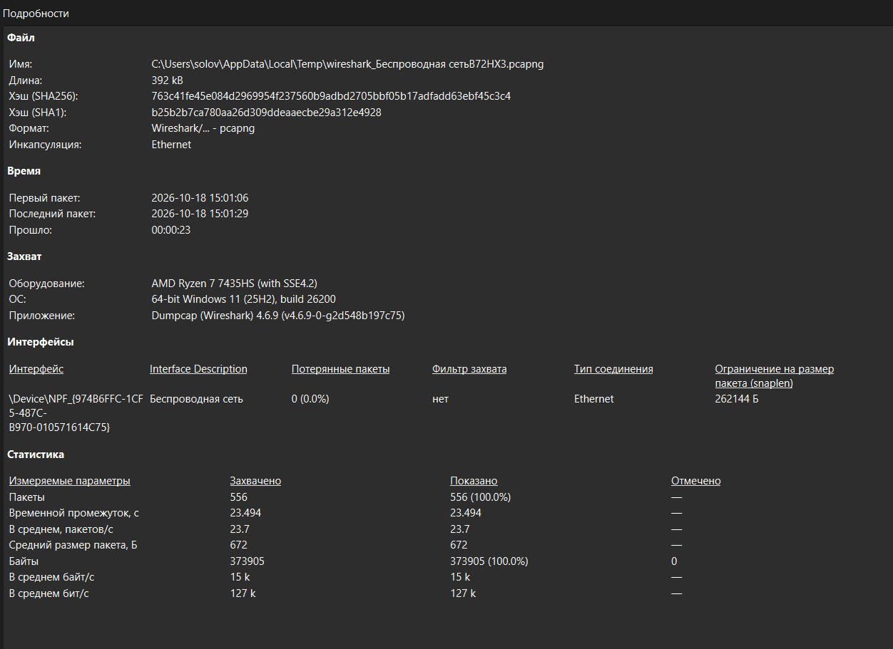

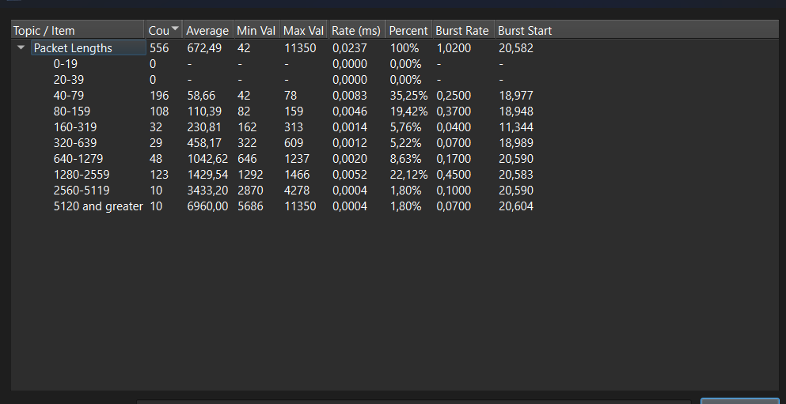

Средний битрейт составил 0,127 % = (0,127 Мбит/с / 100 Мбит/с) * 100 %, где 100 Мбит/с — скорость интернета.

---

# Задание 4:

Статистические данные размеров IPv4-пакетов (минимум, максимум, среднее):

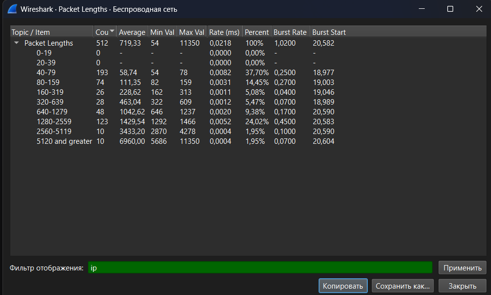 

Соотношение протоколов при фильтрации только IP-трафика:

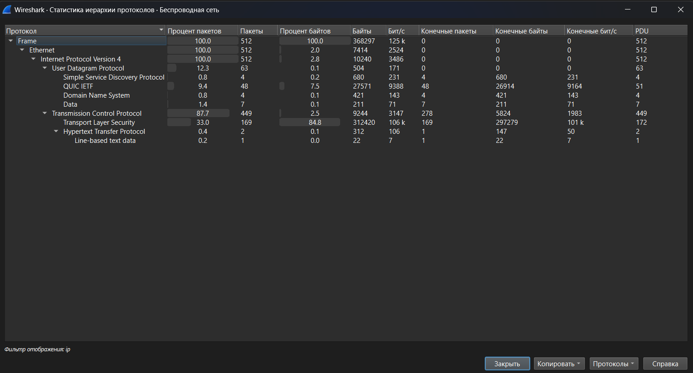 

Детальный разбор выбранного пакета:

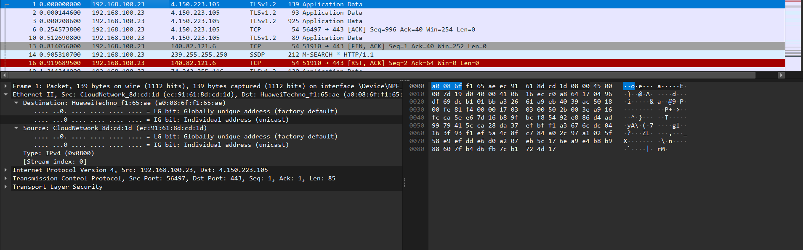

**Отправитель:** 192.168.100.23  
**Получатель:** 4.150.223.105  
**Используемый протокол:** IPv4  
**Общая длина IP-пакета:** 139 байт  
**Длина полезной нагрузки (Len):** 0 (пакет служебный).

---

# Задание 5: 

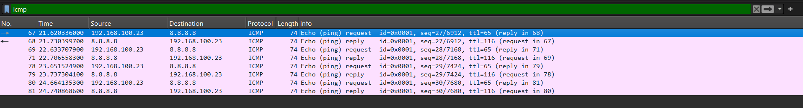 

В ходе обмена было зафиксировано 4 запроса и 4 ответа по протоколу ICMP. Потерь пакетов не наблюдалось (0%), что свидетельствует о стабильном соединении с узлом.

**Детали запроса (Пакет №57):**
• Отправитель: 192.168.100.23 → Получатель: 8.8.8.8.
• В поле Info указано: Echo (ping) request. В заголовке ICMP тип равен 8 (запрос).
• Идентификатор: id=0x0001, номер последовательности: seq=27/6912.

**Детали ответа (Пакет №58):**
• Отправитель: 8.8.8.8 → Получатель: 192.168.100.23.
• В поле Info указано: Echo (ping) reply. В заголовке ICMP тип равен 0 (ответ).
• Значение параметра Time to Live (ttl): 116. 

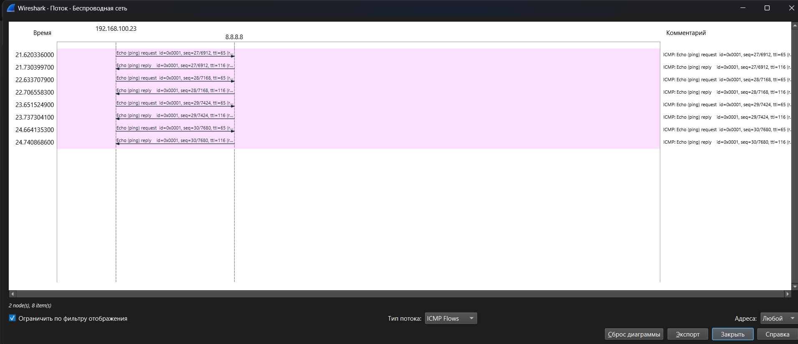

---

# Задание 6:

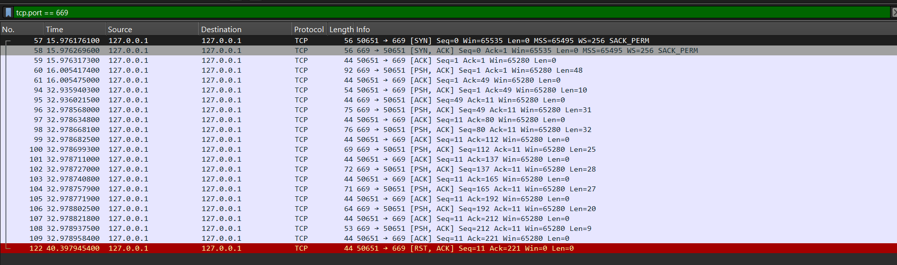 

**Разбор полей заголовка TCP (на примере пакета №60):**

• **Source Port:** 50651. Данный порт был динамически выделен операционной системой для TCP-клиента.
• **Destination Port:** 669. Порт, который прослушивает TCP-сервер.
• **Sequence Number:** Seq=1. Используется для правильной сборки байтового потока.
• **Acknowledgment Number:** Ack=1. Подтверждает успешный прием предыдущих байт.
• **Flags:** [PSH, ACK]. ACK — подтверждение получения. PSH — указывает на необходимость немедленной передачи данных приложению.
• **Длина данных (Len):** 48 байт.

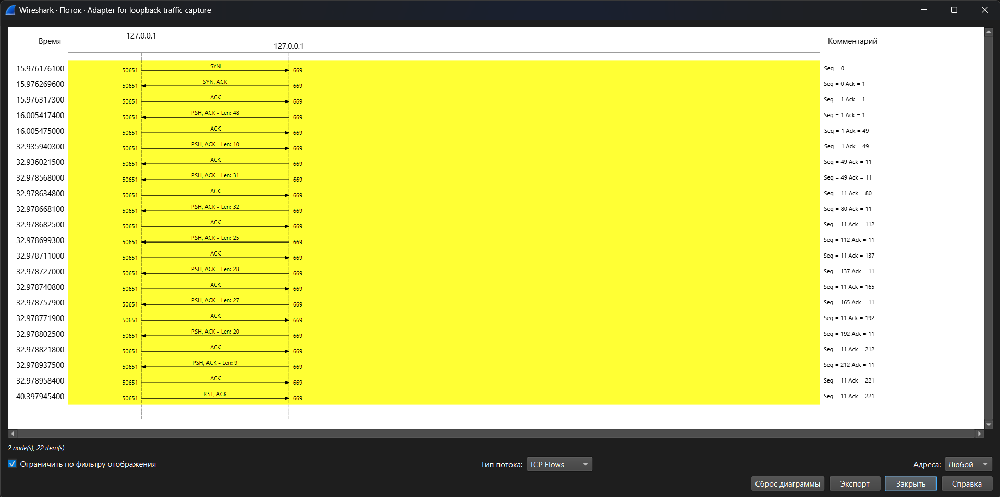

---

# Задание 7: 

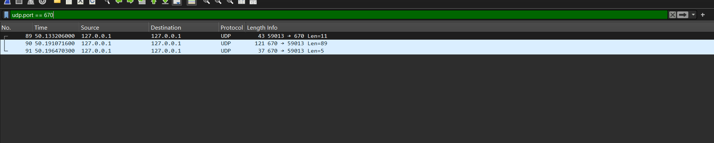 

## User Datagram Protocol

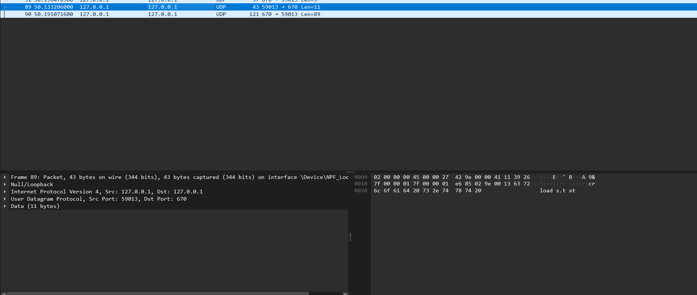 

• **Source Port:** 59013. 
• **Destination Port:** 670. 
• **Length:** 11. Общая длина UDP-датаграммы (заголовок + данные).
• **Checksum:** [Good Checksum: Unverified].

Пояснение по Checksum: Статус «Unverified» возникает из-за особенности работы сетевого стека Windows, который передает пакет на сетевой адаптер, оставляя вычисление контрольной суммы аппаратному обеспечению.

---

# Задание 8

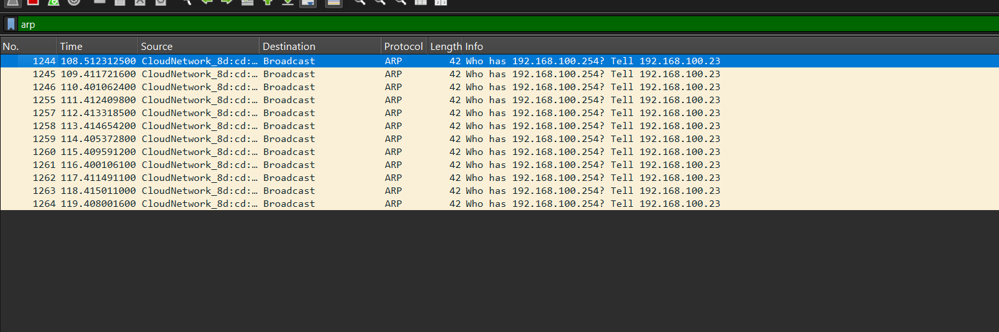 

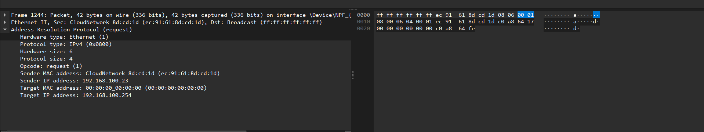 

**Разбор структуры ARP-запроса:**
• **Opcode:** request (1). Означает, что это ARP-запрос.
• **Sender MAC address:** ec:91:61:8d:cd:1d (MAC-адрес твоего компьютера).
• **Sender IP address:** 192.168.100.23.
• **Target MAC address:** 00:00:00:00:00:00. Поле пустое, так как MAC-адрес искомого узла неизвестен.
• **Target IP address:** 192.168.100.254. IP-адрес, который мы пытаемся найти.

---

# Вывод:
В ходе работы были изучены базовые возможности программы Wireshark. Освоены методы захвата трафика, применения фильтров отображения и анализа структуры сетевых протоколов (Ethernet, IP, TCP, UDP, ICMP, ARP).