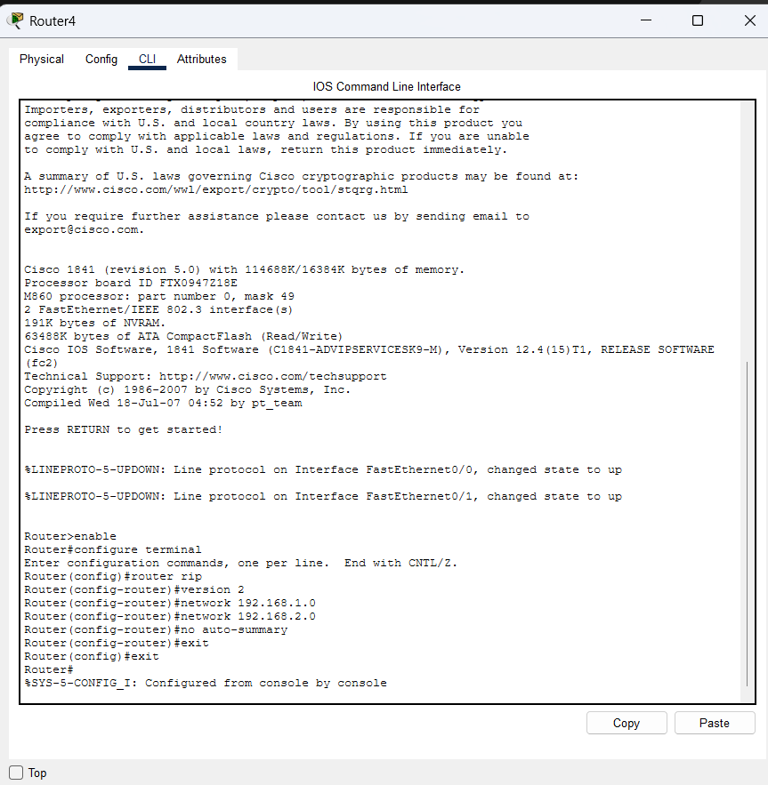
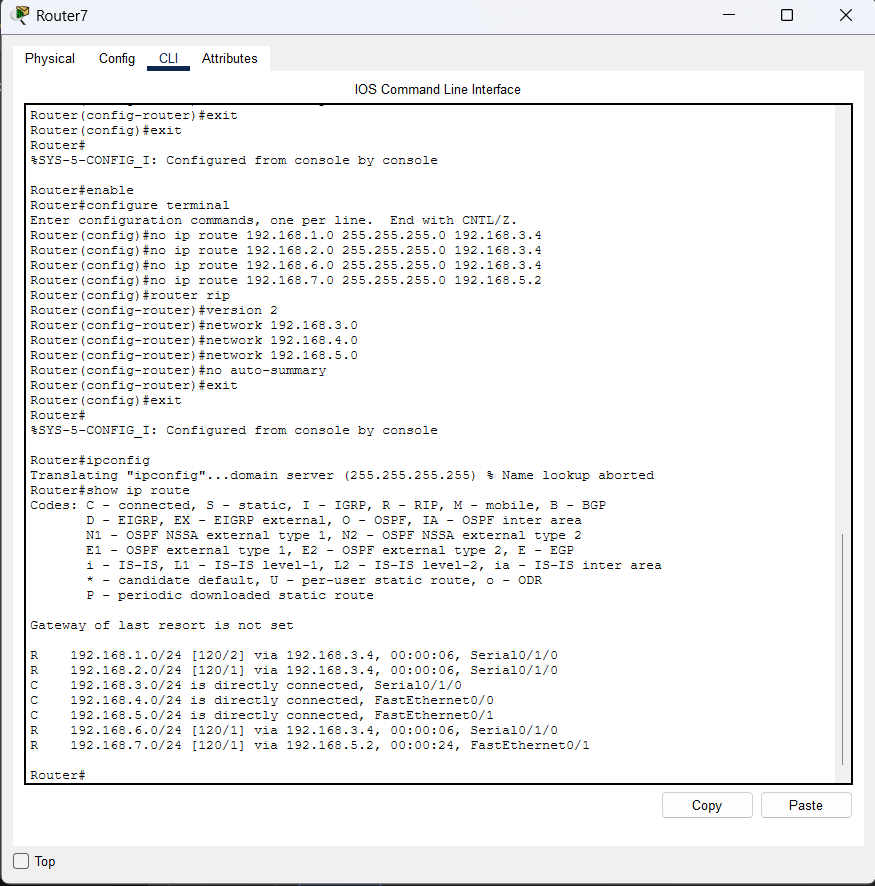
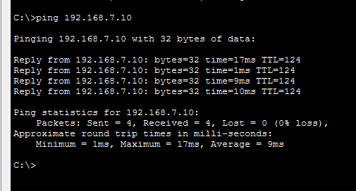
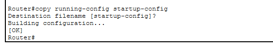

Министерство образования Республики Беларусь

Учреждение образования

“Брестский Государственный технический университет”

Кафедра ИИТ

       

Лабораторная работа №6

По дисциплине “Аппаратное и Программное обеспечение сетей”

Тема: “НАСТРОЙКА ДИНАМИЧЕСКОЙ МАРШРУТИЗАЦИИ С ПОМОЩЬЮ ПРОТОКОЛА RIP НА УСТРОЙСТВАХ CISCO”

Вариант: 9

     

Выполнил:

Студент 3 курса

Группы ИИ-27

Соловчук И.Г.

Проверила:

Кулик А.Д.

     

Брест 2026

# Цель работы:
Настроить динамическую маршрутизацию с помощью протокола RIP на устройствах R1, R2, R3. Обеспечить возможность взаимодействия конечных устройств PC1, PC2, PC3 между собой.

# Ход работы:

## Сборка схемы сети
Собрана схема сети согласно варианту 9.

## Таблица сетевых адресов

## Настройка протокола RIP на маршрутизаторах

Протокол RIP настраивался командой `router rip` с указанием сетей, подключенных к каждому маршрутизатору.

## Проверка таблиц маршрутизации

С помощью команды `show ip route` проверено, что в таблицах маршрутизации появились динамические маршруты, обозначенные буквой `R`.

Router7:

## Проверка взаимодействия через ping

С компьютера PC0 отправлен пакет до PC1 (192.168.7.10). Пинг прошел успешно.

## Сохранение конфигурации

# Вывод:
В данной лабораторной работе я научился настраивать динамическую маршрутизацию с помощью протокола RIP на устройствах Cisco, а также проверять правильность работы протокола с помощью команд `show ip route` и `ping`.