
Министерство образования Республики Беларусь

Учреждение образования

“Брестский Государственный технический университет”

Кафедра ИИТ

       

Лабораторная работа №3

По дисциплине “Аппаратное и Программное обеспечение сетей”

Тема: “анализ сетевого трафика и протоколов на базе wireshark”

     

Выполнил:

Студент 3 курса

Группы ИИ-27

Гурин М.Д.

Проверила:

Кулик А.Д.

     

Брест 2026

Цель работы: Изучить возможности программы Wireshark, правила построения фильтров, приемы статистической обработки сетевого трафика, а также проанализировать структуру сетевых протоколов (Ethernet, IP, ICMP, TCP, UDP, ARP).

Ход работы
1. Захват веб-трафика и статистическая обработка

Был запущен захват на интерфейсе Wi-Fi, выполнена загрузка страницы bstu.by.
С помощью меню Statistics -> Capture File Properties получены следующие данные:

Средняя скорость кадров: 338.6 пакетов/сек.

Средняя скорость байт: 600 КБ/сек (или 4801 кбит/сек).

Размеры пакетов: Минимальный [54], Максимальный [22582], Средний 1773 байт.

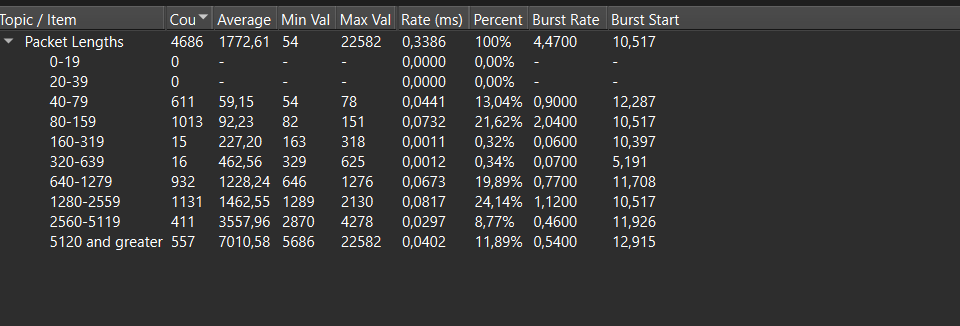

Степень использования полосы пропускания: При скорости 600 КБ/с и пропускной способности Wi-Fi 100 Мбит/с (12.5 МБ/с), загрузка канала составляет примерно 4.8%.
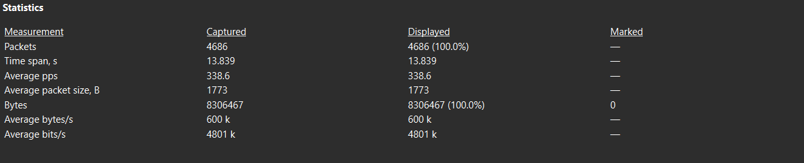

С помощью меню Statistics - Protocol Hierarchy определено процентное соотношение протоколов:

TCP: 98.7% пакетов.

TLS: 21.5% от общего объема байт.

DNS: 0.9%.

UDP: 1.3%.

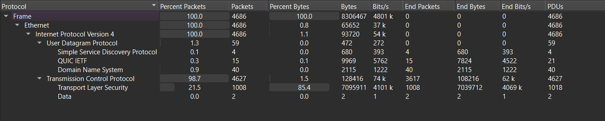

2. Фильтрация IP-пакетов и разбор структур Ethernet и IP

В строке фильтра был применен фильтр ip. Статистика по размерам пакетов изменилась незначительно

Для анализа структуры был выбран пакет с запросом к серверу bstu.by (Client Hello).

Структура заголовка Ethernet II:

 Destination MAC: cc:ff:90:2a:8c:34.

Source MAC: 08:9d:f4:7c:1b:ea .

Type: IPv4 (0x0800).

Структура заголовка IPv4:

Version: 4.

Header Length: 20 bytes.

Total Length: 2116.

Time to Live (TTL): 64.

Protocol: TCP (6).

Source IP: 192.168.0.173.

Destination IP: 93.125.24.147 .

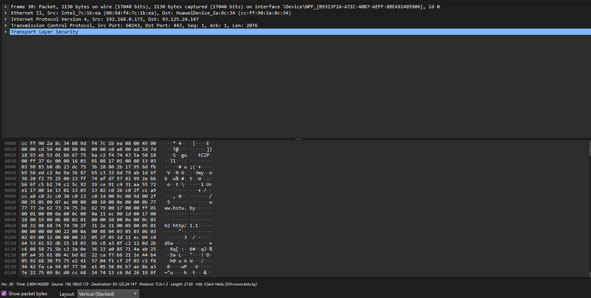

3. Анализ утилиты ping (ICMP)
Был запущен захват и выполнена команда ping 8.8.8.8. С помощью фильтра icmp отфильтрованы служебные пакеты. Утилита ping использует протокол ICMP поверх протокола IP.

Анализ ICMP Echo Request (запрос):

Type: 8 (Echo Request).

Code: 0.

Identifier: 0x0001.

Sequence Number: 3.

Data: 32 байта данных.

(Ответный пакет Echo Reply имеет Type = 0, а Identifier и Sequence Number совпадают с запросом, что подтверждает успешный обмен).

Диаграмма взаимодействия:
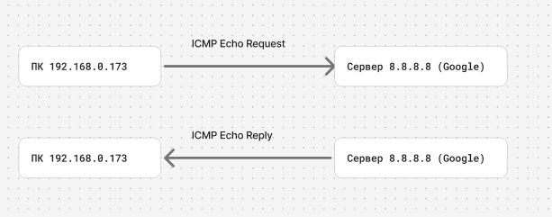

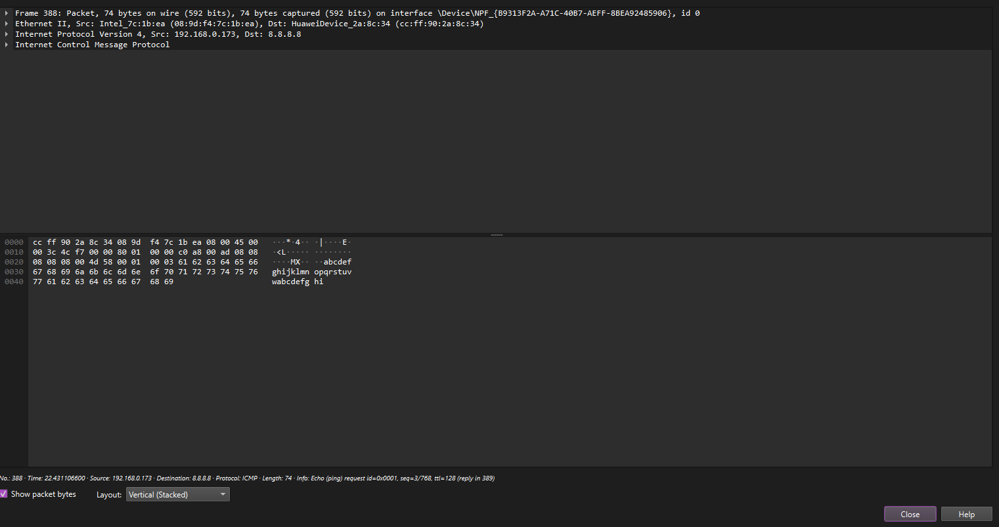

4. Анализ TCP-сегмента
Был запущен TCP-сервер (порт 8080) и TCP-клиент. Отправлена строка из 48 символов. Применен фильтр tcp.port == 8080.

Структура TCP-сегмента:

Source Port: 8080.

Destination Port: 61168.

Sequence Number: 1.

Acknowledgment Number: 51.

Flags: PSH, ACK (подтверждение получения и требование передать данные приложению).

Window Size: 65280.

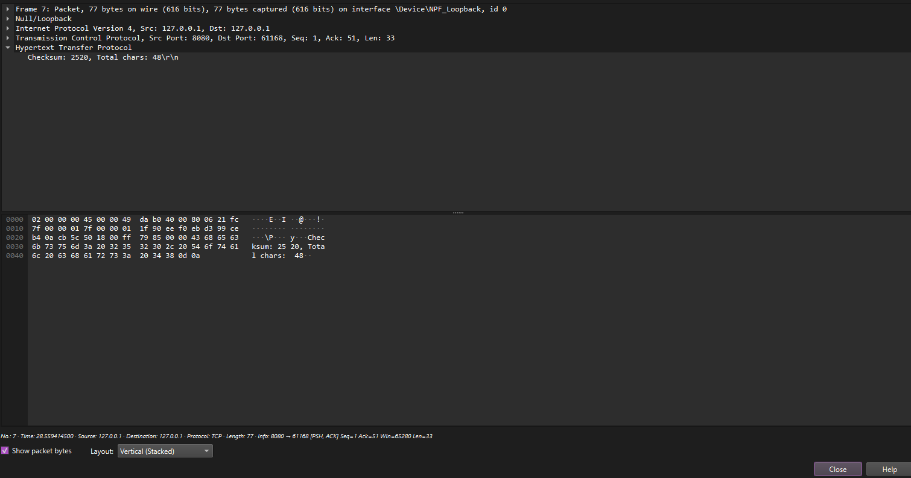

Диаграмма взаимодействия TCP-сервера и клиента:
С помощью меню Statistics - Flow Graph построена наглядная диаграмма установки соединения (3-way handshake):

SYN (клиент отправляет запрос на соединение).

SYN-ACK (сервер подтверждает).

ACK (соединение установлено).
Затем идет передача данных (PSH, ACK).

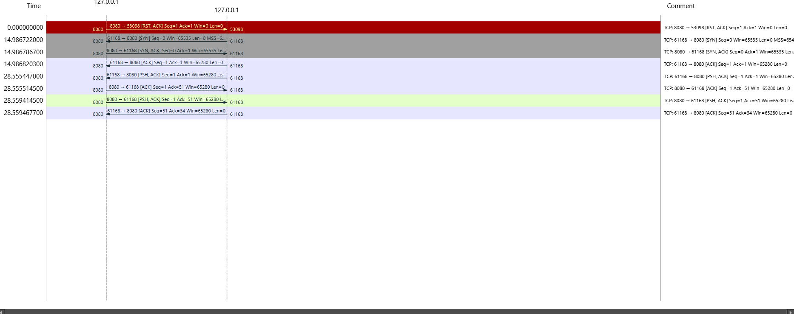

5. Анализ UDP-сегмента
Был запущен UDP-сервер (порт 666) и UDP-клиент. Отправлено 48 символов. Применен фильтр udp.port == 666.

Структура UDP-сегмента:

Source Port: 666 .

Destination Port: 61058 .

Length: 124.

Checksum: 2520.

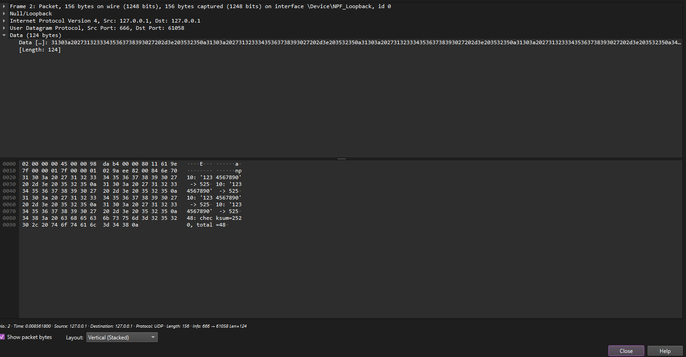

6. Анализ ARP-протокола
(Для этого пункта скриншотов пока нет. Вам нужно переключить интерфейс на Wi-Fi, очистить кэш командой arp -d *, запустить захват с фильтром arp и пропинговать соседний ПК или роутер).
Был очищен ARP-кэш, после чего выполнен ping узла в локальной сети. Захвачены пакеты ARP-запроса и ARP-ответа.

Структура ARP-запроса (Request):

Opcode: request (1).

Sender MAC / IP: MAC и IP моего компьютера.

Target MAC: 00:00:00:00:00:00 (неизвестен).

Target IP: IP-адрес запрашиваемого узла.

Структура ARP-ответа (Reply):

Opcode: reply (2).

Sender MAC / IP: MAC и IP искомого узла.

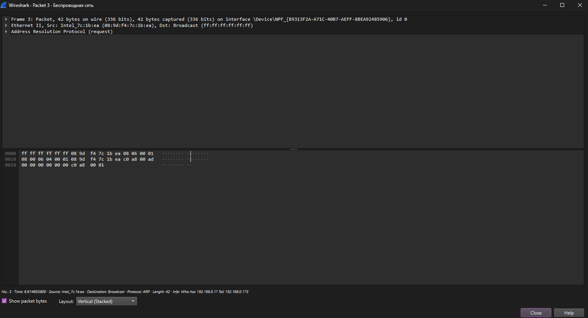

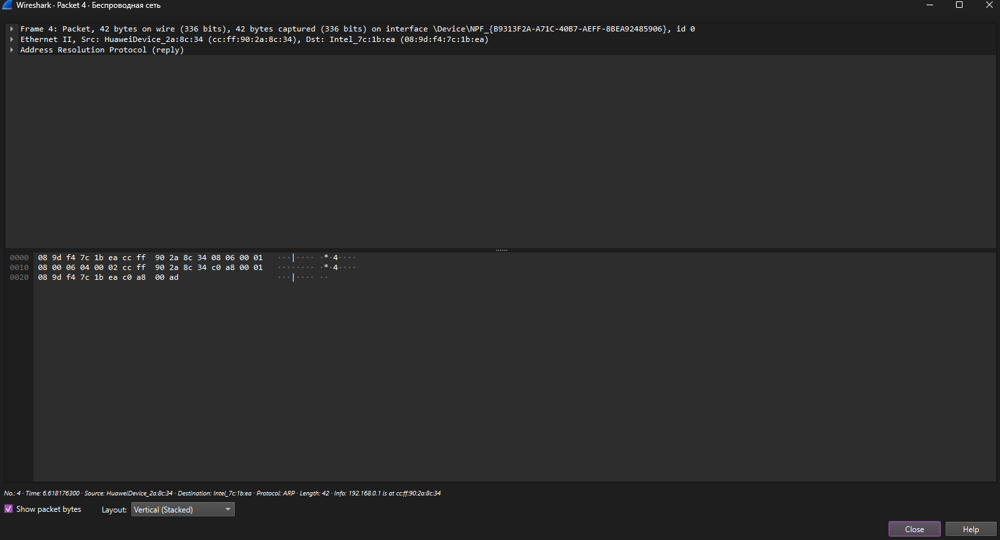

Вывод:
В ходе лабораторной работы я освоил работу со сниффером Wireshark. Научился применять фильтры отображения (ip, icmp, tcp.port==8080, udp.port==666, arp) и анализировать статистику. На практике изучил структуру заголовков Ethernet, IPv4, ICMP, TCP и UDP. Убедился, что TCP — это надежный протокол с установкой соединения (3-way handshake), а UDP — быстрый, но негарантированный. Также был разобран принцип работы протокола ARP, обеспечивающего связь между IP и MAC-адресами.

