<p align="center">Министерство образования Республики Беларусь</p>
<p align="center">Учреждение образования</p>
<p align="center">“Брестский Государственный технический университет”</p>
<p align="center">Кафедра ИИТ</p>
<p align="center">Лабораторная работа №6</p>
<p align="center">По дисциплине “Аппаратное и Программное обеспечение сетей”</p>
<p align="center">Тема: “НАСТРОЙКА ДИНАМИЧЕСКОЙ МАРШРУТИЗАЦИИ С ПОМОЩЬЮ ПРОТОКОЛА RIP НА УСТРОЙСТВАХ CISCO”</p>
<p align="center">Вариант: 6</p>
<p align="right">Выполнил:</p>
<p align="right">Студент 3 курса</p>
<p align="right">Группы ИИ-27</p>
<p align="right">Гурин М.Д.</p>
<p align="right">Проверила:</p>
<p align="right">Кулик А.Д.</p>
<br><br><br><br><br>
<p align="center">Брест 2026</p>


# Цель работы:

    Настроить динамическую маршрутизацию с помощью протокола RIP на устройствах R1, R2, R3, R4. Обеспечить возможность взаимодействия конечных устройств PC1, PC2, PC3, PC4 между собой. С помощью команд

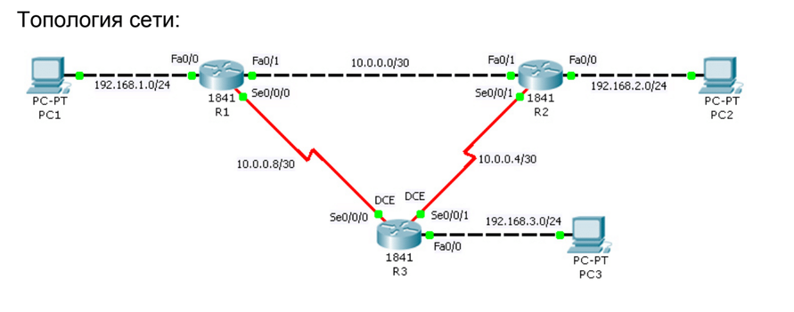

# Ход работы:

## Задание 1

### начальная настройка


Таблица сетевых адресов
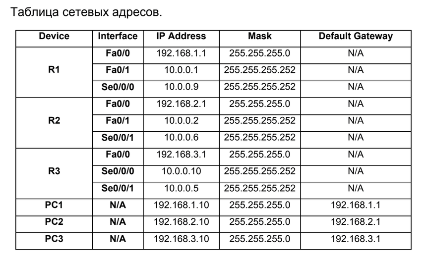

### конфигурация компьютеров

конфигурация компьютера pc-1
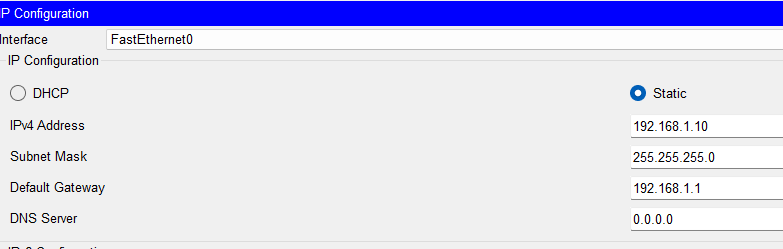

конфигурация компьютера pc-2
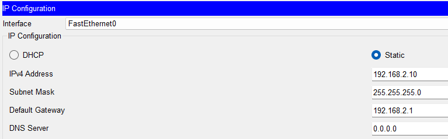

конфигурация компьютера pc-3
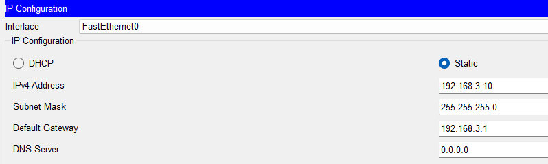


### конфигурация маршрутизаторов


#### R1:

FastEthernet0/0: 
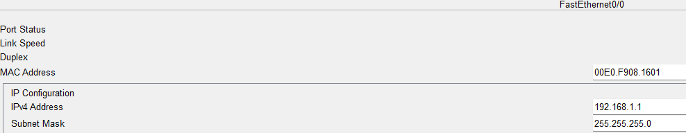
FastEthernet0/1:
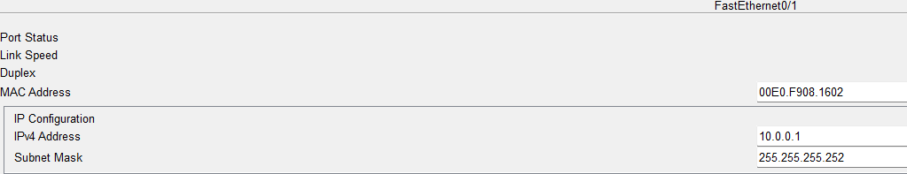
Serial0/0/0:
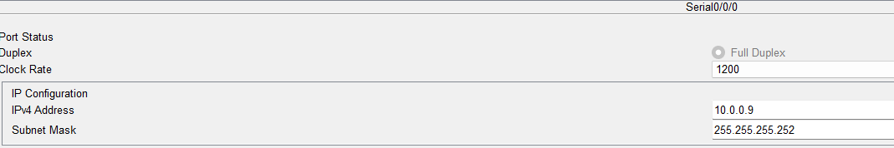

#### R2:

FastEthernet0/0: 
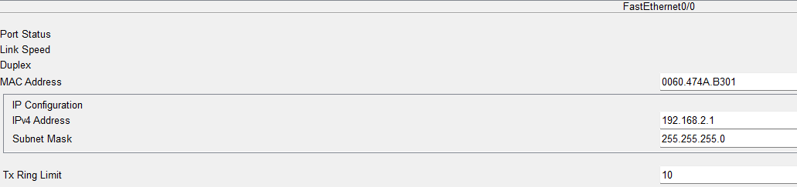
FastEthernet0/1:
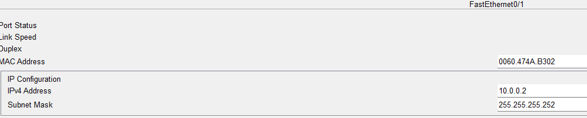
Serial0/0/1:
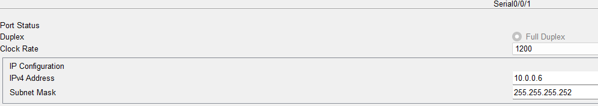

#### R3:

FastEthernet0/0: 
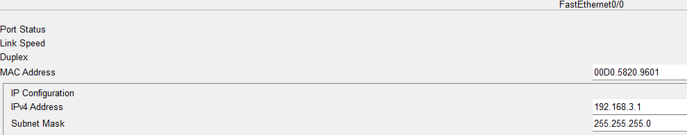
Serial0/0/0:
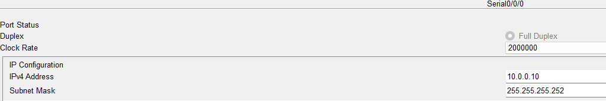
Serial0/0/1:
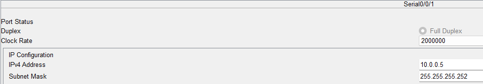

### Проверьте правильность начальной конфигурации устройств c помощью команд

#### R1
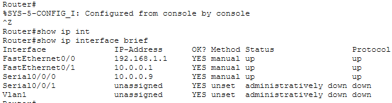
#### R2
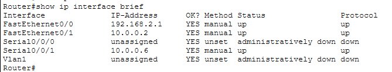
#### R3
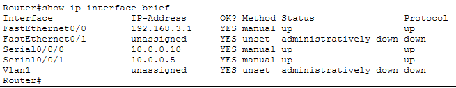

и я проверил с помощью ```show ip route``` что все маршрутизаторы видят друг друга

### Настройте протокол RIP на маршрутизаторах R1, R2, R3

#### R1
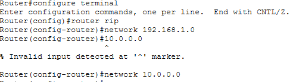

#### R2
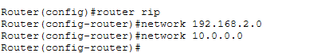

#### R3
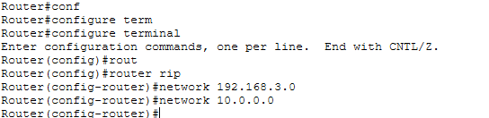

### Проверка правильности работы протокола RIP

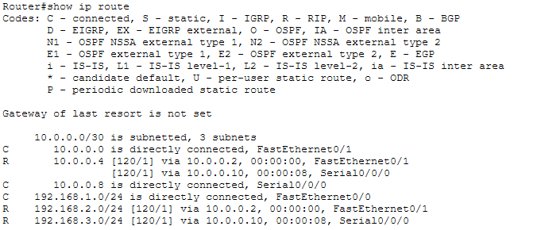
данный вывод полностью совпадает с выводом из методички и также R2 и R3 также полностью совпадают 


### Сохраните конфигурацию устройств

    Router# copy running-config startup-config  
    Destination filename [startup-config]? 
    Building configuration...
    [OK] 
    Router#


## Задание 2
Так как топология в 6 лабораторной точно такой же как в 5 лабораторной, то я буду использовать файл из 5 лабораторной 
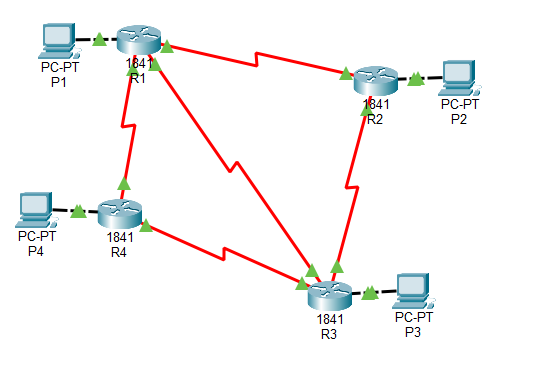
### RIP для R* 
```
enable
configure terminal
router rip
 version 2
 no auto-summary
 network 6.0.0.0
 exit
end
copy running-config startup-config
```
#### Пример одного из маршрутизаторов 
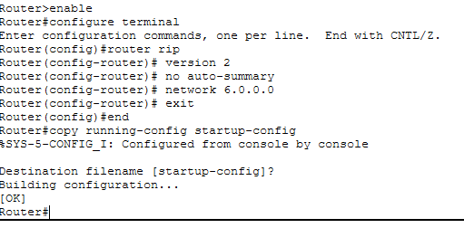


#### Пример проверки правильной настройки протокола RIP
```
show ip protocols
```

```
show ip route
```
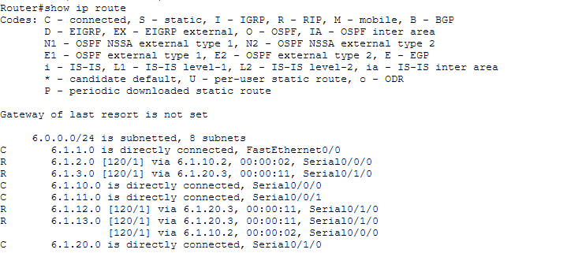
наши RIP маршруты
```
R       6.1.2.0 [120/1] via 6.1.10.2, 00:00:02, Serial0/0/0
R       6.1.3.0 [120/1] via 6.1.20.3, 00:00:11, Serial0/1/0
R       6.1.12.0 [120/1] via 6.1.20.3, 00:00:11, Serial0/1/0
R       6.1.13.0 [120/1] via 6.1.20.3, 00:00:11, Serial0/1/0
```

#### проверка командой ```ping```

я буду проверять с R1 все компьютеры 

```
ping 6.1.2.3
```
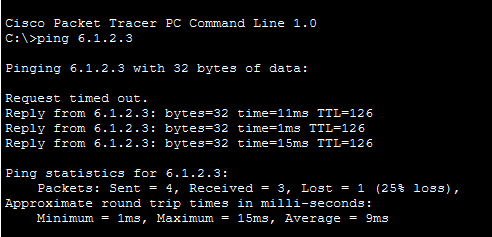
```
ping 6.1.3.4
```
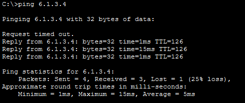
```
ping 6.1.4.5
```
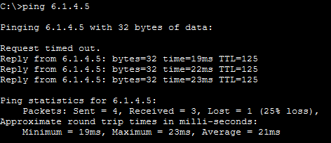

# Вывод
    В ходе выполнения лабораторной работы была изучена и успешно применена на практике настройка динамической маршрутизации с помощью протокола RIP на устройствах Cisco