<p align="center">Министерство образования Республики Беларусь</p>
<p align="center">Учреждение образования</p>
<p align="center">“Брестский Государственный технический университет”</p>
<p align="center">Кафедра ИИТ</p>
<br><br><br><br><br><br><br>
<p align="center">Лабораторная работа №8</p>
<p align="center">По дисциплине “Аппаратное и Программное обеспечение сетей”</p>
<p align="center">Тема: “Утилита для сканирования и исследования безопасности сети NMAP”</p>
<p align="center">Вариант: 6</p>
<br><br><br><br><br>
<p align="right">Выполнил:</p>
<p align="right">Студент 3 курса</p>
<p align="right">Группы ИИ-27</p>
<p align="right">Гурин М.Д.</p>
<p align="right">Проверила:</p>
<p align="right">Кулик А.Д.</p>
<br><br><br><br><br>
<p align="center">Брест 2026</p>


# Цель работы: 

    изучение и практическое применение утилиты для сканирования и
    исследования безопасности сети nmap.

# Рабочее задание
    1. Получите список открытых портов (TCP и UDP) машины, за которой выполняется
    лабораторная работа (localhost). Воспользуйтесь несколькими методами
    сканирования. Сравните результаты.
    2. Определите операционную систему этой же машины.
    3. Узнайте адреса активных хостов в сети лаборатории (без сканирования портов).
    4. Просканируйте хост №1, разными методами. Сравните результаты.
    5. Для четырех хостов (№2-5), выполните следующие действия:
    1. Определите, защищен ли хост межсетевым экраном.
    2. Определите поддерживаемые протоколы.
    3. Выберите оптимальный метод сканирования портов, чтобы избежать
    обнаружения. Определите открытые и фильтрованные порты и по
    возможности версии служб. При необходимости используйте RPC-
    сканирование.
    4. Определите операционную систему

# Ход работы


Саму лабораторную работу я буду выполнять в виртуальной окружении (virtual box). Буду использовать kali linux как основую операционную систему для работы

## Задание 1. Сканирование localhost разными методами

### TCP SYN-сканирование (полуоткрытое)

    sudo nmap -sS localhost


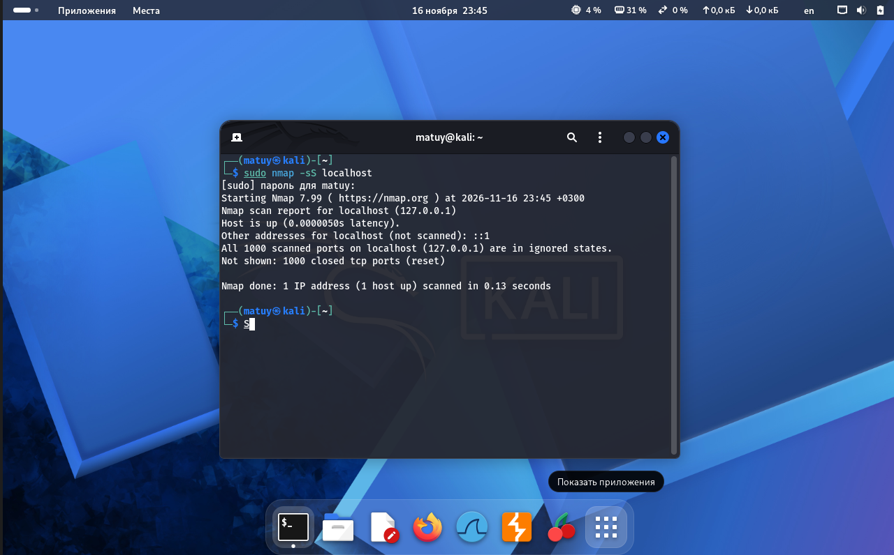

### TCP connect()-сканирование

    nmap -sT localhost


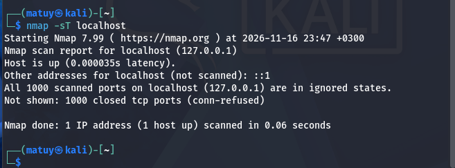

### UDP-сканирование

    sudo nmap -sU localhost

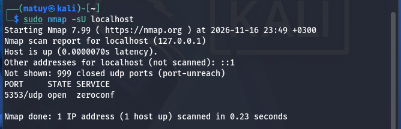

### Комбинированное TCP+UDP

    sudo nmap -sTU localhost

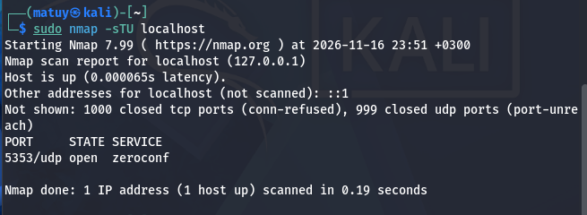

### Сканирование по умолчанию

    nmap localhost

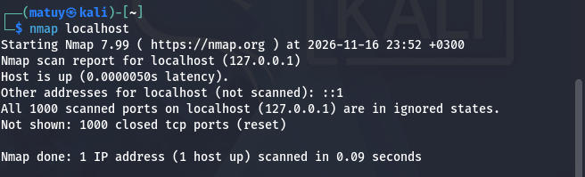

### Промежуточный вывод:
    так как kali у меня запущена на виртуальной машине, то стандартные порты не открыты. Ну и для дальнейшей работы с лабораторной я поставил docker и запустил туда контейнеры и сделал локальную сеть

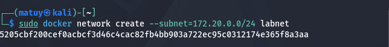

затем я создал контейнер и подключил ее к сети и просканировал порты:
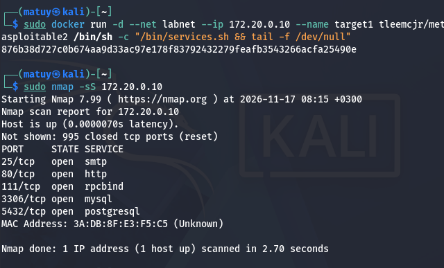

затем создал еще один другой контейнер (web_nginx)(там произошла проблема и корректный ip там 172.20.0.12)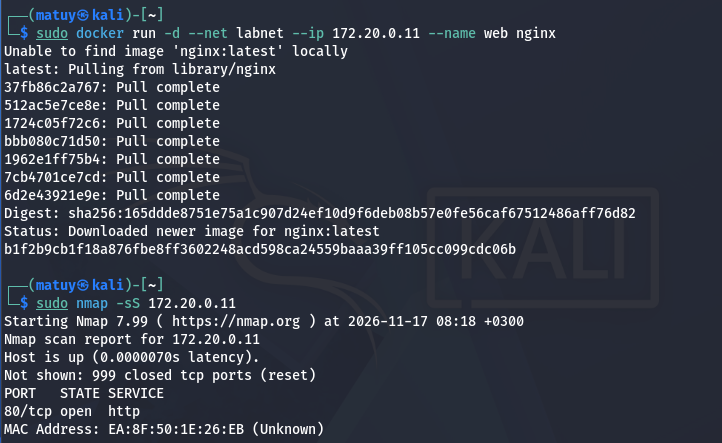

затем создал другой контейнер (ssh_server)
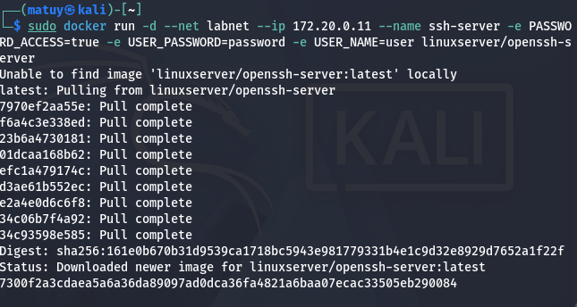

и наконец последний контейнер (redis)

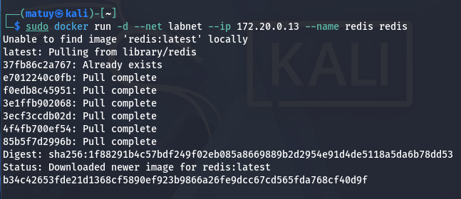

я создал это для последующего задания и правильной показания работы команд: например давайте возьмем и проверим порты 172.20.0.10
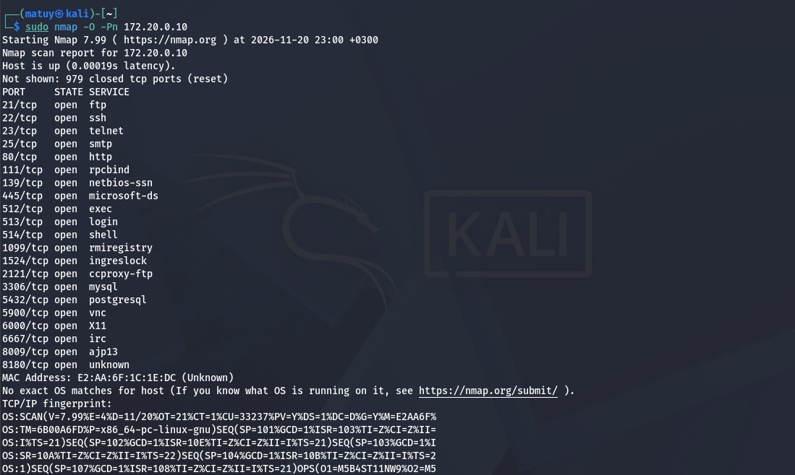
## Задание 2. Определение операцинную систему этой машины

### Запуск определения ОС
    sudo nmap -O localhost

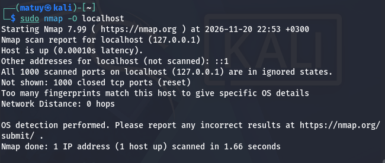 

### промежуточный вывод:
    так как я использую виртуальную машину и порты не выходят в сеть, то операционную систему утилита определить не смогла (используется kali linux)

## Задание 3. узнать адреса активных хостов в сети лаборатории (без сканирования портов)

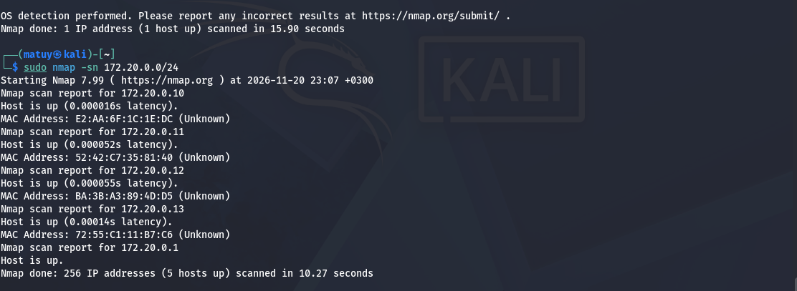

### промежуточный вывод:
    безусловно я знаю уже сеть которую я у себя локально развернул, но считаю что проверка вполне себе валидная

## Задание 4. Просканируйте хост №1, разными методами. Сравните результаты.
    В качестве Хоста №1 выступает Docker-контейнер target1 с IP-адресом 172.20.0.10
### 1.TCP SYN-сканирование (полуоткрытое)


```sudo nmap -sS -Pn 172.20.0.10```


### 2.TCP connect 

```sudo nmap -sT -Pn 172.20.0.10```
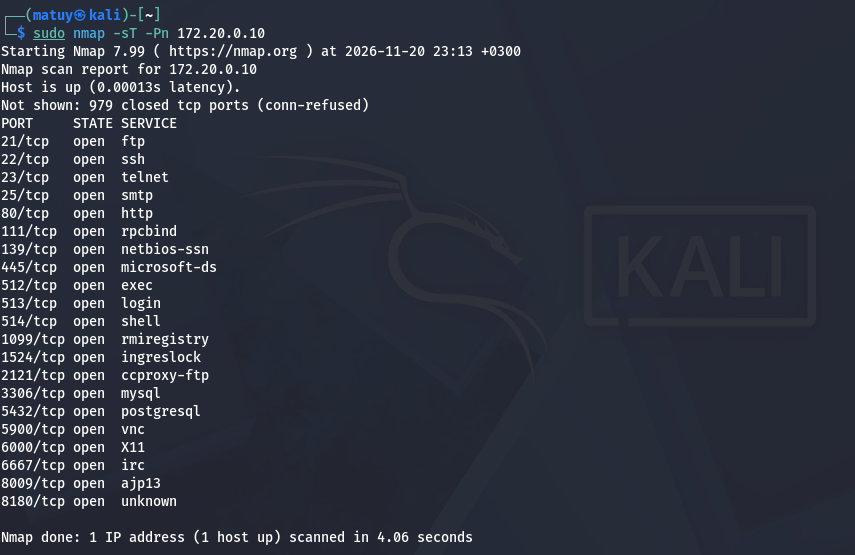

### 3.ACK-сканирование

```sudo nmap -sA -Pn 172.20.0.10```

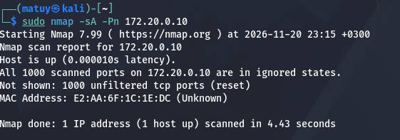

### 4.FIN-сканирование

```sudo nmap -sF -Pn 172.20.0.10```

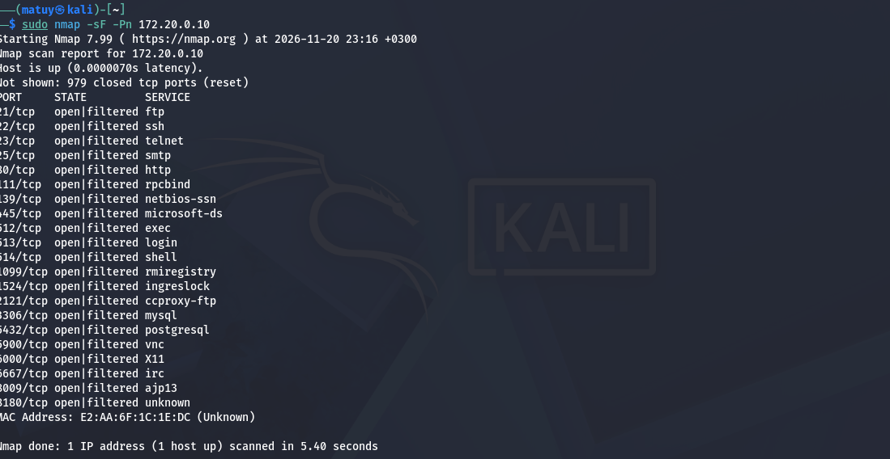

## 5. Для четырех хостов (№2-5), выполните следующие действия:
    1. Определите, защищен ли хост межсетевым экраном.
    2. Определите поддерживаемые протоколы.
    3. Выберите оптимальный метод сканирования портов, чтобы избежать
    обнаружения. Определите открытые и фильтрованные порты и по
    возможности версии служб. При необходимости используйте RPC-
    сканирование.
    4. Определите операционную систему
### Хост №2 (172.20.0.11 - SSH-сервер)

#### 1. Определите, защищен ли хост межсетевым экраном.
``` sudo nmap -sA -Pn 172.20.0.11 ```
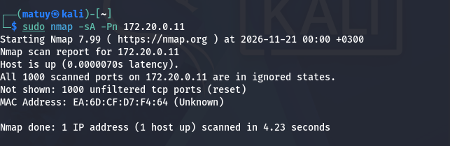

#### 2. Определите поддерживаемые протоколы.
```sudo nmap -sO -Pn 172.20.0.11```
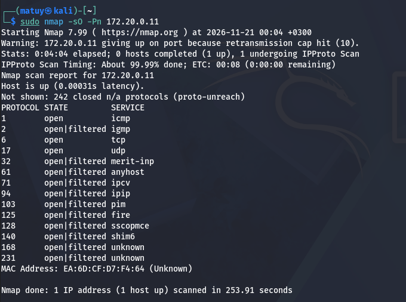
TCP UDP ICMP открытые, а  остальные нет

#### 3. Выберите оптимальный метод сканирования портов, чтобы избежать обнаружения. Определите открытые и фильтрованные порты и по возможности версии служб. При необходимости используйте RPC- сканирование.

``` sudo nmap -sS -sV  172.20.0.11 ```

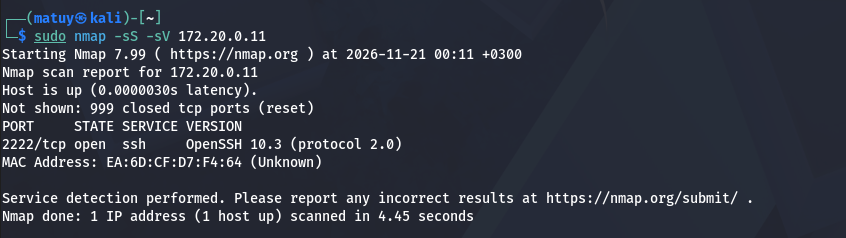

openSSH порт 2222

#### 4. Определите операционную систему
``` sudo nmap -O 172.20.0.11 ```

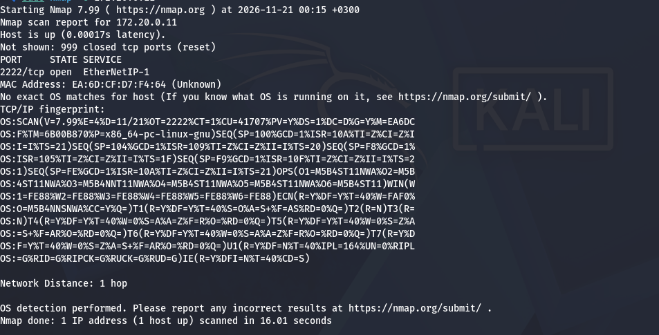

    во второй строчке видно что x86_64-pc-linux-gnu

### Хост №3 (172.20.0.12 - Nginx)

#### 1. Определите, защищен ли хост межсетевым экраном.
``` sudo nmap -sA -Pn 172.20.0.12 ```
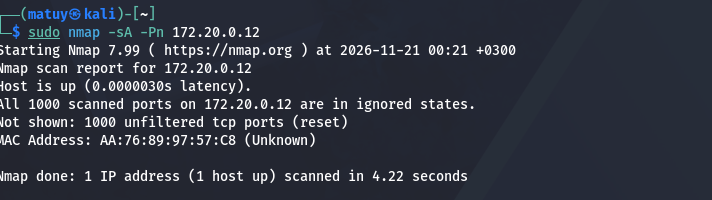

#### 2. Определите поддерживаемые протоколы.
```sudo nmap -sO -Pn 172.20.0.12```
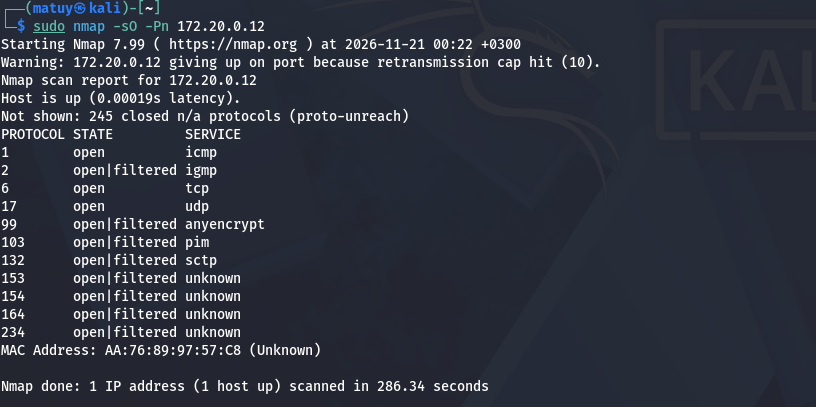

TCP UDP ICMP открытые, а  остальные нет 
#### 3. Выберите оптимальный метод сканирования портов, чтобы избежать обнаружения. Определите открытые и фильтрованные порты и по возможности версии служб. При необходимости используйте RPC- сканирование.

``` sudo nmap -sS -sV  172.20.0.12 ```

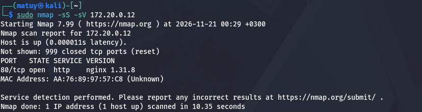

80 tcp open http

#### 4. Определите операционную систему
``` sudo nmap -O 172.20.0.12 ```

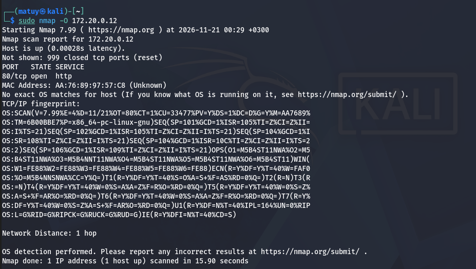

    во второй строчке видно что x86_64-pc-linux-gnu

### Хост №4 (172.20.0.13 - Redis)

#### 1. Определите, защищен ли хост межсетевым экраном.
``` sudo nmap -sA -Pn 172.20.0.13 ```
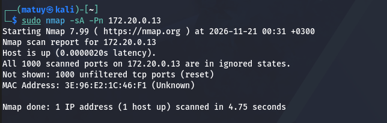

#### 2. Определите поддерживаемые протоколы.
```sudo nmap -sO -Pn 172.20.0.13```
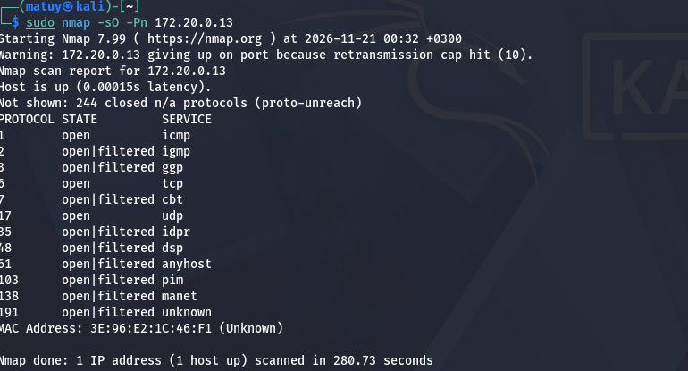


TCP UDP ICMP открытые, а  остальные нет
#### 3. Выберите оптимальный метод сканирования портов, чтобы избежать обнаружения. Определите открытые и фильтрованные порты и по возможности версии служб. При необходимости используйте RPC- сканирование.

``` sudo nmap -sS -sV  172.20.0.13 ```

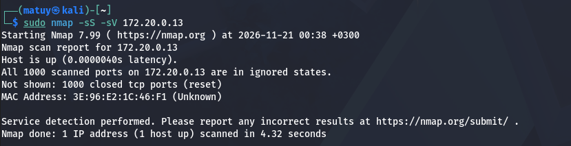

мы видем, что редис не находится в первой тысяче портов, но мы можем узнать что он должен находится в 6379 порту, так что давайте проверим этот порт

``` sudo nmap -sS -sV -Pn -p 6379  172.20.0.13 ```

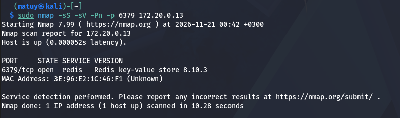

#### 4. Определите операционную систему
``` sudo nmap -O 172.20.0.13 ```

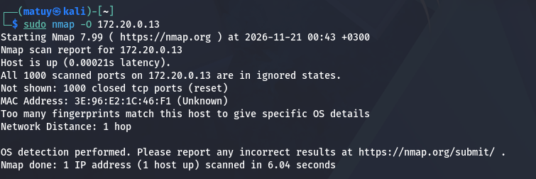

    команда не смогла понять что за операционная система

### Хост №5 (10.0.2.2 - ноутбук с oracle (виртуальной машиной))

#### 1. Определите, защищен ли хост межсетевым экраном.
``` sudo nmap -sA -Pn 10.0.2.2 ```
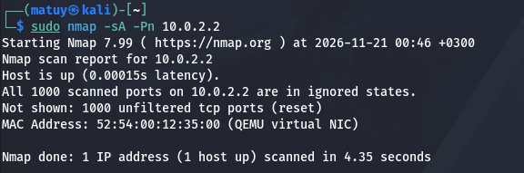

#### 2. Определите поддерживаемые протоколы.
```sudo nmap -sO -Pn 10.0.2.2```
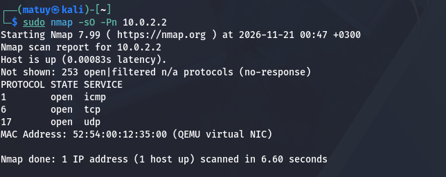

TCP UDP ICMP открытые, а  остальных нет
#### 3. Выберите оптимальный метод сканирования портов, чтобы избежать обнаружения. Определите открытые и фильтрованные порты и по возможности версии служб. При необходимости используйте RPC- сканирование.

``` sudo nmap -sS -sV  10.0.2.2 ```

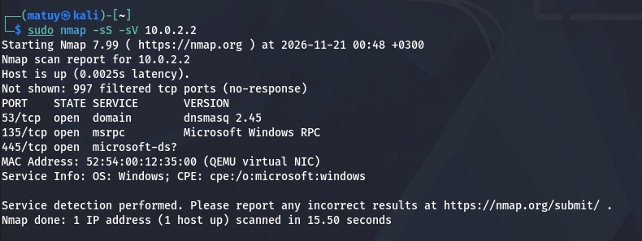


#### 4. Определите операционную систему
``` sudo nmap -O 10.0.2.2 ```

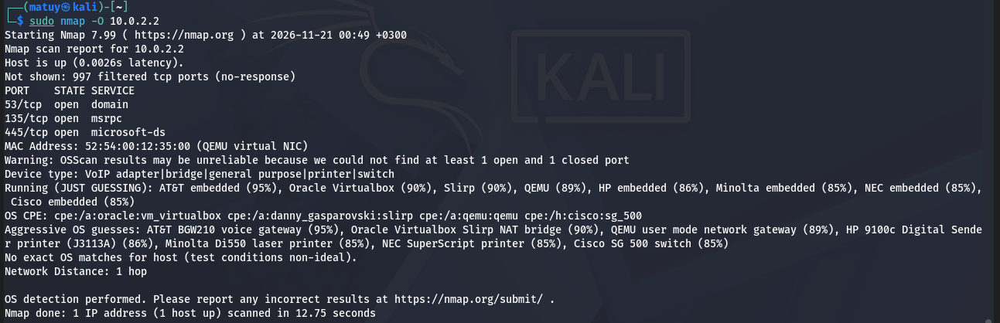

    команда смогла понять что у меня стоит windows

# Вывод: 
    В ходе выполнения лабораторной работы я изучил и практически применил утилиту nmap для сканирования и исследования безопасности сети. Поскольку работа выполнялась на персональном ноутбуке с ограниченным объемом оперативной памяти, для моделирования лабораторной сети была успешно применена технология контейнеризации Docker. Внутри виртуальной машины Kali Linux была создана изолированная подсеть 172.20.0.0/24, в которой контейнеры выполняли роль удаленных хостов.

