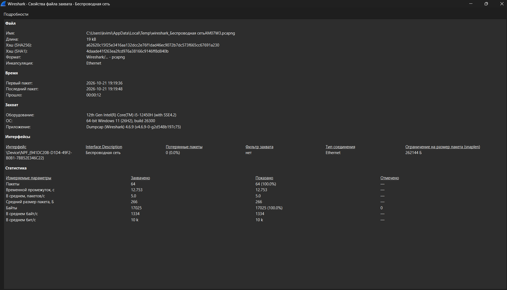
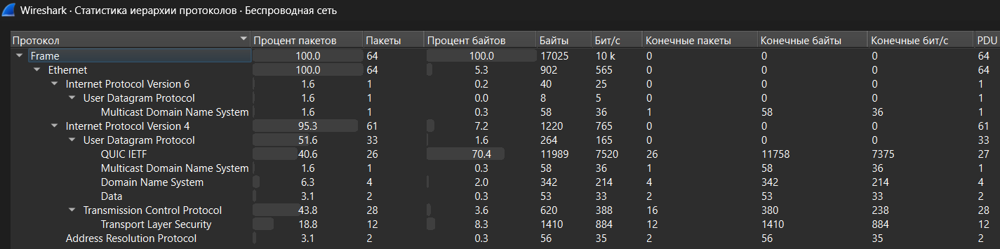
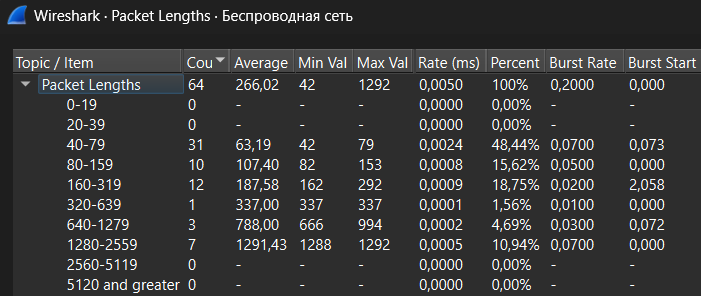
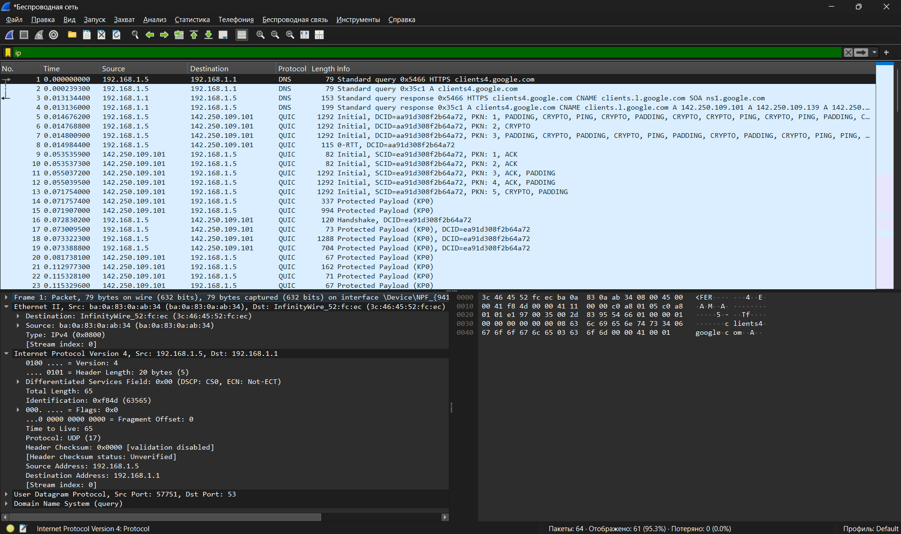
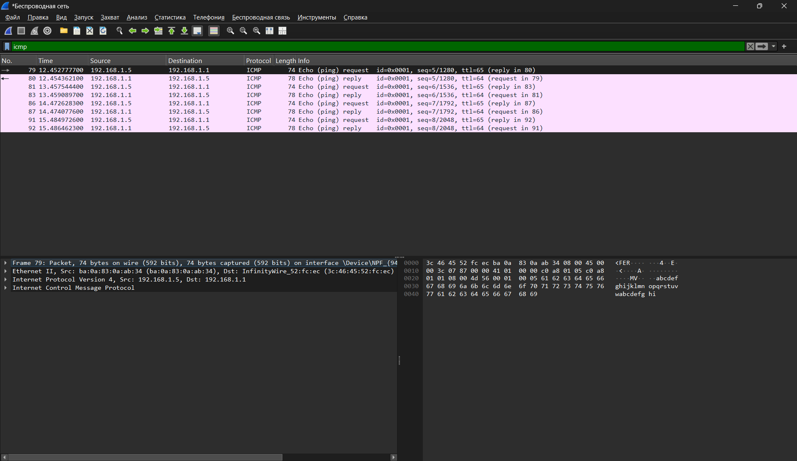
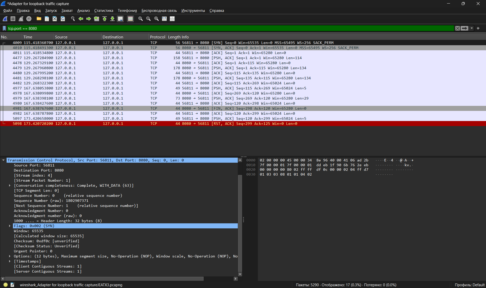
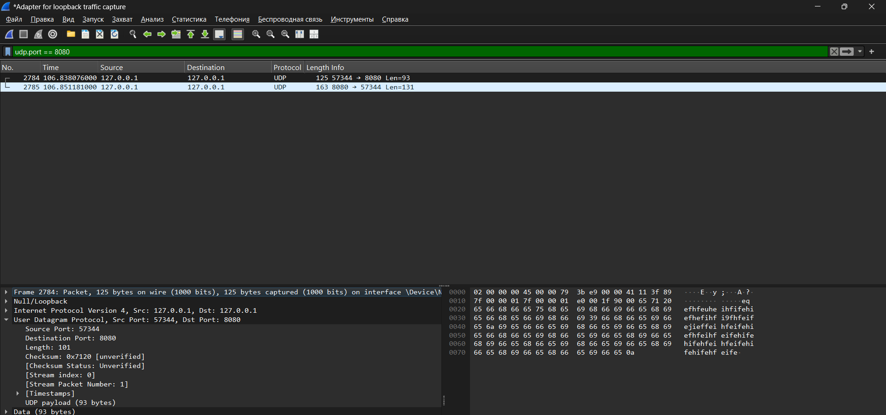
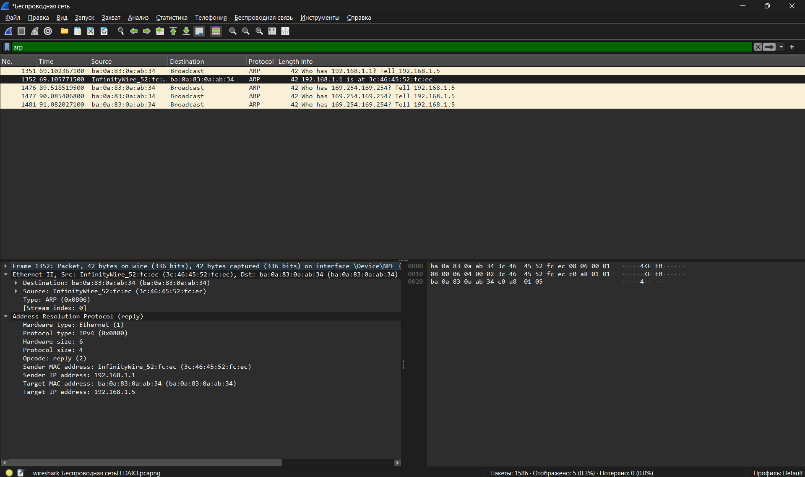

## 3. Захват веб-трафика

**Условия эксперимента:**
- Загружаемая страница: Google (clients4.google.com)
- Сетевой интерфейс: Беспроводная сеть (Wi-Fi)
- Длительность захвата: 12.753 сек
- Оборудование: 12th Gen Intel(R) Core(TM) i5-12450H, Windows 11

**Статистические данные (Statistics -> Свойства файла захвата):**

| Параметр | Значение |
|---|---|
| Общее количество пакетов | 64 |
| Потерянные пакеты | 0 (0.0%) |
| **Средняя скорость кадров/сек** | **5.0 пакетов/сек** |
| **Средняя скорость байт/сек** | **1334 байт/сек** |
| **Средняя скорость бит/сек** | **10 кбит/сек** |
| **Минимальный размер пакета** | **42 байта** |
| **Средний размер пакета** | **266 байт** |
| **Максимальный размер пакета** | **1292 байта** |

**Процентное соотношение трафика разных протоколов (Statistics -> Иерархия протоколов):**

| Протокол | % пакетов | % байт |
|---|---|---|
| Ethernet | 100.0% | 5.3% |
| IPv4 | 95.3% | 7.2% |
| IPv6 | 1.6% | 0.2% |
| TCP | 43.8% | 3.6% |
| TLS (Transport Layer Security) | 18.8% | 8.3% |
| UDP | 51.6% | 1.6% |
| QUIC IETF | 40.6% | **70.4%** |
| DNS | 6.3% | 2.0% |
| ARP | 3.1% | 0.3% |

**Распределение пакетов по размерам:**
- 40–79 байт: 31 пакет (48.44%) — служебные (DNS, ACK, handshake)
- 1280–2559 байт: 7 пакетов (10.94%) — крупные блоки данных

**Степень использования полосы пропускания канала:**
- Средняя скорость: 10 кбит/сек
- Типичная пропускная способность Wi-Fi: ~100 Мбит/сек
- **Загрузка канала:** (10 000 / 100 000 000) * 100% ≈ **0.01%**

**Вывод:** Канал практически не загружен. Основной объем трафика (70.4% байт) приходится на протокол QUIC IETF, который Google использует для защищённого соединения вместо классического TCP+TLS. Почти половина пакетов (48.44%) имеют размер 40–79 байт — это характерно для служебных пакетов (DNS-запросы, TCP-подтверждения, TLS-handshake).

## 4. Анализ IP-пакетов

**Фильтр отображения:** `ip`

После применения фильтра из 64 пакетов осталось 61 (95.3%) — отфильтровались 3 пакета ARP, не являющиеся IP-пакетами.

**Процентное соотношение трафика протоколов стека TCP/IP:**

| Протокол | % пакетов | % байт |
|---|---|---|
| IPv4 | 95.3% | 7.2% |
| IPv6 | 1.6% | 0.2% |
| TCP | 43.8% | 3.6% |
| UDP | 51.6% | 1.6% |
| TLS | 18.8% | 8.3% |
| QUIC IETF | 40.6% | 70.4% |
| DNS | 6.3% | 2.0% |

**Размеры IP-пакетов:**
- Минимальный: 42 байта
- Средний: 266 байт
- Максимальный: 1292 байта

**Структура заголовков (на примере пакета №1 — DNS-запрос к 192.168.1.1):**

### Ethernet II (канальный уровень)

| Поле | Значение | Описание |
|---|---|---|
| Destination | `3c:46:45:52:fc:ec` | MAC-адрес получателя (роутер/шлюз) |
| Source | `ba:0a:83:0a:ab:34` | MAC-адрес отправителя (мой адаптер) |
| Type | `IPv4 (0x0800)` | Тип полезной нагрузки — IP-пакет |

### Internet Protocol Version 4 (сетевой уровень)

| Поле | Значение | Описание |
|---|---|---|
| Version | 4 | Версия протокола IP |
| Header Length | 20 bytes (5) | Длина заголовка без опций |
| Total Length | 65 | Общий размер пакета (заголовок + данные) |
| Identification | 0xf84d (63565) | Идентификатор для сборки фрагментов |
| Flags | 0x0 | Флаги фрагментации не установлены |
| Fragment Offset | 0 | Пакет не фрагментирован |
| **Time to Live** | **65** | Время жизни пакета (уменьшается на 1 на каждом маршрутизаторе) |
| **Protocol** | **UDP (17)** | Протокол транспортного уровня внутри IP |
| Header Checksum | 0x0000 | Контрольная сумма заголовка |
| **Source Address** | **192.168.1.5** | IP-адрес отправителя (мой ПК) |
| **Destination Address** | **192.168.1.1** | IP-адрес получателя (шлюз) |

**Интерпретация:** Пакет является DNS-запросом (UDP, порт 53) от моего компьютера к роутеру для разрешения имени `clients4.google.com`. MAC-адрес получателя в Ethernet-кадре — адрес роутера, так как целевой IP находится в той же локальной сети. TTL=65 означает, что пакет прошёл 1 маршрутизатор (начальное значение обычно 64).

## 5. Анализ утилиты Ping (ICMP)

**Цель:** Проверить доступность узла `192.168.1.1` (основной шлюз) с помощью утилиты `ping` и проанализировать сетевой трафик.

**Фильтр отображения:** `icmp`

**Результат выполнения команды `ping 192.168.1.1`:**
- Отправлено пакетов: 4
- Получено ответов: 4
- Потеряно: 0 (0%)
- Среднее время отклика: < 1 мс

**Захваченные пакеты ICMP:**

| № пакета | Время | Источник | Назначение | Тип | Размер |
|---|---|---|---|---|---|
| 79 | 12.452 | 192.168.1.5 | 192.168.1.1 | Echo (ping) request, TTL=65 | 74 байта |
| 80 | 12.454 | 192.168.1.1 | 192.168.1.5 | Echo (ping) reply, TTL=64 | 78 байт |
| 81 | 13.457 | 192.168.1.5 | 192.168.1.1 | Echo (ping) request, TTL=65 | 74 байта |
| 83 | 13.459 | 192.168.1.1 | 192.168.1.5 | Echo (ping) reply, TTL=64 | 78 байт |
| 86 | 14.472 | 192.168.1.5 | 192.168.1.1 | Echo (ping) request, TTL=65 | 74 байта |
| 87 | 14.474 | 192.168.1.1 | 192.168.1.5 | Echo (ping) reply, TTL=64 | 78 байт |
| 91 | 15.484 | 192.168.1.5 | 192.168.1.1 | Echo (ping) request, TTL=65 | 74 байта |
| 92 | 15.486 | 192.168.1.1 | 192.168.1.5 | Echo (ping) reply, TTL=64 | 78 байт |

**Используемые протоколы:**

Утилита `ping` использует три уровня стека TCP/IP:

1. **Ethernet II** (канальный уровень) — обеспечивает доставку кадров в пределах локальной сети по MAC-адресам.
2. **Internet Protocol Version 4** (сетевой уровень) — обеспечивает маршрутизацию пакетов по IP-адресам.
3. **Internet Control Message Protocol (ICMP)** (RFC 792) — протокол управляющих сообщений, используемый для диагностики. В рамках `ping` применяются два типа сообщений:
   - **Type 8, Code 0** — Echo (ping) request (запрос эха)
   - **Type 0, Code 0** — Echo (ping) reply (ответ эха)

**Интерпретация полей ICMP-пакета (на примере пакета №79 — Echo request):**

| Поле | Значение | Описание |
|---|---|---|
| Type | 8 | Тип сообщения: Echo (ping) request |
| Code | 0 | Код: не используется для Echo |
| Checksum | 0x... | Контрольная сумма для проверки целостности |
| Identifier | 0x0001 | Идентификатор процесса ping (уникален для каждого запуска) |
| Sequence Number | 5/1280 | Номер последовательности запроса (увеличивается с каждым пакетом) |
| Data | `abcdefghijklmnop...` | Тестовые данные (32 байта по умолчанию в Windows) |

**Наблюдения:**
- TTL запроса = 65, TTL ответа = 64. Разница в 1 единицу подтверждает, что пакет прошел через один маршрутизатор (шлюз).
- Размер ответа (78 байт) на 4 байта больше размера запроса (74 байта) — это связано с разным содержимым заголовка ICMP (в ответе поле Type/Code имеет другое значение, но структура та же; разница может быть обусловлена выравниванием).
- Все 4 запроса получили ответы — соединение со шлюзом стабильно, потерь нет.

**Диаграмма взаимодействия машин при работе утилиты ping:**

### Последовательность пакетов ICMP

| № пакета | Направление | Тип | TTL | Описание |
|---|---|---|---|---|
| 79 | Мой ПК → Шлюз | **Echo Request (8)** | 65 | Запрос эха |
| 80 | Шлюз → Мой ПК | **Echo Reply (0)** | 64 | Ответ эха |
| 81 | Мой ПК → Шлюз | **Echo Request (8)** | 65 | Запрос эха |
| 83 | Шлюз → Мой ПК | **Echo Reply (0)** | 64 | Ответ эха |
| 86 | Мой ПК → Шлюз | **Echo Request (8)** | 65 | Запрос эха |
| 87 | Шлюз → Мой ПК | **Echo Reply (0)** | 64 | Ответ эха |
| 91 | Мой ПК → Шлюз | **Echo Request (8)** | 65 | Запрос эха |
| 92 | Шлюз → Мой ПК | **Echo Reply (0)** | 64 | Ответ эха |

**Вывод:** Утилита `ping` успешно проверила доступность шлюза `192.168.1.1`. Все 4 ICMP-запроса (Type 8) были доставлены и на каждый получен корректный ответ (Type 0). Протокол ICMP работает поверх IP и не использует порты (в отличие от TCP/UDP), что видно из заголовков захваченных пакетов.

## 6. Анализ TCP-сеанса (из ЛР №1)

**Фильтр захвата:** отсутствует (захват на loopback-адаптере)
**Фильтр отображения:** `tcp.port == 8080`

Из 5290 захваченных пакетов фильтр отобрал 17 пакетов, относящихся к TCP-соединению между клиентом (порт 56811) и сервером (порт 8080) на локальном хосте 127.0.0.1.

### Этапы TCP-сессии

**1. Установка соединения (Three-Way Handshake):**

| № пакета | Флаги | Source → Destination | Seq | Ack | Len | Описание |
|---|---|---|---|---|---|---|
| 4009 | **SYN** | 56811 → 8080 | 0 | 0 | 0 | Клиент запрашивает соединение |
| 4010 | **SYN, ACK** | 8080 → 56811 | 0 | 1 | 0 | Сервер подтверждает запрос |
| 4011 | **ACK** | 56811 → 8080 | 1 | 1 | 0 | Клиент подтверждает — соединение установлено |

**2. Передача данных:**

| № пакета | Флаги | Len | Описание |
|---|---|---|---|
| 4477 | PSH, ACK | 114 | Клиент отправляет команду `connect` |
| 4479 | PSH, ACK | 134 | Сервер отправляет ответ |
| 4481 | PSH, ACK | 134 | Сервер отправляет продолжение ответа |
| 4977 | PSH, ACK | 5 | Клиент отправляет данные (строка с `#`) |
| 4979 | PSH, ACK | 29 | Сервер отправляет ответ |
| 4980 | PSH, ACK | 5 | Клиент отправляет `~#~#` (завершение) |
| 5097 | PSH, ACK | 5 | Дополнительная передача данных |

**3. Завершение соединения:**

| № пакета | Флаги | Seq | Ack | Описание |
|---|---|---|---|---|
| 4981 | **FIN, ACK** | 298 | 120 | Клиент инициирует закрытие соединения |
| 4982 | ACK | 120 | 299 | Сервер подтверждает FIN |
| 5098 | **RST, ACK** | 299 | 125 | Сброс соединения (сервер закрыл сокет) |

### Структура заголовка TCP (на примере пакета №4009 — SYN)

| Поле | Значение | Описание |
|---|---|---|
| **Source Port** | **56811** | Случайный эфемерный порт клиента |
| **Destination Port** | **8080** | Порт сервера (зарезервирован для приложения) |
| **Sequence Number** | **0** (relative) / 1802907371 (raw) | Номер первого байта данных. Для SYN = 0 (относительный) |
| **Acknowledgment Number** | 0 | Не используется в SYN-пакете |
| **Header Length** | 32 bytes (8) | Длина заголовка TCP с опциями (8 × 4 = 32 байта) |
| **Flags** | **0x002 (SYN)** | Флаг запроса на установление соединения |
| **Window Size** | **65535** | Максимальный размер окна приема (буфер клиента) |
| **Checksum** | 0xdf0c [unverified] | Контрольная сумма сегмента (проверка отключена в Wireshark) |
| **Urgent Pointer** | 0 | Указатель на срочные данные (не используется) |
| **Options** | MSS=65495, WS=256, SACK_PERM | Параметры соединения: максимальный размер сегмента, масштаб окна, выборочное подтверждение |

### Диаграмма TCP-сессии

### Последовательность пакетов TCP-сессии

| № пакета | Направление | Флаги | Seq | Ack | Len | Событие |
|---|---|---|---|---|---|---|
| 4009 | Клиент → Сервер | **SYN** | 0 | 0 | 0 | Запрос соединения |
| 4010 | Сервер → Клиент | **SYN, ACK** | 0 | 1 | 0 | Подтверждение запроса |
| 4011 | Клиент → Сервер | **ACK** | 1 | 1 | 0 | Соединение установлено |
| 4477 | Клиент → Сервер | PSH, ACK | 1 | 1 | 114 | Команда `connect` |
| 4479 | Сервер → Клиент | PSH, ACK | 1 | 115 | 134 | Ответ сервера |
| 4481 | Сервер → Клиент | PSH, ACK | 115 | 135 | 134 | Продолжение ответа |
| 4977 | Клиент → Сервер | PSH, ACK | 115 | 135 | 5 | Данные (строка с `#`) |
| 4979 | Сервер → Клиент | PSH, ACK | 135 | 120 | 29 | Ответ сервера |
| 4980 | Клиент → Сервер | PSH, ACK | 120 | 298 | 5 | Завершение `~#~#` |
| 4981 | Клиент → Сервер | **FIN, ACK** | 298 | 120 | 0 | Закрытие соединения |
| 4982 | Сервер → Клиент | ACK | 120 | 299 | 0 | Подтверждение FIN |
| 5098 | Сервер → Клиент | **RST, ACK** | 299 | 125 | 0 | Принудительный сброс |

**Вывод:** TCP обеспечивает надёжную передачу данных за счёт:
1. Установления соединения (three-way handshake: SYN → SYN-ACK → ACK)
2. Нумерации байтов (Sequence/Acknowledgment Number) для контроля целостности
3. Управления потоком (Window Size = 65535 байт)
4. Корректного завершения (FIN → ACK) или принудительного сброса (RST)

Флаг PSH указывает на немедленную доставку данных приложению. В конце сессии наблюдается RST-пакет — это означает, что сервер принудительно закрыл сокет после завершения работы клиента.

## 7. Анализ UDP-сеанса (из ЛР №2)

**Фильтр захвата:** отсутствует (захват на loopback-адаптере)
**Фильтр отображения:** `udp.port == 8080`

Захвачено 2 пакета UDP-обмена между клиентом (порт 57344) и сервером (порт 8080) на локальном хосте 127.0.0.1.

### Захваченные пакеты

| № пакета | Время | Source | Destination | Protocol | Length | Info |
|---|---|---|---|---|---|---|
| 2784 | 106.838 | 127.0.0.1 | 127.0.0.1 | UDP | 125 | 57344 → 8080 Len=93 |
| 2785 | 106.851 | 127.0.0.1 | 127.0.0.1 | UDP | 163 | 8080 → 57344 Len=131 |

### Структура заголовка UDP (на примере пакета №2784 — запрос клиента)

| Поле | Значение | Описание |
|---|---|---|
| **Source Port** | **57344** | Случайный эфемерный порт клиента |
| **Destination Port** | **8080** | Порт сервера |
| **Length** | **101** | Общая длина датаграммы UDP (8 байт заголовка + 93 байта данных) |
| **Checksum** | **0x7120** [unverified] | Контрольная сумма датаграммы (проверка отключена в Wireshark) |
| **UDP payload** | 93 bytes | Полезная нагрузка — отправленная клиентом строка |

### Сравнение UDP и TCP

| Характеристика | TCP (ЛР №1) | UDP (ЛР №2) |
|---|---|---|
| Установление соединения | **Есть** (SYN → SYN-ACK → ACK) | **Нет** — данные отправляются сразу |
| Завершение соединения | **Есть** (FIN → ACK, RST) | **Нет** — просто прекращение отправки |
| Флаги | SYN, ACK, PSH, FIN, RST | **Отсутствуют** |
| Sequence Number | Есть (нумерация байтов) | **Отсутствует** |
| Acknowledgment Number | Есть (подтверждения) | **Отсутствует** |
| Window Size | Есть (управление потоком) | **Отсутствует** |
| Размер заголовка | 20-60 байт (с опциями) | **Всегда 8 байт** |
| Надёжность доставки | Гарантируется | **Не гарантируется** |
| Порядок доставки | Гарантируется | **Не гарантируется** |

**Вывод:** UDP — минималистичный протокол без установления соединения. Заголовок содержит всего 4 поля (Source Port, Destination Port, Length, Checksum) и занимает фиксированные 8 байт. В отличие от TCP, здесь нет флагов, номеров последовательности, подтверждений и механизма управления потоком. Это делает UDP быстрее и проще, но перекладывает ответственность за надёжность на приложение. В захваченной сессии видно, что клиент сразу отправил данные (пакет 2784) без какого-либо "рукопожатия", а сервер ответил (пакет 2785) — ровно 2 пакета на весь обмен, тогда как в TCP-сессии (ЛР №1) потребовалось 17 пакетов для аналогичной операции.

## 8. Анализ ARP-протокола

**Фильтр отображения:** `arp`

**Предварительные действия:**
1. Очистка ARP-кэша: `arp -d 192.168.1.1`
2. Захват трафика на интерфейсе "Беспроводная сеть"
3. Генерация ARP-трафика командой `ping 192.168.1.1`

### Последовательность ARP-пакетов

| № пакета | Направление | Тип | Ethernet Destination | Описание |
|---|---|---|---|---|
| 1351 | Мой ПК → Broadcast | **ARP Request** | `ff:ff:ff:ff:ff:ff` | "Who has 192.168.1.1? Tell 192.168.1.5" |
| 1352 | Роутер → Мой ПК | **ARP Reply** | `ba:0a:83:0a:ab:34` | "192.168.1.1 is at 3c:46:45:52:fc:ec" |

### Структура заголовка ARP Reply (пакет №1352)

**Ethernet II:**

| Поле | Значение | Описание |
|---|---|---|
| Destination | `ba:0a:83:0a:ab:34` | MAC-адрес моего компьютера (адресный ответ) |
| Source | `3c:46:45:52:fc:ec` | MAC-адрес роутера |
| Type | `ARP (0x0806)` | Тип полезной нагрузки — ARP |

**Address Resolution Protocol (reply):**

| Поле | Значение | Описание |
|---|---|---|
| Hardware type | Ethernet (1) | Тип аппаратного адреса |
| Protocol type | IPv4 (0x0800) | Тип протокола сетевого уровня |
| Hardware size | 6 | Длина MAC-адреса (байт) |
| Protocol size | 4 | Длина IP-адреса (байт) |
| **Opcode** | **reply (2)** | Тип операции: ответ |
| **Sender MAC** | **3c:46:45:52:fc:ec** | MAC-адрес роутера (искомый) |
| **Sender IP** | **192.168.1.1** | IP-адрес роутера |
| **Target MAC** | **ba:0a:83:0a:ab:34** | MAC-адрес моего ПК |
| **Target IP** | **192.168.1.5** | IP-адрес моего ПК |

### Отличия ARP Request от ARP Reply

| Поле | ARP Request (№1351) | ARP Reply (№1352) |
|---|---|---|
| Opcode | request (1) | reply (2) |
| Ethernet Destination | `ff:ff:ff:ff:ff:ff` (broadcast) | `ba:0a:83:0a:ab:34` (unicast) |
| Target MAC | `00:00:00:00:00:00` (неизвестен) | `ba:0a:83:0a:ab:34` (заполнен) |
| Sender MAC | `ba:0a:83:0a:ab:34` (мой ПК) | `3c:46:45:52:fc:ec` (роутер) |

**Вывод:** Протокол ARP работает на канальном уровне и решает задачу сопоставления IP-адресов с MAC-адресами в локальной сети. Когда компьютеру нужно отправить пакет устройству с известным IP, но неизвестным MAC, он рассылает **широковещательный ARP Request** (Destination = `ff:ff:ff:ff:ff:ff`). Все устройства в сегменте получают запрос, но отвечает только то, чей IP совпадает с запрашиваемым. Ответ приходит **адресно (unicast)** и содержит искомый MAC-адрес. После получения ответа запись сохраняется в **ARP-кэше** ОС (команда `arp -a`) как динамическая (dynamic) с временем жизни обычно 2-10 минут.

