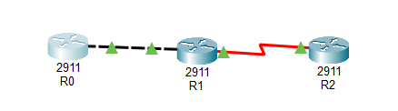

## Часть 1. Локальная сеть

### 1. Топология
Создана топология из 2 коммутаторов (Switch 2960) и 7 рабочих станций (PC0–PC6). Кабели: *Copper Straight-Through* (ПК–Коммутатор) и *Copper Cross-Over* (Коммутатор–Коммутатор). Сеть: `6.1.1.0/24`.

 
> *Рисунок 1. Топология локальной сети.*

### 2. Вывод консоли: проверка конфигурации (ipconfig)
```
C:\>ipconfig

FastEthernet0 Connection:(default port)
   Connection-specific DNS Suffix..: 
   IPv4 Address....................: 6.1.1.1
   Subnet Mask.....................: 255.255.255.0
   Default Gateway.................: 0.0.0.0
```
### 3. Вывод консоли: проверка связности (ping)
```
C:\>ping 6.1.1.2

Pinging 6.1.1.2 with 32 bytes of data:
Reply from 6.1.1.2: bytes=32 time<1ms TTL=128
Reply from 6.1.1.2: bytes=32 time<1ms TTL=128
Reply from 6.1.1.2: bytes=32 time<1ms TTL=128
Reply from 6.1.1.2: bytes=32 time<1ms TTL=128

Ping statistics for 6.1.1.2:
    Packets: Sent = 4, Received = 4, Lost = 0 (0% loss)
```
### 4. Разъяснение
* ipconfig: показывает настройки сетевого интерфейса (IP, маску, шлюз). Шлюз 0.0.0.0, так как маршрутизация не требуется.
* ping: использует ICMP (Echo Request/Reply). 0% потерь и время <1 мс подтверждают корректность коммутации и IP-адресации.

## Часть 2. Конфигурация маршрутизаторов

### 1. Топология
3 маршрутизатора (модель 2911). R1 и R2 соединены через GigabitEthernet (Cross-Over). R2 и R3 соединены через Serial (DCE на R2).

> *Рисунок 2. Топология сети с маршрутизаторами.*

### 2. Таблица сетевых адресов
| Устройство | Интерфейс | IP-адрес | Маска подсети | Роль |
| :--- | :--- | :--- | :--- | :--- |
| **R1** | GigabitEthernet 0/0 | 172.16.0.1 | 255.255.255.252 | DTE |
| **R2** | GigabitEthernet 0/0 | 172.16.0.2 | 255.255.255.252 | DTE |
| **R2** | Serial 0/0/0 | 172.16.0.5 | 255.255.255.252 | DCE |
| **R3** | Serial 0/0/0 | 172.16.0.6 | 255.255.255.252 | DTE |

### 3. Ход конфигурирования
```
! Настройка R1
R1(config)# interface gigabitethernet 0/0
R1(config-if)# ip address 172.16.0.1 255.255.255.252
R1(config-if)# no shutdown
R1(config)# ip route 172.16.0.4 255.255.255.252 172.16.0.2

! Настройка R2 (DCE)
R2(config)# interface gigabitethernet 0/0
R2(config-if)# ip address 172.16.0.2 255.255.255.252
R2(config-if)# no shutdown
R2(config)# interface serial 0/0/0
R2(config-if)# ip address 172.16.0.5 255.255.255.252
R2(config-if)# clock rate 64000
R2(config-if)# no shutdown

! Настройка R3
R3(config)# interface serial 0/0/0
R3(config-if)# ip address 172.16.0.6 255.255.255.252
R3(config-if)# no shutdown
R3(config)# ip route 172.16.0.0 255.255.255.252 172.16.0.5
```

### 4. Вывод консоли: статус интерфейсов и тестирование

Команда `show ip interface brief` на R1:

| Интерфейс | IP-адрес | Статус | Протокол |
|---|---|---|---|
| GigabitEthernet0/0 | 172.16.0.1 | up | up |
| Serial0/0/0 | unassigned | administratively down | down |    

Статус `up/up` для GigabitEthernet0/0 означает, что интерфейс физически включен и канальный протокол активен. Serial0/0/0 на R1 не используется в данной топологии, поэтому находится в состоянии `administratively down`.
```
R1# ping 172.16.0.6

Type escape sequence to abort.
Sending 5, 100-byte ICMP Echos to 172.16.0.6, timeout is 2 seconds:
.!!!!
Success rate is 80 percent (4/5), round-trip min/avg/max = 1/6/9 ms
```
Первый пакет (.) потерян из-за ARP-запроса, остальные 4 (!!!!) доставлены успешно. Маршрутизация работает корректно.