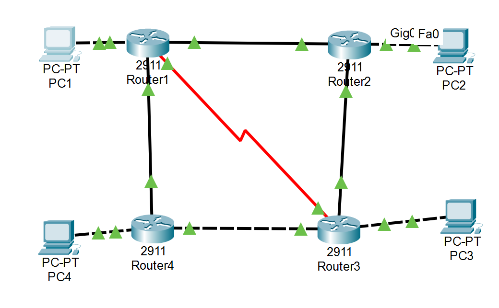

<p align="center">Министерство образования Республики Беларусь</p>
<p align="center">Учреждение образования</p>
<p align="center">“Брестский Государственный технический университет”</p>
<p align="center">Кафедра ИИТ</p>
<br><br><br><br><br><br><br>
<p align="center">Лабораторная работа №5</p>
<p align="center">По дисциплине “Аппаратное и Программное обеспечение сетей”</p>
<p align="center">Тема: “Организация UDP – сервера/клиента”</p>
<p align="center">Вариант: 7</p>
<br><br><br><br><br>
<p align="right">Выполнил:</p>
<p align="right">Студент 3 курса</p>
<p align="right">Группы ИИ-27</p>
<p align="right">Лыщенко К.В.</p>
<p align="right">Проверил:</p>
<p align="right">Кулик А.Д.</p>
<br><br><br><br><br>
<p align="center">Брест 2026</p>

## 1. Схема сети

Связи:
* PC1 ↔ R1 (Gig0/0)
* PC2 ↔ R2 (Gig0/0)
* PC3 ↔ R3 (Gig0/0)
* PC4 ↔ R4 (Gig0/0)
* R1 ↔ R2 (Gig0/1)
* R2 ↔ R3 (Gig0/2)
* R3 ↔ R4 (Gig0/1)
* R4 ↔ R1 (Gig0/2)
* R1 ↔ R3 (Serial0/0/0 — DCE)

## 2. Таблица IP-адресов
| Устройство | Интерфейс | IP-адрес | Маска | Шлюз |
| :--- | :--- | :--- | :--- | :--- |
| **PC1** | FastEthernet0 | 192.168.1.10 | 255.255.255.0 | 192.168.1.1 |
| **PC2** | FastEthernet0 | 192.168.2.10 | 255.255.255.0 | 192.168.2.1 |
| **PC3** | FastEthernet0 | 192.168.3.10 | 255.255.255.0 | 192.168.3.1 |
| **PC4** | FastEthernet0 | 192.168.4.10 | 255.255.255.0 | 192.168.4.1 |
| **R1** | GigabitEthernet0/0 | 192.168.1.1 | 255.255.255.0 | — |
| **R1** | GigabitEthernet0/1 | 192.168.10.1 | 255.255.255.0 | — |
| **R1** | GigabitEthernet0/2 | 192.168.12.1 | 255.255.255.0 | — |
| **R1** | Serial0/0/0 (DCE) | 192.168.11.1 | 255.255.255.0 | — |
| **R2** | GigabitEthernet0/0 | 192.168.2.1 | 255.255.255.0 | — |
| **R2** | GigabitEthernet0/1 | 192.168.10.2 | 255.255.255.0 | — |
| **R2** | GigabitEthernet0/2 | 192.168.13.1 | 255.255.255.0 | — |
| **R3** | GigabitEthernet0/0 | 192.168.3.1 | 255.255.255.0 | — |
| **R3** | GigabitEthernet0/1 | 192.168.14.1 | 255.255.255.0 | — |
| **R3** | GigabitEthernet0/2 | 192.168.13.2 | 255.255.255.0 | — |
| **R3** | Serial0/0/0 | 192.168.11.2 | 255.255.255.0 | — |
| **R4** | GigabitEthernet0/0 | 192.168.4.1 | 255.255.255.0 | — |
| **R4** | GigabitEthernet0/1 | 192.168.14.2 | 255.255.255.0 | — |
| **R4** | GigabitEthernet0/2 | 192.168.12.2 | 255.255.255.0 | — |
## 3. Ход настройки статической маршрутизации
R1:
```
R1(config)# ip route 192.168.2.0 255.255.255.0 192.168.10.2
R1(config)# ip route 192.168.3.0 255.255.255.0 192.168.11.2
R1(config)# ip route 192.168.4.0 255.255.255.0 192.168.12.2
```
R2:
```
R2(config)# ip route 192.168.1.0 255.255.255.0 192.168.10.1
R2(config)# ip route 192.168.3.0 255.255.255.0 192.168.13.2
R2(config)# ip route 192.168.4.0 255.255.255.0 192.168.13.2
```
R3:
```
R3(config)# ip route 192.168.1.0 255.255.255.0 192.168.11.1
R3(config)# ip route 192.168.2.0 255.255.255.0 192.168.13.1
R3(config)# ip route 192.168.4.0 255.255.255.0 192.168.14.2
```
R4:
```
R4(config)# ip route 192.168.1.0 255.255.255.0 192.168.12.1
R4(config)# ip route 192.168.2.0 255.255.255.0 192.168.12.1
R4(config)# ip route 192.168.3.0 255.255.255.0 192.168.14.1
```
## 4. Результаты проверки
Вывод show ip interface brief на R1:
```
Interface              IP-Address      OK? Method Status                Protocol 
GigabitEthernet0/0     192.168.1.1     YES manual up                    up 
GigabitEthernet0/1     192.168.10.1    YES manual up                    up 
GigabitEthernet0/2     192.168.12.1    YES manual up                    up 
Serial0/0/0            192.168.11.1    YES manual up                    up 
```
Вывод show ip route на R1:
```
C       192.168.1.0/24 is directly connected, GigabitEthernet0/0
S       192.168.2.0/24 [1/0] via 192.168.10.2
S       192.168.3.0/24 [1/0] via 192.168.11.2
S       192.168.4.0/24 [1/0] via 192.168.12.2
C       192.168.10.0/24 is directly connected, GigabitEthernet0/1
C       192.168.11.0/24 is directly connected, Serial0/0/0
C       192.168.12.0/24 is directly connected, GigabitEthernet0/2
```
Буква S подтверждает наличие статических маршрутов.
Проверка связности с PC1:
* Ping до PC4 (192.168.4.10):
```
Pinging 192.168.4.10 with 32 bytes of data:
Reply from 192.168.4.10: bytes=32 time<1ms TTL=126
Reply from 192.168.4.10: bytes=32 time=1ms TTL=125
Reply from 192.168.4.10: bytes=32 time<1ms TTL=126
Reply from 192.168.4.10: bytes=32 time=1ms TTL=125

Packets: Sent = 4, Received = 4, Lost = 0 (0% loss)
```
* Ping до PC2 (192.168.2.10):
```
Packets: Sent = 4, Received = 4, Lost = 0 (0% loss)
```
* Ping до PC3 (192.168.3.10):
```
Packets: Sent = 4, Received = 4, Lost = 0 (0% loss)
```
## 5. Вывод
Статическая маршрутизация настроена корректно. Все конечные устройства (PC1–PC4) достигают друг друга через маршрутизаторы R1–R4. Потеря первого пакета при первом ping объясняется ARP-запросом, последующие пинги проходят с 0% потерь. Конфигурация сохранена на всех устройствах командой copy running-config startup-config.