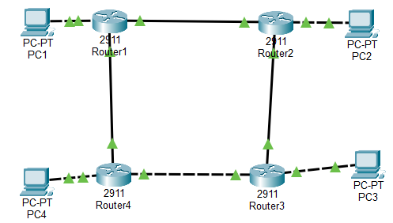

<p align="center">Министерство образования Республики Беларусь</p>
<p align="center">Учреждение образования</p>
<p align="center">“Брестский Государственный технический университет”</p>
<p align="center">Кафедра ИИТ</p>
<br><br><br><br><br><br><br>
<p align="center">Лабораторная работа №6</p>
<p align="center">По дисциплине “Аппаратное и Программное обеспечение сетей”</p>
<p align="center">Тема: “Настройка динамической маршрутизации с помощью протокола RIP на устройствах CISCO”</p>
<p align="center">Вариант: 7</p>
<br><br><br><br><br>
<p align="right">Выполнил:</p>
<p align="right">Студент 3 курса</p>
<p align="right">Группы ИИ-27</p>
<p align="right">Лыщенко К.В.</p>
<p align="right">Проверил:</p>
<p align="right">Кулик А.Д.</p>
<br><br><br><br><br>
<p align="center">Брест 2026</p>

---

## 1. Схема сети



Связи:
- PC1 ↔ R1 (Gig0/0)
- PC2 ↔ R2 (Gig0/0)
- PC3 ↔ R3 (Gig0/0)
- PC4 ↔ R4 (Gig0/0)
- R1 ↔ R2 (Gig0/1 ↔ Gig0/1)
- R2 ↔ R3 (Gig0/2 ↔ Gig0/2)
- R3 ↔ R4 (Gig0/1 ↔ Gig0/1)
- R4 ↔ R1 (Gig0/2 ↔ Gig0/2)

---

## 2. Таблица IP-адресов

| Устройство | Интерфейс | IP-адрес | Маска | Шлюз |
| :--- | :--- | :--- | :--- | :--- |
| **PC1** | FastEthernet0 | 192.168.1.10 | 255.255.255.0 | 192.168.1.1 |
| **PC2** | FastEthernet0 | 192.168.2.10 | 255.255.255.0 | 192.168.2.1 |
| **PC3** | FastEthernet0 | 192.168.3.10 | 255.255.255.0 | 192.168.3.1 |
| **PC4** | FastEthernet0 | 192.168.4.10 | 255.255.255.0 | 192.168.4.1 |
| **R1** | GigabitEthernet0/0 | 192.168.1.1 | 255.255.255.0 | — |
| **R1** | GigabitEthernet0/1 | 10.0.0.1 | 255.255.255.252 | — |
| **R1** | GigabitEthernet0/2 | 10.0.0.14 | 255.255.255.252 | — |
| **R2** | GigabitEthernet0/0 | 192.168.2.1 | 255.255.255.0 | — |
| **R2** | GigabitEthernet0/1 | 10.0.0.2 | 255.255.255.252 | — |
| **R2** | GigabitEthernet0/2 | 10.0.0.5 | 255.255.255.252 | — |
| **R3** | GigabitEthernet0/0 | 192.168.3.1 | 255.255.255.0 | — |
| **R3** | GigabitEthernet0/1 | 10.0.0.9 | 255.255.255.252 | — |
| **R3** | GigabitEthernet0/2 | 10.0.0.6 | 255.255.255.252 | — |
| **R4** | GigabitEthernet0/0 | 192.168.4.1 | 255.255.255.0 | — |
| **R4** | GigabitEthernet0/1 | 10.0.0.10 | 255.255.255.252 | — |
| **R4** | GigabitEthernet0/2 | 10.0.0.13 | 255.255.255.252 | — |

---

## 3. Ход настройки протокола RIP

### 3.1. Базовая конфигурация интерфейсов (на примере R1)

```cisco
Router> enable
Router# configure terminal
Router(config)# hostname R1
R1(config)# no ip domain-lookup
R1(config)# interface gigabitethernet 0/0
R1(config-if)# ip address 192.168.1.1 255.255.255.0
R1(config-if)# no shutdown
R1(config-if)# exit
R1(config)# interface gigabitethernet 0/1
R1(config-if)# ip address 10.0.0.1 255.255.255.252
R1(config-if)# no shutdown
R1(config-if)# exit
R1(config)# interface gigabitethernet 0/2
R1(config-if)# ip address 10.0.0.14 255.255.255.252
R1(config-if)# no shutdown
R1(config-if)# exit
```

Аналогично настроены R2, R3, R4 согласно таблице адресов.

### 3.2. Настройка протокола RIP

**На R1:**
```cisco
R1(config)# router rip
R1(config-router)# version 2
R1(config-router)# no auto-summary
R1(config-router)# network 192.168.1.0
R1(config-router)# network 10.0.0.0
R1(config-router)# exit
```

**На R2:**
```cisco
R2(config)# router rip
R2(config-router)# version 2
R2(config-router)# no auto-summary
R2(config-router)# network 192.168.2.0
R2(config-router)# network 10.0.0.0
R2(config-router)# exit
```

**На R3:**
```cisco
R3(config)# router rip
R3(config-router)# version 2
R3(config-router)# no auto-summary
R3(config-router)# network 192.168.3.0
R3(config-router)# network 10.0.0.0
R3(config-router)# exit
```

**На R4:**
```cisco
R4(config)# router rip
R4(config-router)# version 2
R4(config-router)# no auto-summary
R4(config-router)# network 192.168.4.0
R4(config-router)# network 10.0.0.0
R4(config-router)# exit
```

**Пояснение:** команда `network` в RIP указывает класс сети, к которой принадлежат интерфейсы. Все интерфейсы с IP из этой сети начинают участвовать в обмене RIP-объявлениями. Используется `version 2` и `no auto-summary` для корректной работы с VLSM (разные маски /24 и /30).

### 3.3. Сохранение конфигурации

На каждом маршрутизаторе:
```cisco
Router# copy running-config startup-config
Destination filename [startup-config]? 
Building configuration...
[OK]
```

---

## 4. Результаты проверки

### 4.1. Проверка статуса интерфейсов (R1)

```cisco
R1# show ip interface brief
Interface              IP-Address      OK? Method Status                Protocol 
GigabitEthernet0/0     192.168.1.1     YES manual up                    up 
GigabitEthernet0/1     10.0.0.1        YES manual up                    up 
GigabitEthernet0/2     10.0.0.14       YES manual up                    up 
```

Статус `up/up` на всех активных интерфейсах подтверждает корректную физическую и канальную связность.

### 4.2. Проверка таблицы маршрутизации (R1)

```cisco
R1# show ip route
Codes: L - local, C - connected, S - static, R - RIP, M - mobile, B - BGP
       D - EIGRP, EX - EIGRP external, O - OSPF, IA - OSPF inter area
       N1 - OSPF NSSA external type 1, N2 - OSPF NSSA external type 2
       E1 - OSPF external type 1, E2 - OSPF external type 2, E - EGP
       i - IS-IS, L1 - IS-IS level-1, L2 - IS-IS level-2, ia - IS-IS inter area
       * - candidate default, U - per-user static route, o - ODR
       P - periodic downloaded static route

Gateway of last resort is not set

     10.0.0.0/8 is variably subnetted, 6 subnets, 2 masks
C       10.0.0.0/30 is directly connected, GigabitEthernet0/1
L       10.0.0.1/32 is directly connected, GigabitEthernet0/1
R       10.0.0.4/30 [120/1] via 10.0.0.2, 00:00:20, GigabitEthernet0/1
R       10.0.0.8/30 [120/1] via 10.0.0.13, 00:00:26, GigabitEthernet0/2
C       10.0.0.12/30 is directly connected, GigabitEthernet0/2
L       10.0.0.14/32 is directly connected, GigabitEthernet0/2
     192.168.1.0/24 is variably subnetted, 2 subnets, 2 masks
C       192.168.1.0/24 is directly connected, GigabitEthernet0/0
L       192.168.1.1/32 is directly connected, GigabitEthernet0/0
R    192.168.2.0/24 [120/1] via 10.0.0.2, 00:00:20, GigabitEthernet0/1
R    192.168.3.0/24 [120/2] via 10.0.0.2, 00:00:20, GigabitEthernet0/1
                    [120/2] via 10.0.0.13, 00:00:26, GigabitEthernet0/2
R    192.168.4.0/24 [120/1] via 10.0.0.13, 00:00:26, GigabitEthernet0/2
```

Буква **R** подтверждает наличие маршрутов, полученных динамически по протоколу RIP. Метрика `[120/1]` — административное расстояние 120 (стандарт для RIP) и hop count = 1. Маршрут к сети 192.168.3.0/24 имеет метрику `[120/2]`, так как до нее 2 перехода (через R2 или R4).

### 4.3. Тестирование связности (Ping с PC1)

**Ping до PC2 (192.168.2.10):**
```text
PC> ping 192.168.2.10
Pinging 192.168.2.10 with 32 bytes of data:
Reply from 192.168.2.10: bytes=32 time<1ms TTL=126
Reply from 192.168.2.10: bytes=32 time<1ms TTL=126
Reply from 192.168.2.10: bytes=32 time<1ms TTL=126
Reply from 192.168.2.10: bytes=32 time<1ms TTL=126

Packets: Sent = 4, Received = 4, Lost = 0 (0% loss)
```

**Ping до PC3 (192.168.3.10):**
```text
PC> ping 192.168.3.10
Pinging 192.168.3.10 with 32 bytes of data:
Reply from 192.168.3.10: bytes=32 time=1ms TTL=125
Reply from 192.168.3.10: bytes=32 time<1ms TTL=126
Reply from 192.168.3.10: bytes=32 time<1ms TTL=126
Reply from 192.168.3.10: bytes=32 time<1ms TTL=126

Packets: Sent = 4, Received = 4, Lost = 0 (0% loss)
```

**Ping до PC4 (192.168.4.10):**
```text
PC> ping 192.168.4.10
Pinging 192.168.4.10 with 32 bytes of data:
Reply from 192.168.4.10: bytes=32 time<1ms TTL=126
Reply from 192.168.4.10: bytes=32 time<1ms TTL=126
Reply from 192.168.4.10: bytes=32 time<1ms TTL=126
Reply from 192.168.4.10: bytes=32 time<1ms TTL=126

Packets: Sent = 4, Received = 4, Lost = 0 (0% loss)
```

---

## 5. Вывод

В ходе лабораторной работы была успешно настроена динамическая маршрутизация с помощью протокола **RIP version 2** в сети из 4 маршрутизаторов (кольцевая топология). Протокол RIP автоматически обменивается информацией о маршрутах между соседями, и каждый роутер получает полные сведения обо всех сетях топологии (отмечены маркером `R` в таблице маршрутизации). 

Тестирование утилитой `ping` подтвердило 100% связность между всеми конечными узлами (PC1–PC4) с 0% потерь пакетов. Использование `version 2` и команды `no auto-summary` обеспечило корректную работу протокола с VLSM (различные маски подсетей /24 для LAN и /30 для межроутерных линков).

**Преимущества динамической маршрутизации (RIP) по сравнению со статической (ЛР5):**
- Не требуется вручную прописывать маршруты на каждом роутере.
- При изменении топологии (например, обрыв линка) RIP автоматически пересчитает маршруты (сходимость ~30–60 секунд).
- Масштабируемость — добавление новых сетей требует минимальной конфигурации.