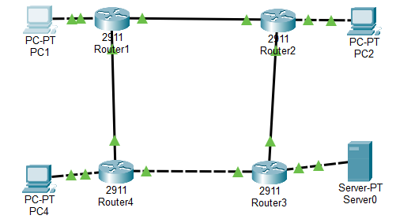
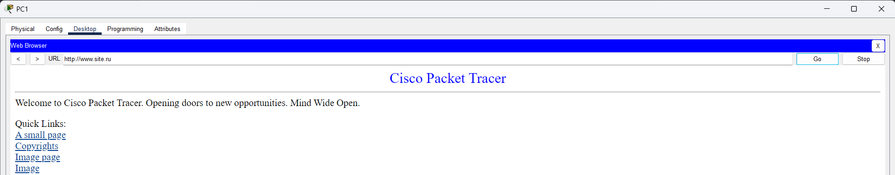

<p align="center">Министерство образования Республики Беларусь</p>
<p align="center">Учреждение образования</p>
<p align="center">“Брестский Государственный технический университет”</p>
<p align="center">Кафедра ИИТ</p>
<br><br><br><br><br><br><br>
<p align="center">Лабораторная работа №7</p>
<p align="center">По дисциплине “Аппаратное и Программное обеспечение сетей”</p>
<p align="center">Тема: “Настройка маршрута по умолчанию на устройствах Cisco”</p>
<p align="center">Вариант: 7</p>
<br><br><br><br><br>
<p align="right">Выполнил:</p>
<p align="right">Студент 3 курса</p>
<p align="right">Группы ИИ-27</p>
<p align="right">Лыщенко К.В.</p>
<p align="right">Проверил:</p>
<p align="right">Кулик А.Д.</p>
<br><br><br><br><br>
<p align="center">Брест 2026</p>

---

## 1. Схема сети



*Связи:*
- PC1 ↔ R1 (Gig0/0)
- PC2 ↔ R2 (Gig0/0)
- Web-server ↔ R3 (Gig0/0)
- PC4 ↔ R4 (Gig0/0)
- R1 ↔ R2 (Gig0/1 ↔ Gig0/1)
- R2 ↔ R3 (Gig0/2 ↔ Gig0/2)
- R3 ↔ R4 (Gig0/1 ↔ Gig0/1)
- R4 ↔ R1 (Gig0/2 ↔ Gig0/2)

---

## 2. Таблица IP-адресов

| Устройство | Интерфейс | IP-адрес | Маска | Шлюз |
| :--- | :--- | :--- | :--- | :--- |
| **PC1** | FastEthernet0 | 192.168.1.10 | 255.255.255.0 | 192.168.1.1 |
| **PC2** | FastEthernet0 | 192.168.2.10 | 255.255.255.0 | 192.168.2.1 |
| **Web-server** | FastEthernet0 | 192.168.3.10 | 255.255.255.0 | 192.168.3.1 |
| **PC4** | FastEthernet0 | 192.168.4.10 | 255.255.255.0 | 192.168.4.1 |
| **R1** | GigabitEthernet0/0 | 192.168.1.1 | 255.255.255.0 | — |
| **R1** | GigabitEthernet0/1 | 10.0.0.1 | 255.255.255.252 | — |
| **R1** | GigabitEthernet0/2 | 10.0.0.14 | 255.255.255.252 | — |
| **R2** | GigabitEthernet0/0 | 192.168.2.1 | 255.255.255.0 | — |
| **R2** | GigabitEthernet0/1 | 10.0.0.2 | 255.255.255.252 | — |
| **R2** | GigabitEthernet0/2 | 10.0.0.5 | 255.255.255.252 | — |
| **R3** | GigabitEthernet0/0 | 192.168.3.1 | 255.255.255.0 | — |
| **R3** | GigabitEthernet0/1 | 10.0.0.9 | 255.255.255.252 | — |
| **R3** | GigabitEthernet0/2 | 10.0.0.6 | 255.255.255.252 | — |
| **R4** | GigabitEthernet0/0 | 192.168.4.1 | 255.255.255.0 | — |
| **R4** | GigabitEthernet0/1 | 10.0.0.10 | 255.255.255.252 | — |
| **R4** | GigabitEthernet0/2 | 10.0.0.13 | 255.255.255.252 | — |

---

## 3. Ход настройки маршрута по умолчанию

### 3.1. Исключение сети Web-server из RIP
На **R3** сеть `192.168.3.0/24` исключается из протокола RIP, так как согласно заданию она не должна анонсироваться соседям:
```cisco
R3# configure terminal
R3(config)# router rip
R3(config-router)# no network 192.168.3.0
R3(config-router)# exit
```

### 3.2. Настройка статического маршрута по умолчанию на R3
На **R3** создаётся маршрут по умолчанию, указывающий на интерфейс с Web-сервером:
```cisco
R3(config)# ip route 0.0.0.0 0.0.0.0 GigabitEthernet0/0
```

### 3.3. Распространение маршрута по умолчанию через RIP
На **R3** включается рассылка маршрута по умолчанию соседям:
```cisco
R3(config)# router rip
R3(config-router)# default-information originate
R3(config-router)# exit
R3(config)# end
R3# copy running-config startup-config
```

### 3.4. Сброс таблиц маршрутизации
На **R1**, **R2**, **R4** выполнена команда для ускорения пересчёта таблиц:
```cisco
clear ip route *
```

---

## 4. Результаты проверки

### 4.1. Таблица маршрутизации R1 (после настройки)
```cisco
R1# show ip route
Gateway of last resort is 10.0.0.2 to network 0.0.0.0

     10.0.0.0/8 is variably subnetted, 6 subnets, 2 masks
C       10.0.0.0/30 is directly connected, GigabitEthernet0/1
L       10.0.0.1/32 is directly connected, GigabitEthernet0/1
R       10.0.0.4/30 [120/1] via 10.0.0.2, 00:00:29, GigabitEthernet0/1
R       10.0.0.8/30 [120/1] via 10.0.0.13, 00:00:09, GigabitEthernet0/2
C       10.0.0.12/30 is directly connected, GigabitEthernet0/2
L       10.0.0.14/32 is directly connected, GigabitEthernet0/2
     192.168.1.0/24 is variably subnetted, 2 subnets, 2 masks
C       192.168.1.0/24 is directly connected, GigabitEthernet0/0
L       192.168.1.1/32 is directly connected, GigabitEthernet0/0
R    192.168.2.0/24 [120/1] via 10.0.0.2, 00:00:29, GigabitEthernet0/1
R    192.168.4.0/24 [120/1] via 10.0.0.13, 00:00:09, GigabitEthernet0/2
R*   0.0.0.0/0 [120/2] via 10.0.0.2, 00:00:07, GigabitEthernet0/1
               [120/2] via 10.0.0.13, 00:00:07, GigabitEthernet0/2
```
**Ключевые результаты:**
- `Gateway of last resort is 10.0.0.2 to network 0.0.0.0`
- Строка `R* 0.0.0.0/0 [120/2]` — маршрут по умолчанию получен по RIP
- Сети `192.168.3.0/24` в таблице **нет** — доступ к Web-server обеспечивается через default route

### 4.2. Проверка связности (ping с PC1)
```text
PC> ping 192.168.3.10
Reply from 192.168.3.10: bytes=32 time=1ms TTL=125
Reply from 192.168.3.10: bytes=32 time<1ms TTL=126
Reply from 192.168.3.10: bytes=32 time<1ms TTL=126
Reply from 192.168.3.10: bytes=32 time<1ms TTL=126

Packets: Sent = 4, Received = 4, Lost = 0 (0% loss)
```

### 4.3. Браузерный тест
На **Web-server** настроены службы HTTP и DNS (запись `www.site.ru` → `192.168.3.10`). На **PC1** указан DNS-сервер `192.168.3.10`.
При вводе `www.site.ru` в Web Browser на PC1 страница успешно загрузилась:

Это подтверждает корректную работу маршрута по умолчанию для прикладного трафика.

---

## 5. Вывод
В ходе лабораторной работы на маршрутизаторе **R3** настроен статический маршрут по умолчанию (`ip route 0.0.0.0 0.0.0.0 GigabitEthernet0/0`). Сеть `192.168.3.0/24` исключена из протокола RIP, а маршрут по умолчанию распространён по всей сети командой `default-information originate`.

На внутренних маршрутизаторах (R1, R2, R4) появилась запись `R* 0.0.0.0/0` при отсутствии конкретной сети `192.168.3.0/24`. Весь трафик с неизвестным адресом назначения автоматически перенаправляется на R3. Проверка утилитой `ping` и через браузер подтвердила полную работоспособность настроенной маршрутизации.