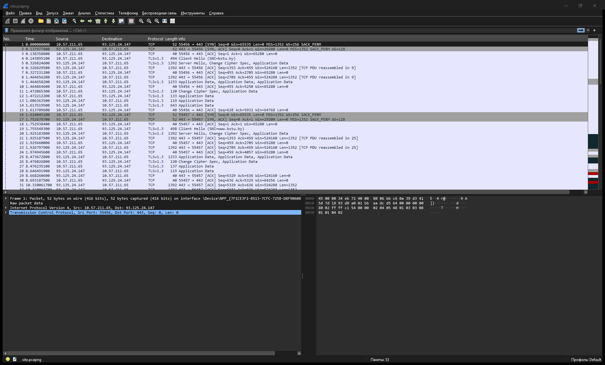
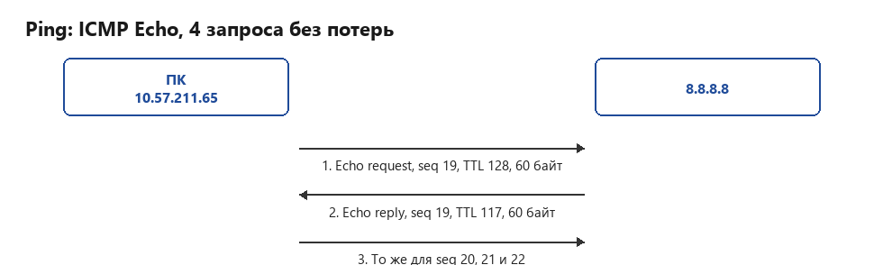
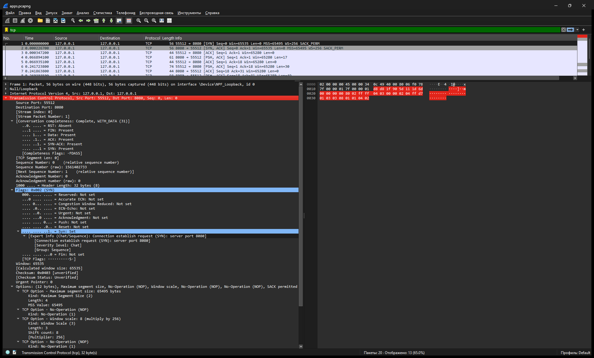
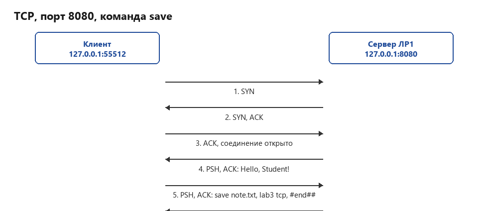
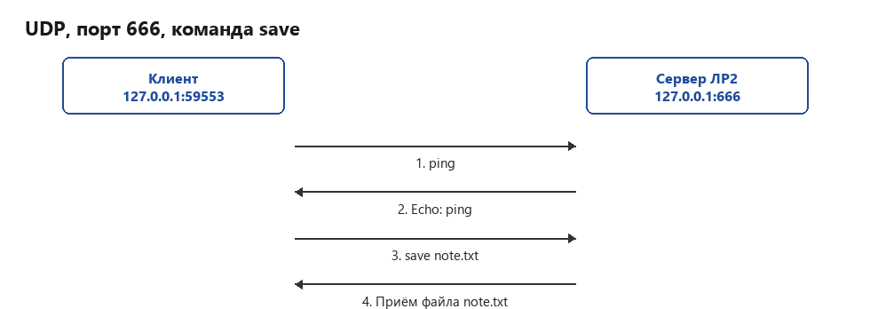
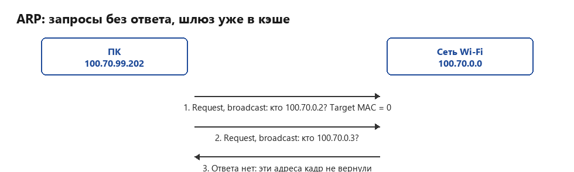

# Лабораторная работа №3

Вариант 11. Туз Г.С., группа ИИ-27. Дисциплина «Аппаратное и программное обеспечение сетей».

Разбор сделан в Wireshark 4.6 по дампам с этой машины: AMD Ryzen 5 220, Windows 11. Страница открывалась через адаптер hide.me, кадры Ethernet и ARP сняты с интерфейса «Беспроводная сеть» (120 Мбит/с, адрес 100.70.99.202). Сеансы программ первой и второй работ сняты с loopback-адаптера Npcap.

## 1. Wireshark

Wireshark 4.6 с драйвером Npcap снимает кадры с выбранного адаптера, разбирает заголовки и считает статистику. Захват пишется в pcapng. На этой машине три разных источника:

- hide.me отдаёт сразу IP, кадра Ethernet в дампе сайта и ping нет;
- «Беспроводная сеть» отдаёт Ethernet II, с неё сняты заголовок кадра и ARP;
- Npcap Loopback отдаёт сеансы `127.0.0.1` первой и второй работ.

Строка фильтра под панелью инструментов зелёная, когда выражение принято. Статистика берётся из меню «Статистика»: свойства файла, иерархия протоколов, график ввода-вывода.

## 2. Фильтры захвата и отображения

Фильтр захвата задаётся до записи, синтаксис BPF. В файл попадает только то, что прошло фильтр. Здесь использованы `host 93.125.24.147` для страницы и `arp` для ARP. Отброшенные кадры в файл уже не вернуть.

Фильтр отображения пишется в строку после записи и файл не уменьшает. Его можно менять сколько угодно раз. В разборе: `ip`, `icmp`, `frame.number == 3`, `tcp`, `udp`. Для сеансов программ это `tcp.port == 8080` и `udp.port == 666`.

## 3. Захват веб-трафика

**Условия:**

- Страница: https://bstu.by, адрес 93.125.24.147
- Интерфейс захвата: hide.me
- Фильтр захвата: `host 93.125.24.147`
- Длительность: 14,341 с
- Потерь на интерфейсе нет: принято 53, отброшено 0

**Свойства файла захвата:**

| Параметр | Значение |
|---|---|
| Пакетов | 53 |
| Потерянные | 0 |
| Кадров в секунду | 3,7 |
| Байт в секунду | 1688 |
| Бит в секунду | 13,5 кбит/с |
| Минимальный размер | 40 байт |
| Средний размер | 456,85 байт |
| Максимальный размер | 1392 байт |

Объём данных 24213 байт. Скорость 1688 байт/с × 8 = 13504 бит/с.

**Иерархия протоколов.** Адаптер туннеля отдаёт IP без кадра Ethernet, поэтому в статистике нет строки Ethernet. Все 53 пакета — IPv4 и TCP.

| Протокол | Пакетов | % пакетов | Байт | % байт |
|---|---|---|---|---|
| IPv4 | 53 | 100 | 24213 | 100 |
| TCP | 53 | 100 | 24213 | 100 |
| TLS | 16 | 30,2 | 9153 | 37,8 |

Остальные 37 пакетов TCP — это SYN, ACK и короткие служебные сегменты без записи TLS.

**Длины пакетов:**

| Диапазон | Пакетов | Доля |
|---|---|---|
| 40–79 байт | 29 | 54,72 % |
| 80–159 байт | 6 | 11,32 % |
| 320–639 байт | 2 | 3,77 % |
| 640–1279 байт | 3 | 5,66 % |
| 1280–2559 байт | 13 | 24,53 % |

Короткие пакеты — рукопожатие и подтверждения. 13 пакетов по 1392 байта — куски страницы.

**Загрузка канала.** Физическая скорость беспроводного адаптера 120 Мбит/с.

(13504 / 120000000) × 100 % ≈ **0,011 %**

Канал почти пустой. Страница идёт по HTTPS: читается заголовок TCP, текст страницы внутри TLS не виден.

## 4. Анализ IP-пакетов

**Фильтр отображения:** `ip`

В файле загрузки сайта и так только IPv4, поэтому фильтр оставляет те же 53 пакета. Доля TCP не меняется: 100 % пакетов и 37,8 % байт у TLS.

Размеры те же: минимум 40 байт, среднее 456,85, максимум 1392.

Кадр Ethernet у этих 53 пакетов отсутствует: туннель их так и отдаёт. Заголовок Ethernet снят с беспроводного адаптера, пакет №3 файла `wifi.pcapng`. Это исходящий IP-пакет того же компьютера к узлу VPN 95.216.6.21. Получатель кадра — шлюз Wi-Fi.

### Ethernet II

| Поле | Значение | Описание |
|---|---|---|
| Destination | `00:00:5e:00:52:13` | MAC шлюза 100.70.0.1 |
| Source | `f0:68:e3:39:6a:5e` | MAC беспроводного адаптера |
| Type | `IPv4 (0x0800)` | дальше лежит IP-пакет |

### Internet Protocol Version 4

| Поле | Значение | Описание |
|---|---|---|
| Version | 4 | IPv4 |
| Header Length | 20 bytes | опций IP нет |
| Total Length | 124 | заголовок и данные |
| Identification | 0x637b (25467) | номер для сборки фрагментов |
| Flags | 0x0 | флаг DF не установлен |
| Fragment Offset | 0 | пакет не фрагмент |
| Time to Live | 128 | стартовое значение Windows, маршрутизаторов ещё не было |
| Protocol | UDP (17) | внутри UDP |
| Header Checksum | 0xa8f8 | контрольная сумма заголовка |
| Source Address | 100.70.99.202 | адрес компьютера в Wi-Fi |
| Destination Address | 95.216.6.21 | узел, куда уходит туннель |

Первый пакет уже самой загрузки bstu.by (файл `site.pcapng`, пакет №1) — это TCP SYN. У него нет Ethernet, заголовок IP другой: источник 10.57.211.65, назначение 93.125.24.147, длина 52, идентификатор 0xeb72, флаг DF, TTL 128, протокол TCP (6), контрольная сумма 0xbbc6.

## 5. Анализ утилиты Ping (ICMP)

Ping до шлюза Wi-Fi 100.70.0.1 заканчивается общей ошибкой: запрос ICMP в этот интерфейс не уходит. Поэтому снят ping до 8.8.8.8, интерфейс hide.me, фильтр отображения `icmp`.

Команда отправила 4 запроса и получила 4 ответа, потерь 0. По меткам пакетов задержки 57, 58, 132 и 50 мс.

| № | Направление | Тип | TTL | Размер | Sequence |
|---|---|---|---|---|---|
| 1 | 10.57.211.65 → 8.8.8.8 | Echo request | 128 | 60 | 19 |
| 2 | 8.8.8.8 → 10.57.211.65 | Echo reply | 117 | 60 | 19 |
| 3 | 10.57.211.65 → 8.8.8.8 | Echo request | 128 | 60 | 20 |
| 4 | 8.8.8.8 → 10.57.211.65 | Echo reply | 117 | 60 | 20 |
| 5 | 10.57.211.65 → 8.8.8.8 | Echo request | 128 | 60 | 21 |
| 6 | 8.8.8.8 → 10.57.211.65 | Echo reply | 117 | 60 | 21 |
| 7 | 10.57.211.65 → 8.8.8.8 | Echo request | 128 | 60 | 22 |
| 8 | 8.8.8.8 → 10.57.211.65 | Echo reply | 117 | 60 | 22 |

**Какие протоколы видны.** На этом адаптере кадра Ethernet нет. В пакете два уровня: IPv4 и ICMP. Портов у ICMP нет.

- Type 8, Code 0 — Echo request
- Type 0, Code 0 — Echo reply

**Пакет №1, запрос:**

| Поле | Значение | Описание |
|---|---|---|
| Type | 8 | Echo request |
| Code | 0 | для echo код не используется |
| Checksum | 0x4d48 | контрольная сумма ICMP |
| Identifier | 1 | номер этого запуска ping |
| Sequence | 19 | номер попытки, Windows продолжает нумерацию |
| Data | 32 байта | нагрузка по умолчанию |

Запрос уходит с TTL 128. Ответ приходит с TTL 117: пока пакет шёл обратно, значение уже уменьшили маршрутизаторы. Оба пакета по 60 байт: 20 байт IP, 8 байт заголовка ICMP и 32 байта данных. Размер запроса и ответа совпадает.

| № | Направление | Тип | Sequence |
|---|---|---|---|
| 1 | ПК → 8.8.8.8 | Echo request (8) | 19 |
| 2 | 8.8.8.8 → ПК | Echo reply (0) | 19 |
| 3 | ПК → 8.8.8.8 | Echo request (8) | 20 |
| 4 | 8.8.8.8 → ПК | Echo reply (0) | 20 |
| 5 | ПК → 8.8.8.8 | Echo request (8) | 21 |
| 6 | 8.8.8.8 → ПК | Echo reply (0) | 21 |
| 7 | ПК → 8.8.8.8 | Echo request (8) | 22 |
| 8 | 8.8.8.8 → ПК | Echo reply (0) | 22 |

Узел 8.8.8.8 ответил на все четыре запроса.

## 6. Анализ TCP-сеанса (из ЛР №1)

Захват на loopback, фильтра захвата не было, фильтр отображения `tcp.port == 8080`.

Клиент 127.0.0.1:55512 подключился к серверу первой работы на 127.0.0.1:8080. В файле 20 пакетов, из них 13 относятся к TCP.

**Рукопожатие:**

| № | Флаги | Направление | Seq | Ack | Len |
|---|---|---|---|---|---|
| 1 | SYN | 55512 → 8080 | 0 | 0 | 0 |
| 2 | SYN, ACK | 8080 → 55512 | 0 | 1 | 0 |
| 3 | ACK | 55512 → 8080 | 1 | 1 | 0 |

**Данные:**

| № | Флаги | Кто | Len | Содержимое |
|---|---|---|---|---|
| 4 | PSH, ACK | сервер | 17 | `Hello, Student!` |
| 6 | PSH, ACK | клиент | 30 | `save note.txt`, строка `lab3 tcp`, маркер `#end##` |
| 8 | PSH, ACK | сервер | 49 | `Файл создан: note.txt, размер 9` |

Пакеты 5, 7 и 9 — пустые ACK на эти сегменты.

**Закрытие:**

| № | Флаги | Направление | Seq | Ack |
|---|---|---|---|---|
| 10 | FIN, ACK | клиент → сервер | 31 | 67 |
| 11 | ACK | сервер → клиент | 67 | 32 |
| 13 | FIN, ACK | сервер → клиент | 67 | 32 |
| 14 | ACK | клиент → сервер | 32 | 68 |

RST в этом сеансе нет: сокет закрыт флагами FIN.

**Заголовок TCP, пакет №1 (SYN):**

| Поле | Значение | Описание |
|---|---|---|
| Source Port | 55512 | временный порт клиента |
| Destination Port | 8080 | порт сервера первой работы |
| Sequence Number | 0 (raw 1561402733) | номер байтов клиента |
| Acknowledgment Number | 0 | в SYN подтверждать нечего |
| Header Length | 32 bytes | есть опции |
| Flags | SYN (0x002) | запрос соединения |
| Window Size | 65535 | сколько байт клиент готов принять |
| Checksum | 0x0403 | контрольная сумма сегмента |
| Urgent Pointer | 0 | срочных данных нет |
| Options | MSS=65495, WS=8, SACK_PERM | параметры, которые предлагает клиент |

Ответ сервера, пакет №2: флаги SYN+ACK, его номер 0 (raw 3198328171), подтверждение 1, окно 65535. Подтверждение на единицу больше номера SYN: флаг SYN занимает один номер.

| № | Направление | Флаги | Seq | Ack | Len | Событие |
|---|---|---|---|---|---|---|
| 1 | клиент → сервер | SYN | 0 | 0 | 0 | запрос соединения |
| 2 | сервер → клиент | SYN, ACK | 0 | 1 | 0 | согласие сервера |
| 3 | клиент → сервер | ACK | 1 | 1 | 0 | соединение открыто |
| 4 | сервер → клиент | PSH, ACK | 1 | 1 | 17 | `Hello, Student!` |
| 6 | клиент → сервер | PSH, ACK | 1 | 18 | 30 | `save` и `#end##` |
| 8 | сервер → клиент | PSH, ACK | 18 | 31 | 49 | файл создан, 9 байт |
| 10 | клиент → сервер | FIN, ACK | 31 | 67 | 0 | клиент закрывает |
| 13 | сервер → клиент | FIN, ACK | 67 | 32 | 0 | сервер закрывает |
| 14 | клиент → сервер | ACK | 32 | 68 | 0 | подтверждение FIN |

Флаг PSH просит отдать байты приложению сразу, без накопления. Номера Seq и Ack сдвигаются на длину принятых данных, поэтому сервер в пакете 8 подтверждает 31-й байт клиента: 1 байт начала плюс 30 байт команды.

## 7. Анализ UDP-сеанса (из ЛР №2)

Тот же loopback-файл, фильтр отображения `udp.port == 666`. Семь датаграмм между клиентом 127.0.0.1:59553 и сервером второй работы на порту 666.

| № | Source → Destination | Length кадра | UDP Length | Содержимое |
|---|---|---|---|---|
| 12 | 59553 → 666 | 36 | 12 | `ping` |
| 15 | 666 → 59553 | 42 | 18 | `Echo: ping` |
| 16 | 59553 → 666 | 45 | 21 | `save note.txt` |
| 17 | 666 → 59553 | 62 | 38 | `Приём файла note.txt` |
| 18 | 59553 → 666 | 44 | 20 | `строка` |
| 19 | 59553 → 666 | 38 | 14 | `#end##` |
| 20 | 666 → 59553 | 80 | 56 | `Файл создан: note.txt, размер 13` |

Между `save` и маркером сервер молчит: строка файла отдельным ответом не подтверждается. Ответ приходит на `#end##`.

**Заголовок UDP, пакет №12:**

| Поле | Значение | Описание |
|---|---|---|
| Source Port | 59553 | порт клиента |
| Destination Port | 666 | порт сервера второй работы |
| Length | 12 | 8 байт заголовка и 4 байта слова `ping` |
| Checksum | 0x37c7 | контрольная сумма датаграммы |

| | TCP, порт 8080 | UDP, порт 666 |
|---|---|---|
| Соединение | SYN, SYN+ACK, ACK | нет, датаграмма уходит сразу |
| Закрытие | FIN с обеих сторон | нет отдельного пакета закрытия |
| Флаги | SYN, ACK, PSH, FIN | нет |
| Номера байтов | Seq и Ack | нет |
| Окно | Window 65535 | нет |
| Заголовок | 20 байт, у SYN 32 с опциями | всегда 8 байт |
| Сколько пакетов ушло на тот же сценарий save | 13 | 7 |

UDP не нумерует байты и не подтверждает доставку. Сервер второй работы сам отвечает текстом, это уже логика программы, не протокола.

## 8. Анализ ARP-протокола

Интерфейс «Беспроводная сеть», фильтр захвата `arp`. Шлюз 100.70.0.1 к этому моменту уже был в кэше (`arp -a`: 100.70.0.1 → `00:00:5e:00:52:13`), поэтому нового запроса про него не было. Запросы ушли про адреса 100.70.0.2 и 100.70.0.3. Ответов нет: эти адреса кадр не вернули. Очистить кэш шлюза без прав администратора не удалось, запись осталась dynamic.

**Запрос, пакет №1.** Opcode = 1.

| Поле | Значение |
|---|---|
| Ethernet Destination | `ff:ff:ff:ff:ff:ff` |
| Ethernet Source | `f0:68:e3:39:6a:5e` |
| Type | ARP (0x0806) |
| Opcode | request (1) |
| Sender MAC | `f0:68:e3:39:6a:5e` |
| Sender IP | 100.70.99.202 |
| Target MAC | `00:00:00:00:00:00` |
| Target IP | 100.70.0.2 |

Кадр широковещательный: MAC получателя ещё неизвестен, в поле Target MAC нули. Пакет №2 такой же, но Target IP = 100.70.0.3. Пакеты 3–6 повторяют эти два запроса.

Отличаться ответ должен так: opcode = 2, Ethernet Destination уже конкретный MAC спрашивающего, Target MAC заполнен, Sender MAC и Sender IP принадлежат тому, чей адрес спрашивали. В этом захвате такого кадра нет.

В кэше при этом лежит готовая пара шлюза: 100.70.0.1 и `00:00:5e:00:52:13`. Ей же пользуется кадр из раздела 4: пакет на 95.216.6.21 отправлен именно на этот MAC.

## Контрольные вопросы

**1. Зачем мониторят трафик.** Чтобы увидеть, доходит ли обмен, какой протокол его везёт, где задержка и нет ли потерь. В этой работе так проверены загрузка bstu.by, ping, сеансы `save` и запросы ARP.

**2. Мониторинг и фильтрация.** Мониторинг снимает и разбирает поток. Фильтрация оставляет из него часть: по адресу, порту или протоколу. Фильтр захвата режет поток до записи, фильтр отображения только прячет уже записанные пакеты.

**3. Зачем нужен сниффер.** Он забирает кадры с адаптера и показывает их содержимое. Без него сеанс `save` виден только по тексту в окне клиента, а флаги TCP, порты и ARP — нет.

**4. Что сниффер умеет.** Захват, разбор заголовков, фильтры, поиск, статистику, график ввода-вывода и сохранение pcapng. В отчёте использованы список пакетов, иерархия протоколов и график.

**5. Два вида фильтров.** Фильтр захвата (`host 93.125.24.147`, `arp`) уменьшает файл и нагрузку, но отброшенное пропадает. Фильтр отображения (`icmp`, `tcp`, `udp`) ничего не удаляет: тот же файл открывается с другой строкой.

**6. Какая статистика есть в Wireshark.** Свойства файла (число пакетов, время, байт/с, min/avg/max), иерархия протоколов, длины пакетов, график ввода-вывода. Цифры раздела 3 сняты отсюда.

**7. Задача ARP.** По IPv4 в своей подсети узнать MAC. Запрос уходит на `ff:ff:ff:ff:ff:ff`, в Target MAC нули. Ответ приносит MAC владельца адреса. Пока пара лежит в кэше, нового запроса нет: шлюз `100.70.0.1` уже был `00:00:5e:00:52:13`, поэтому в дампе только вопросы про `.2` и `.3`.
