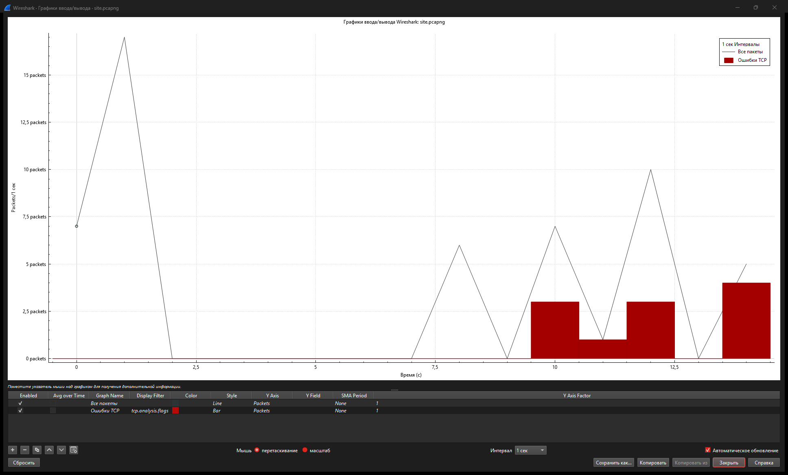
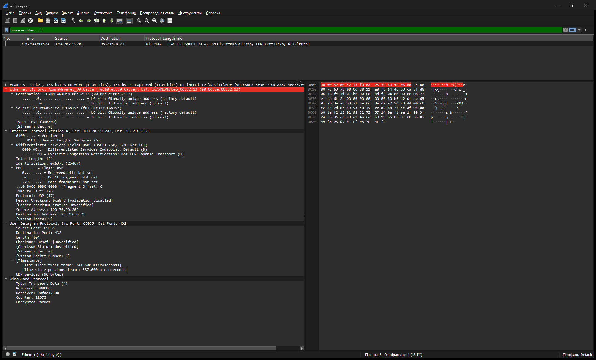
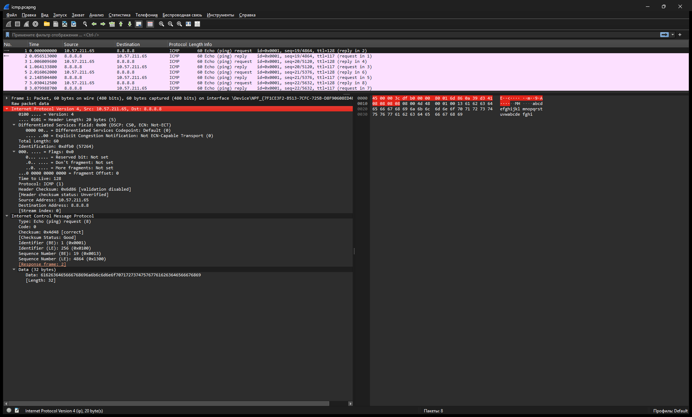
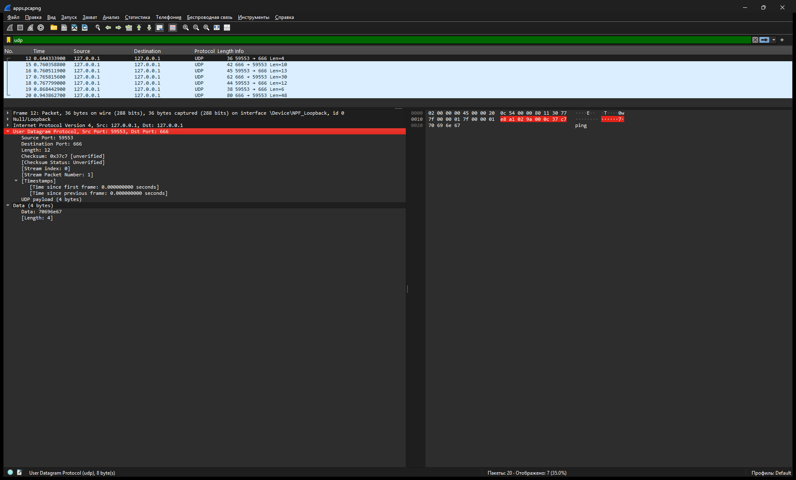
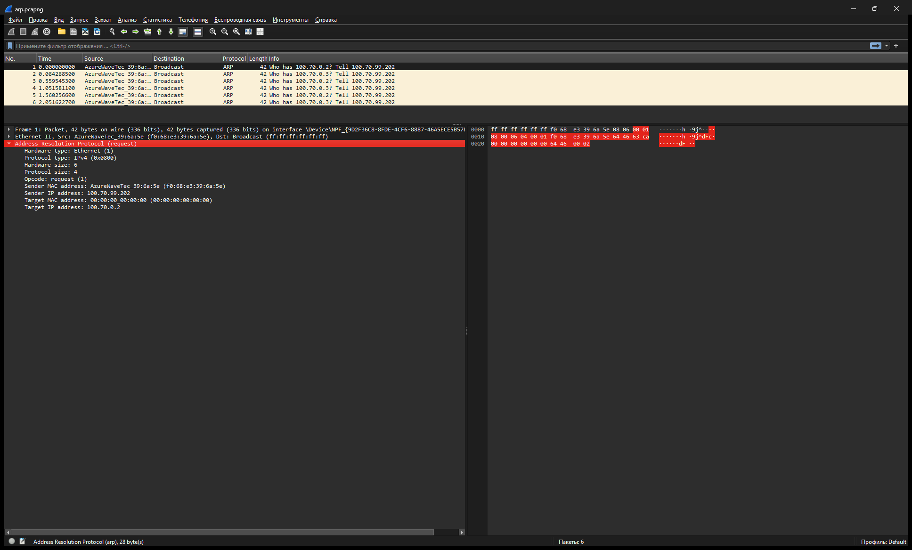

# Лабораторная работа №3

Туз Г.С., группа ИИ-27, вариант 11. Предмет «Аппаратное и программное обеспечение сетей».

Снимал на своём компьютере: AMD Ryzen 5 220, Windows 11, Wireshark 4.6, драйвер Npcap. Страница и ping шли через туннель hide.me. Кадр Ethernet и ARP брал с «Беспроводной сети»: 120 Мбит/с, адрес 100.70.99.202. Программы первой и второй работ гонял на 127.0.0.1, их пакеты лежат в loopback.

## Как устроен сниффер на этой машине

Wireshark читает кадры с того адаптера, который выбран в списке, и складывает их в pcapng. Дальше он сам раскладывает байты по заголовкам и считает скорости. У меня адаптеры отдают разный вид пакета:

- hide.me сразу даёт IPv4, строки Ethernet в дампе сайта и ping нет;
- «Беспроводная сеть» даёт Ethernet II, оттуда взяты MAC шлюза и ARP;
- Npcap Loopback пишет обмен программ на 127.0.0.1.

Зелёная строка под кнопками значит, что выражение фильтра принято. Числа для отчёта смотрел в меню «Статистика»: свойства файла, иерархия протоколов, график ввода-вывода.

## Чем режется запись и чем режется уже записанное

До старта захвата в поле BPF можно оставить только нужные кадры. Так я ограничил сайт выражением `host 93.125.24.147`, а ARP — выражением `arp`. Что не прошло, в файл не попадает, вернуть это потом нельзя.

После остановки та же запись открывается целиком, а строка над списком только прячет лишнее. Её менял сколько угодно раз: `ip`, `icmp`, `frame.number == 3`, `tcp`, `udp`. Для программ это порты `tcp.port == 8080` и `udp.port == 666`. Сам pcapng от этой строки не худеет.

## Загрузка https://bstu.by

Страница открывалась на 93.125.24.147, захват шёл 14,341 с на hide.me. Драйвер принял 53 пакета и не отбросил ни одного.

В свойствах файла: 3,7 кадра/с, 1688 байт/с, то есть 13,5 кбит/с. Самый короткий пакет 40 байт, средний 456,85, самый длинный 1392. Всего набежало 24213 байт. Проверка скорости: 1688 × 8 = 13504 бит/с.

Туннель не подкладывает Ethernet, поэтому иерархия начинается с IPv4. Все 53 пакета — IPv4 и одновременно TCP. У 16 из них Wireshark дописал TLS: это 30,2 % пакетов и 9153 байта, 37,8 % объёма. Остальные 37 — SYN, ACK и короткие служебные сегменты, записи TLS на них нет.

По длине картина такая. 29 пакетов (54,72 %) короче 80 байт: рукопожатие и подтверждения. Ещё 6 пакетов (11,32 %) лежат в 80–159. Два пакета (3,77 %) попали в 320–639, три (5,66 %) в 640–1279. Тринадцать пакетов (24,53 %) занимают 1280–2559 и на проводе имеют длину 1392: это куски страницы.

Беспроводной адаптер при этом работает на 120 Мбит/с. Доля этой загрузки:

(13504 / 120000000) × 100 % ≈ 0,011 %

Канал пустой. Текст страницы не читается: снаружи виден заголовок TCP, байты сайта закрыты TLS.

## Один кадр с адресами Ethernet и IP

Фильтр `ip` на файле сайта ничего не выкидывает: там и так 53 пакета IPv4. Доля TCP остаётся 100 % пакетов, у TLS по-прежнему 37,8 % байт. Минимум, среднее и максимум те же: 40, 456,85 и 1392 байта.

У этих 53 пакетов нет кадра Ethernet. Его я взял из `wifi.pcapng`, пакет №3. Это исходящий пакет того же компьютера на узел VPN 95.216.6.21. Кадр адресован шлюзу Wi-Fi, не самому VPN.

В Ethernet II получатель `00:00:5e:00:52:13` — MAC шлюза 100.70.0.1. Отправитель `f0:68:e3:39:6a:5e` — беспроводной адаптер. Поле Type равно `0x0800`, дальше лежит IPv4.

В заголовке IPv4 этого кадра: версия 4, длина заголовка 20 байт, опций нет. Total Length 124. Identification `0x637b` (25467). Flags `0x0`, бит DF снят, смещение фрагмента 0, это не фрагмент. TTL 128: Windows только что отдал пакет, маршрутизатор его ещё не уменьшал. Protocol 17, внутри UDP. Контрольная сумма заголовка `0xa8f8`. Источник 100.70.99.202, назначение 95.216.6.21.

Для сравнения первый пакет уже самой страницы, `site.pcapng` №1, — TCP SYN без Ethernet. Там источник 10.57.211.65, назначение 93.125.24.147, длина 52, идентификатор `0xeb72`, флаг DF стоит, TTL снова 128, протокол 6, контрольная сумма `0xbbc6`.

## Ping до 8.8.8.8

До шлюза 100.70.0.1 ping кончается общей ошибкой: ICMP в этот интерфейс не уходит. Поэтому четыре запроса ушли на 8.8.8.8 через hide.me, в списке оставлен фильтр `icmp`.

Пришли четыре ответа, потерь нет. По меткам времени задержки 57, 58, 132 и 50 мс. Кадра Ethernet на этом адаптере нет, уровней два: IPv4 и ICMP. Портов у ICMP нет. Запрос — type 8, code 0. Ответ — type 0, code 0.

Первый запрос: контрольная сумма `0x4d48`, identifier 1 (этот запуск ping), sequence 19. Windows не начинает нумерацию с нуля, а продолжает прошлую. Данных 32 байта, как у ping без ключа длины. TTL запроса 128, TTL ответа 117: на обратном пути маршрутизаторы уже уменьшили поле. Оба пакета по 60 байт: 20 байт IP, 8 байт ICMP и 32 байта данных. Размер ответа равен размеру запроса.

Дальше то же парами. Sequence 20, 21 и 22: запрос с 10.57.211.65 на 8.8.8.8 и ответ обратно, TTL запроса 128, TTL ответа 117. Узел ответил на все четыре.

## Сеанс save по TCP, порт 8080

Захват loopback без BPF. В списке оставлены пакеты `tcp.port == 8080`. Клиент 127.0.0.1:55512 открыл сервер первой работы на 127.0.0.1:8080. В файле 20 пакетов, к TCP относятся 13.

Открытие: пакет 1 SYN от 55512 к 8080, seq 0, ack 0, длина 0. Пакет 2 SYN+ACK обратно, seq 0, ack 1. Пакет 3 ACK, seq 1, ack 1. Соединение открыто.

Данные. Пакет 4, сервер, PSH+ACK, 17 байт: `Hello, Student!`. Пакет 6, клиент, PSH+ACK, 30 байт: команда `save note.txt`, строка `lab3 tcp` и маркер `#end##`. Пакет 8, сервер, PSH+ACK, 49 байт: `Файл создан: note.txt, размер 9`. Пакеты 5, 7 и 9 — пустые ACK на эти сегменты.

Закрытие без RST. Пакет 10 FIN+ACK от клиента, seq 31, ack 67. Пакет 11 ACK сервера, seq 67, ack 32. Пакет 13 FIN+ACK сервера, seq 67, ack 32. Пакет 14 ACK клиента, seq 32, ack 68.

SYN, пакет 1, разобран так. Порт источника 55512, порт назначения 8080. Sequence 0, сырое значение 1561402733. Acknowledgment 0: в SYN подтверждать нечего. Заголовок 32 байта, потому что есть опции. Флаги только SYN (`0x002`). Окно 65535. Контрольная сумма `0x0403`. Urgent pointer 0. Опции: MSS 65495, масштаб окна 8, SACK разрешён.

Ответ сервера, пакет 2: SYN+ACK, его номер 0 (сырое 3198328171), подтверждение 1, окно 65535. Подтверждение на единицу больше номера SYN, потому что сам флаг SYN занимает один номер.

Дальше по относительному счёту. Пакет 4: сервер шлёт приветствие, seq 1, ack 1, длина 17. Пакет 6: клиент шлёт save, seq 1, ack 18, длина 30. Пакет 8: сервер сообщает о файле, seq 18, ack 31, длина 49. Пакет 10: клиент закрывает, seq 31, ack 67. Пакет 13: сервер закрывает, seq 67, ack 32. Пакет 14: клиент подтверждает, seq 32, ack 68.

PSH просит отдать байты программе сразу, не копить. Seq и Ack сдвигаются на длину принятого. Поэтому в пакете 8 сервер подтверждает 31-й байт клиента: единица за SYN плюс 30 байт команды.

## Сеанс save по UDP, порт 666

Тот же loopback-файл, в строке `udp.port == 666`. Семь датаграмм. Клиент 127.0.0.1:59553, сервер второй работы на порту 666.

Пакет 12: клиент шлёт `ping`, кадр 36 байт, длина UDP 12. Пакет 15: сервер отвечает `Echo: ping`, кадр 42, UDP 18. Пакет 16: `save note.txt`, кадр 45, UDP 21. Пакет 17: `Приём файла note.txt`, кадр 62, UDP 38. Пакет 18: слово `строка`, кадр 44, UDP 20. Пакет 19: маркер `#end##`, кадр 38, UDP 14. Пакет 20: `Файл создан: note.txt, размер 13`, кадр 80, UDP 56.

Между `save` и маркером сервер молчит: строка файла отдельным ответом не подтверждается. Текст приходит только на `#end##`.

Пакет 12, заголовок UDP. Порт источника 59553, порт назначения 666. Length 12: 8 байт заголовка и 4 байта слова `ping`. Checksum `0x37c7`.

Рядом с TCP на том же сценарии save разница такая. TCP сначала три пакета открытия и в конце FIN с обеих сторон, UDP датаграмму шлёт сразу и отдельного закрытия нет. У TCP есть флаги SYN, ACK, PSH, FIN, номера Seq и Ack и окно 65535. У UDP этого нет, заголовок всегда 8 байт, а у SYN он был 32 из-за опций. На тот же save ушло 13 пакетов TCP и 7 датаграмм UDP.

UDP не нумерует байты и не подтверждает доставку. Строка «файл создан» — ответ программы, не свойство протокола.

## ARP: вопросы без ответа

Захват на «Беспроводной сети», в BPF только `arp`. Шлюз 100.70.0.1 к этому моменту уже был в кэше: `arp -a` показывал 100.70.0.1 → `00:00:5e:00:52:13`. Нового вопроса про него не было. Ушли вопросы про 100.70.0.2 и 100.70.0.3. Ответов нет, эти адреса кадр не вернули. Стереть запись шлюза без прав администратора не вышло, она осталась dynamic.

Пакет №1, opcode 1. Ethernet Destination `ff:ff:ff:ff:ff:ff`, Source `f0:68:e3:39:6a:5e`, Type `0x0806`. Sender MAC `f0:68:e3:39:6a:5e`, Sender IP 100.70.99.202, Target MAC `00:00:00:00:00:00`, Target IP 100.70.0.2. Кадр широковещательный: MAC ещё неизвестен, поэтому в Target MAC нули. Пакет №2 такой же, но спрашивает 100.70.0.3. Пакеты 3–6 повторяют эти два вопроса.

Ответ выглядел бы иначе: opcode 2, Ethernet Destination уже конкретный MAC спрашивающего, Target MAC заполнен, Sender MAC и Sender IP принадлежат тому, чей адрес спрашивали. Такого кадра в захвате нет.

Готовая пара шлюза при этом в кэше лежит. Ей же пользуется кадр из разбора IP: пакет на 95.216.6.21 ушёл именно на `00:00:5e:00:52:13`.

## Ответы на вопросы

Следить за трафиком нужно, чтобы понять, дошёл ли обмен, каким протоколом и с какой задержкой. Здесь так проверены страница bstu.by, четыре эха, оба сеанса `save` и вопросы ARP.

Съём и разбор — это мониторинг. Отбор по адресу, порту или протоколу — фильтрация. BPF отсекает кадры до записи. Строка над списком только скрывает уже записанное.

Сниффер забирает кадры с адаптера и показывает байты. Без него от `save` остаётся текст в окне клиента, а флаги TCP, порты и ARP не видны.

В этой работе пригодились запись в pcapng, разбор заголовков, обе строки фильтра, свойства файла, иерархия протоколов и график ввода-вывода.

`host 93.125.24.147` и `arp` уменьшили файл, но отброшенное пропало. `icmp`, `tcp` и `udp` тот же файл не трогают: меняется только видимый список.

Из статистики взяты число пакетов, длительность, байт/с, минимум, среднее, максимум, доли протоколов, гистограмма длин и график.

ARP по IPv4 своей подсети узнаёт MAC. Вопрос идёт на `ff:ff:ff:ff:ff:ff`, в Target MAC нули. Ответ приносит MAC владельца. Пока пара в кэше, вопрос не повторяют: шлюз `100.70.0.1` уже был `00:00:5e:00:52:13`, поэтому в дампе только `.2` и `.3`.
