
Министерство образования Республики Беларусь

Учреждение образования

“Брестский Государственный технический университет”

Кафедра ИИТ

       

Лабораторная работа №3

По дисциплине “Аппаратное и Программное обеспечение сетей”

Тема: “АНАЛИЗ СЕТЕВОГО ТРАФИКА И ПРОТОКОЛОВ НА БАЗЕ WIRESHARK”

     

Выполнил:

Студент 3 курса

Группы ИИ-27

Юшкевич А.Ю.

Проверила:

Кулик А.Д.

     

Брест 2026

# Цель
Изучить краткие теоретические сведения по возможностям, приемам работы с программой Wireshark(файл netWS.pdf). Изучить:типы фильтрации трафика, правила построения фильтров, приемы статистическойобработкисетевого трафикав Wireshark

# Задание на выполнение

1. Запустив Wiresharkна захват, выполнить загрузку доступной в лабораторных условиях страницы (bstu.by, iit.bstu.byили др.). Остановить и сохранить захват. Для захваченных пакетов определить статистические данные:процентное соотношение трафика разных протоколов в сети;среднюю скорость кадров/сек;среднюю скорость байт/сек;минимальный, максимальный и средний размеры пакета;
2. Отфильтровать в захвате IPпакеты.Определить статистические данные:процентное соотношение трафика разных протоколов стека tcp/ipв сети;средний, минимальный, максимальный размеры пакета.На примере любого IP-пакета указать структуры протоколов Ethernet и IP. Отметить поля заголовков и описать ихи интерпретировать их значения.
3. Запустив Wireshark на захват, выполнить разработанный в предыдущей лабораторнойработе TCP-сервер и TCP-клиент.Сохранить результат. Сформировав нужный фильтр, отфильтровать пакетыданного сеанса.На примере любого TCP-сегментауказать структуру протоколаTCP. Отметить поля заголовка,описать их и интерпретировать их значения.Составить диаграмму взаимодействия TCP-сервераи TCP-клиента.
4. Запустив Wireshark на захват, выполнить разработанный в предыдущей лабораторнойработе UDP-сервер и UDP-клиент.Сохранить результат. Сформировав нужный фильтр, отфильтровать пакеты данного сеанса.На примере любого UDP-сегментауказать структуру протоколаUDP. Отметить поля заголовка,описать их и интерпретировать их значения.
5. Выполнить анализ ARP-протокола по примеру из методических указаний.

# Ход работы

## 1. Запуск и статистические данные для пакетов

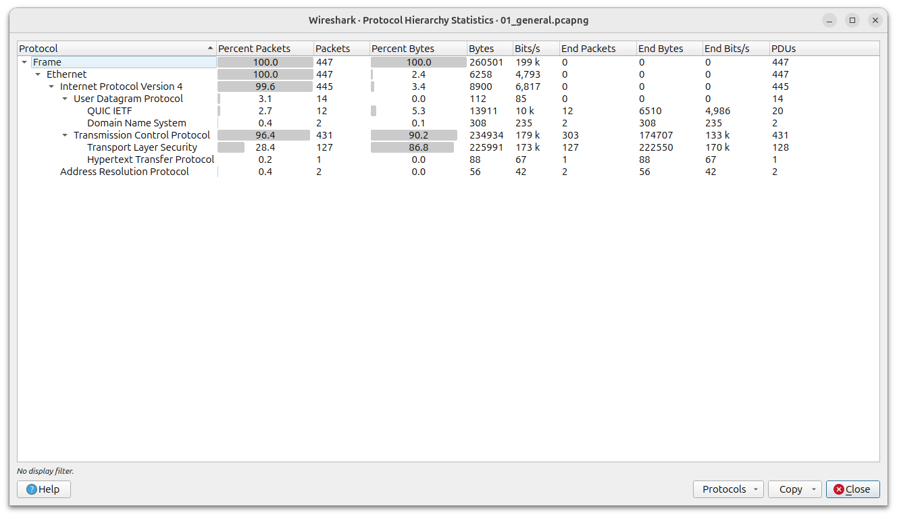

### Распределение процентного соотношения трафика разных протоколов в сети

* **TCP (96.4%)** - почти все пакеты в сети относятся к TCP-соединениям.
* **UDP (3.1%)** - незначительное количество пакетов.
* **ARP (0.4%)** - минимальное количество служебных пакетов.

### Средние скорости и средний размер пакета

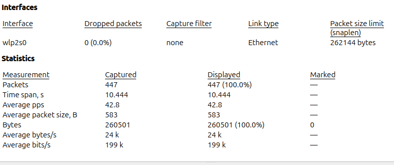

* **Average pps (42.8)** - означает, что за каждую секунду захвата сетевого интерфейса передавалось 42.8 пакета.
* **Average  bytes/s (24)** - означает, что пропускная способность канала во время записи трафика составляла 24 килобайта в секунду.
* **Average packet size (583)** - означает, что средний пакет в этом захвате весит 583 байта.

### Минимальные и максимальные размеры пакетов

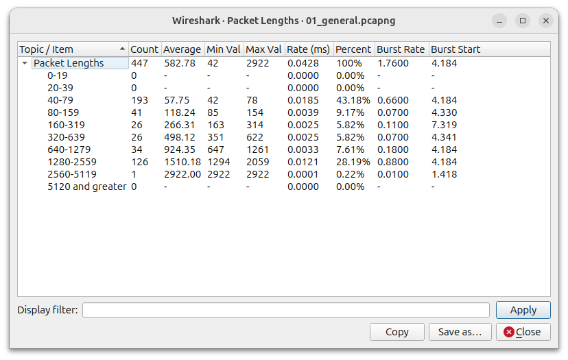

* **Min val (42)** - означает, что минимальный размер пакета в этмо захвате весит 42 байта.
* **Max val (2922)** - означает, что максимальный размер пакета в этмо захвате весит 2922 байта.

## 2. Фильтрация IP пакетов

### Процентное соотношение трафика разных протоколов стека tcp/ip в сети

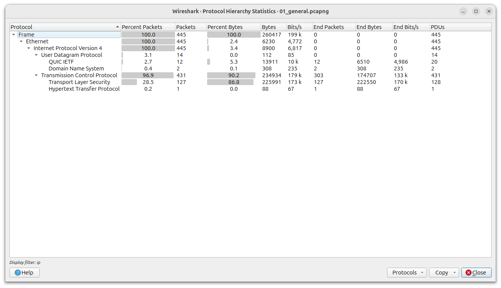

* **TCP (96.9%)** - почти все пакеты в сети относятся к TCP-соединениям.
* **UDP (3.1%)** - незначительное количество пакетов.
* **ARP (0.2%)** - минимальное количество служебных пакетов.

### Cредний, минимальный, максимальный размеры пакета

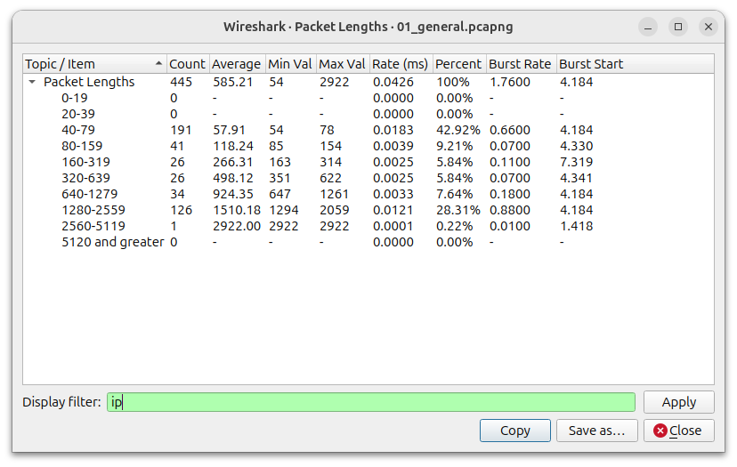

* **Average (585)** - означает, что средний пакет в этом захвате весит 585 байта.
* **Min val (54)** - означает, что минимальный размер пакета в этмо захвате весит 54 байта.
* **Max val (2922)** - означает, что максимальный размер пакета в этмо захвате весит 2922 байта.

### Структура протоколов Ethernet

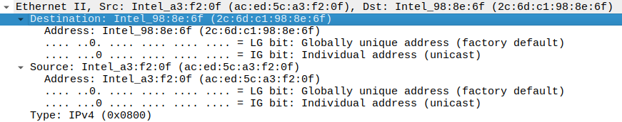

* **Destination ** - данное поле показывает МАС-адресс назначения.
* **Source ** - данное поле показывает МАС-адрес источника.
* **Type ** - тип протокола.

### Структура протокола IP

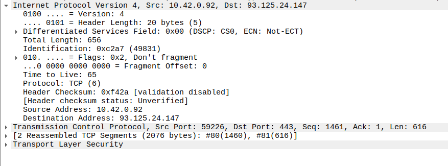

* **Version (4)** - версия протокола.
* **Header Length (20 байт)** - длина заголовка. 
* **Total Length (656 байт)** - общая длина пакета. 
* **Identification ** - идентификатор пакета, используется при сборке фрагментов.
* **Flags ** - указывают, есть ли ещё фрагменты и можно ли фрагментировать.
* **Time to Live (65)** - время жизник пакета, каждый маршрутизатор уменьшает его на 1.
* **Protocol (6)** - протокол, например, 6 для TCP, 17 для UDP, 1 для ICMP.
* **Source Address ** - IP-адрес источника. 
* **Destination Address ** - IP-адрес назначения.

## 3. Фильтрация TCP пакетов

### Структура протокола TCP

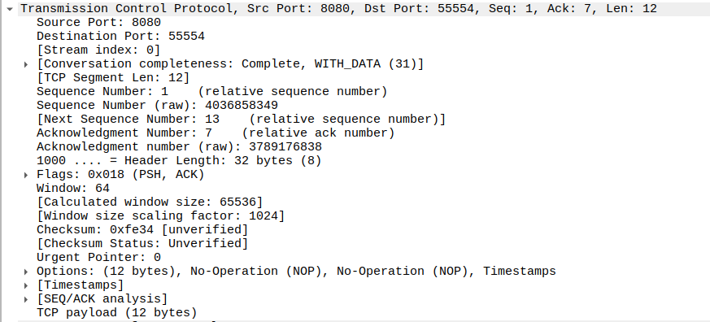

* **Source Port (8080)** - порт источника (сервера).
* **Destination Port (55554)** - порт назначения (клиента).
* **Sequence Number (1)** - номер последовательности, указывает на позицию первого байта данных в этом сегменте.
* **Acknowledgment Number (7)** - номер подтверждения, показывает, что сервер успешно получил данные от клиента.
* **Header Length (32 байта)** - длина заголовка TCP.
* **Flags (0x018: PSH, ACK)** - флаги управления: ACK подтверждает получение предыдущих данных, PSH требует немедленно передать данные приложению без буферизации.
* **Window (64)** - объем данных, который отправитель готов принять.
* **Checksum (0xe34)** - контрольная сумма для проверки целостности заголовка и данных.
* **Urgent Pointer (0)** - указатель на срочные данные (срочных данных нет).
* **TCP payload (12 байт)** - размер полезной нагрузки (сами переданные данные).

## 4. Фильтрация UDP пакетов

### Структура протокола UDP

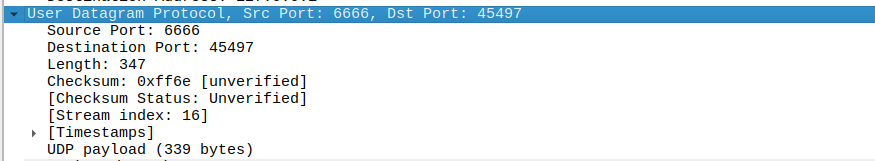

* **Source Port (6666)** - порт источника.
* **Destination Port (45497)** - порт назначения.
* **Length (347)** - длина UDP-заголовка и данных.
* **Checksum (0xff6e)** - контрольная сумма.
* **UDP payload (339 байт)** - размер переданных данных.

## Анализ ARP-запроса

### Структура ARP

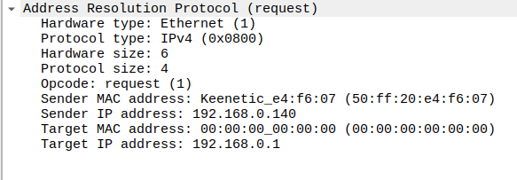

IP-адрес получателя, при этом поле МАС-адреса пустое.

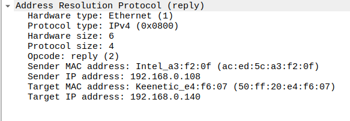

IP-адерс получателя, при этом заполнено целевое поле МАС-адреса получателя. МАС и IP адреса исходного оптравителя также указаны.