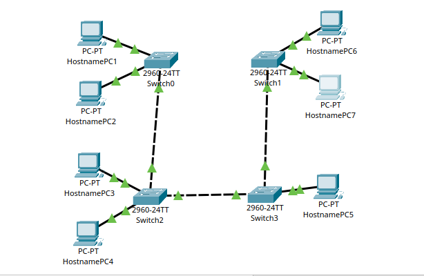
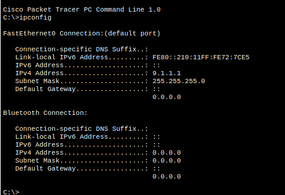
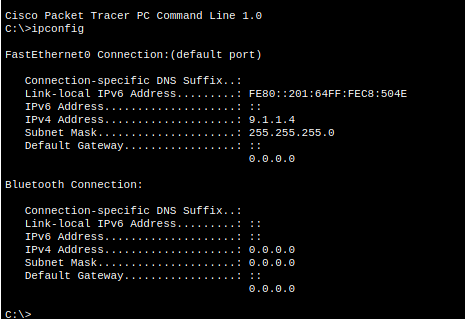
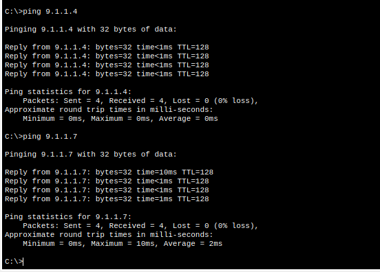
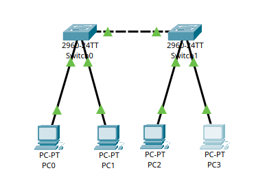
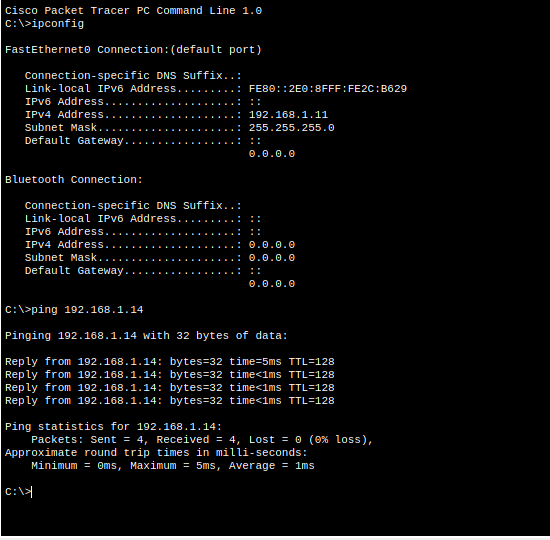

Учреждение образования

“Брестский Государственный технический университет”

Кафедра ИИТ

       

Лабораторная работа №4

По дисциплине “Аппаратное и Программное обеспечение сетей”

Тема: “ИЗУЧЕНИЕ ПАКЕТА CISCO PACKET TRACER. НАЧАЛЬНАЯ КОНФИГУРАЦИЯ МАРШРУТИЗАТОРА CISCO”

Вариант: 9

     

Выполнил:

Студент 3 курса

Группы ИИ-27

Юшкевич А.Ю.

Проверила:

Кулик А.Д.

     

Брест 2026

---

# Цель

Изучить интерфейс эмулятора Cisco Packet Tracer, научиться добавлять и соединять сетевые устройства, настраивать IP-адресацию на ПК, проверять связность командой ping, а также изучить начальную конфигурацию маршрутизатора Cisco и принципы работы таблицы маршрутизации.

# Ход работы

## Часть 1

### Проверка сетевой конфигурации (ipconfig)

### Проверки работоспособности сети (ping)

#### ipconfig показывает текущую сетевую конфигурацию узла:

* **IP Address** - адрес ПК в сети

* **Subnet Mask** - маска подсети

* **Default Gateway** - адрес шлюза

#### ping проверяет доступность узла и качество связи:

* **Reply from …** - узел отвечает, связь есть;

* **bytes/time/TTL** - размер ответа, время отклика и число маршрутов;

* **Packets: Sent/Received/Lost и Loss** - сколько пакетов отправлено, получено и потеряно;

* **Minimum/Maximum/Average** - минимальное, максимальное и среднее время отклика.

## Часть 2

### Таблица сетевых адресов

| Устройство | IP Adress | Subnet Mask |
| --- | --- | --- |
| PC0 | 192.168.1.11 | 255.255.255.0 |
| PC1 | 192.168.1.12 | 255.255.255.0 |
| PC2 | 192.168.1.13 | 255.255.255.0 |
| PC3 | 192.168.1.14 | 255.255.255.0 |

### Проверки сети

# Выводы

В ходе выполнения лабораторной работы я изучил основыне возможности Cisco Packet Tracer, получил практические навыки построения и настройки локальной сети.