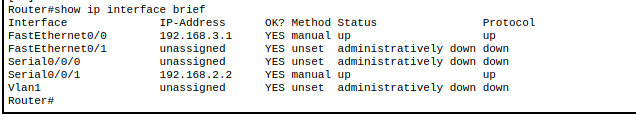
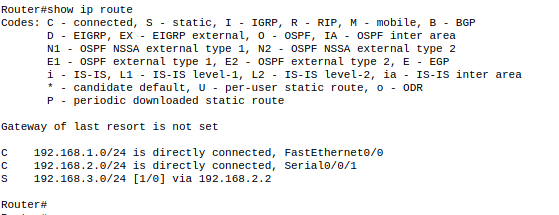
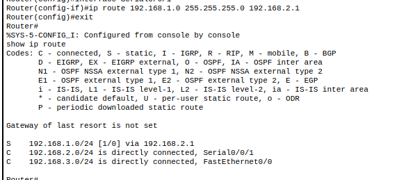
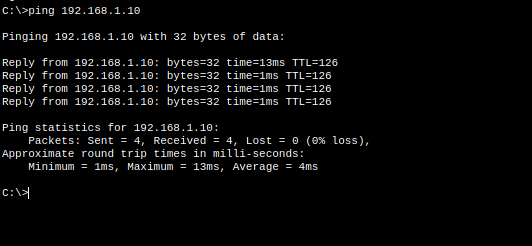
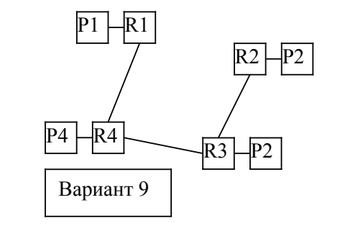
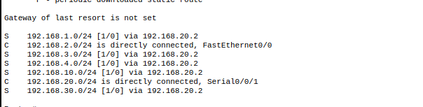
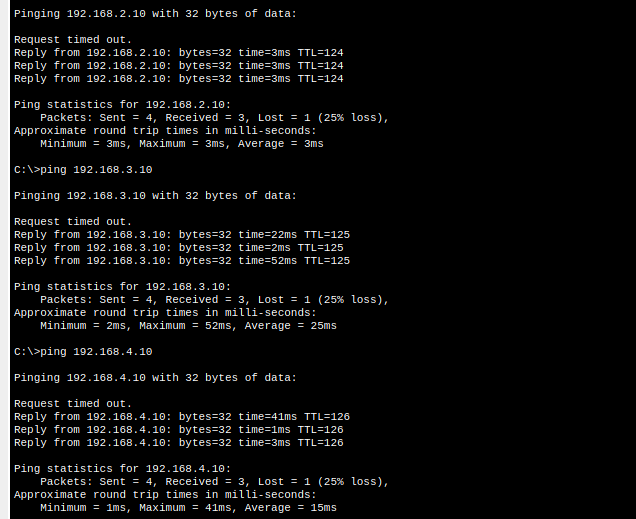
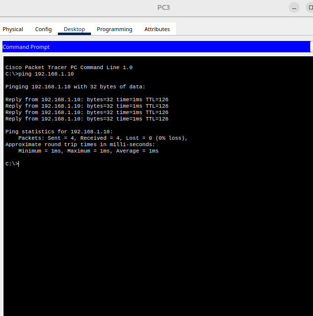

<p align="center">Министерство образования Республики Беларусь</p>
<p align="center">Учреждение образования</p>
<p align="center">“Брестский Государственный технический университет”</p>
<p align="center">Кафедра ИИТ</p>
<br><br><br><br><br><br><br>
<p align="center">Лабораторная работа №5</p>
<p align="center">По дисциплине “Аппаратное и Программное обеспечение сетей”</p>
<p align="center">Тема: “НАСТРОЙКА СТАТИЧЕСКОЙ МАРШРУТИЗАЦИИ НА УСТРОЙСТВАХ CISCO.”</p>
<p align="center">Вариант: 9</p>
<br><br><br><br><br>
<p align="right">Выполнил:</p>
<p align="right">Студент 3 курса</p>
<p align="right">Группы ИИ-27</p>
<p align="right">Юшкевич А.Ю.</p>
<p align="right">Проверил:</p>
<p align="right">Кулик А.Д.</p>
<br><br><br><br><br>
<p align="center">Брест 2026</p>

---

# Цель

Изучить интерфейс эмулятора Cisco Packet Tracer, научиться добавлять и соединять сетевые устройства, настраивать IP-адресацию на ПК, проверять связность командой ping, а также изучить начальную конфигурацию маршрутизатора Cisco и принципы работы таблицы маршрутизации.

# Ход работы

# Ознакомительная часть

Для данной топологии:


Имеем следующую таблицу адресов: 

| Device | Interface | IPAddress | Mask | DefaultGateway |
| --- | --- | --- | --- | --- |
| R1 | Fa0/0 | 192.168.1.1 | 255.255.255.0 | N/A | 
| --- | S0/1/| 192.168.2.1 | 255.255.255.0 | N/A |
| R2 | Fa0/0 | 192.168.3.1 | 255.255.255.0 | N/A |
| --- | S0/1/0 | 192.168.2.2 | 255.255.255.0 | N/A | 
| PC1 | N/A | 192.168.1.10 | 255.255.255.0 | 192.168.1.1 |
| PC2 | N/A | 192.168.3.10 | 255.255.255.0 | 192.168.3.1 |

Используя статическую маршрутизацию, обеспечим взаимодействие конечных устройств(PC1 и PC2). С помощью команды show и утилиты ping удостоверимся возможность взаимодействия конечных устройств обеспечена.

## Настроим конфигурации и активность интерфейсов маршрутизатора при помощи команды:
```no shutdown```

Перед настройкой статической маршрутизации проверяем, что на маршрутизаторах корректно заданы IP-адреса и активны нужные интерфейсы.

На R1 и R2 в привилегированном режиме выполняем:
```cisco
enable
show ip interface brief
```
Проверяем, что интерфейсы FastEthernet0/0 и Serial0/1/0 имеют статус up/up (или up/down на serial-стороне DTE до поднятия второй стороны). Если интерфейс находится в состоянии administratively down, его нужно поднять командой no shutdown.




## Настроим статическую маршрутизацию и проверим информацию в таблице маршрутизации




### Проверим корректуню работу сети




# 1. Индивидуальная работа

Топология представляет собой цепочку из четырёх маршрутизаторов R0 – R3 – R2 – R1, к каждому из которых подключён персональный компьютер (PC0, PC3, PC2, PC1 соответственно). Маршрутизаторы соединены последовательными (serial) линками. Задача — обеспечить связность между всеми ПК через статическую маршрутизацию.

Топология по варианту 9:



Реализуем в Cisco Packet Tracer


## Настроим статическую маршрутизацию

Для удобства составим вспомагательную таблицу

| Device | Interface | IP Address | Mask | Default Gateway |
| --- | --- | --- | --- | --- |
| PC0 | Fa0 | 192.168.1.10 | 255.255.255.0 | 192.168.1.1 |
| PC1 | Fa0 | 192.168.2.10 | 255.255.255.0 | 192.168.2.1 |
| PC2 | Fa0 | 192.168.3.10 | 255.255.255.0 | 192.168.3.1 |
| PC3 | Fa0 | 192.168.4.10 | 255.255.255.0 | 192.168.4.1 |
|    |    |    |    |    |
| Router0 | Fa0/0 (к PC0) | 192.168.1.1 | 255.255.255.0 | N/A |
| Router0 | Se0/0/1 (к R3) | 192.168.10.1 | 255.255.255.0 | N/A |
|    |    |    |    |    |
| Router1 | Fa0/0 (к PC1) | 192.168.2.1 | 255.255.255.0 | N/A |
| Router1 | Se0/0/1 (к R2) | 192.168.20.1 | 255.255.255.0| N/A |
|    |    |    |    |    |
| Router2 | Fa0/0 (к PC2) | 192.168.3.1 | 255.255.255.0 | N/A |
| Router2 | Se0/0/0 (к R3) | 192.168.30.1 | 255.255.255.0 | N/A |
| Router2 | Se0/0/1 (к R1) | 192.168.20.2 | 255.255.255.0 | N/A |
|    |    |    |    |    |      
| Router3 | Fa0/0 (к PC3) | 192.168.4.1 | 255.255.255.0 | N/A |
| Router3 | Se0/0/1 (к R0) | 192.168.10.2 | 255.255.255.0 | N/A |
| Router3 | Se0/0/0 (к R2) | 192.168.30.2 | 255.255.255.0 | N/A |

### Для роутера 0


### Для роутера 3


### Для роутера 2


### Для роутера 1



### Проверим корректуню работу сети (от ПК0)

При корректной настройке первый пакет может быть потерян (Request timed out) из-за ARP-запроса, далее идут ответы Reply from .... Если ping проходит между всеми парами ПК, значит статическая маршрутизация настроена правильно.



#### от ПК3



# Выводы

В ходе выполнения данной лабораторной работы я изучил построение статической маршрутизации в Cisco Packet Tracer, настройку статической маршрутизации на устройствах Cisco, распределение IP-адресов и проверку связности сети с помощью утилиты ping и команд show.

В ознакомительной части была настроена связность двух ПК через два маршрутизатора: на каждом роутере добавлен один статический маршрут к удалённой LAN.

В индивидуальной части (вариант 9) была реализована цепочка из четырёх маршрутизаторов с четырьмя ПК. Для обеспечения полной связности между всеми ПК на каждом роутере настроены статические маршруты ко всем удалённым сетям. Всего настроено:

    R0 — 5 маршрутов;

    R3 — 4 маршрута;

    R2 — 4 маршрута;

    R1 — 5 маршрутов.

Проверка с помощью ping со стороны PC0 и PC3 подтвердила, что все конечные устройства взаимодействуют друг с другом. Команда show ip route показала наличие как подключённых (C), так и статических (S) маршрутов, что соответствует поставленной задаче