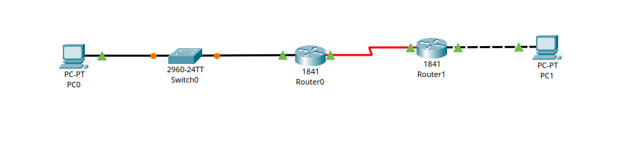
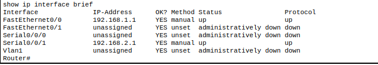
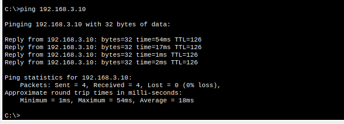
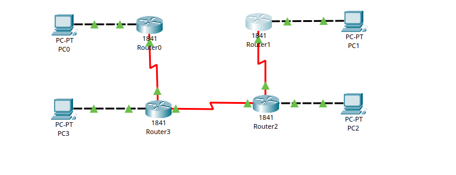
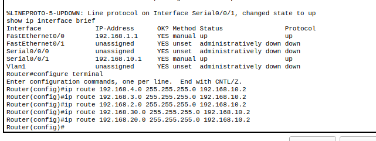
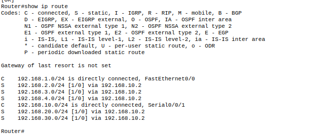
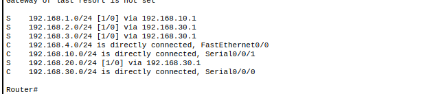
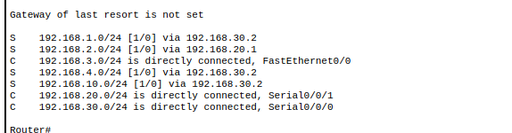

<p align="center">Министерство образования Республики Беларусь</p>
<p align="center">Учреждение образования</p>
<p align="center">“Брестский Государственный технический университет”</p>
<p align="center">Кафедра ИИТ</p>
<br><br><br><br><br><br><br>
<p align="center">Лабораторная работа №5</p>
<p align="center">По дисциплине “Аппаратное и Программное обеспечение сетей”</p>
<p align="center">Тема: “НАСТРОЙКА СТАТИЧЕСКОЙ МАРШРУТИЗАЦИИ НА УСТРОЙСТВАХ CISCO.”</p>
<p align="center">Вариант: 9</p>
<br><br><br><br><br>
<p align="right">Выполнил:</p>
<p align="right">Студент 3 курса</p>
<p align="right">Группы ИИ-27</p>
<p align="right">Юшкевич А.Ю.</p>
<p align="right">Проверила:</p>
<p align="right">Кулик А.Д.</p>
<br><br><br><br><br>
<p align="center">Брест 2026</p>

---

# Цель

Изучить интерфейс эмулятора Cisco Packet Tracer, научиться добавлять и соединять сетевые устройства, настраивать IP-адресацию на ПК, проверять связность командой ping, а также изучить начальную конфигурацию маршрутизатора Cisco и принципы работы таблицы маршрутизации.

# Ход работы

**1.** Загрузив lab5-a.pdf, изучить материал; выполнить этапы настройки статическоймаршрутизации на устройствах Cisco, изложенные в документе. По требованиюпреподавателя продемонстрировать правильность настройки.

**2.** Собрать схему сети согласно выданному варианту задания; распределить IP-адресапо аналогии с примером в lab5-a.pdf; составить таблицу сетевых адресов;сконфигурировать устройства.

**3.** Для собранной схемы сети выполнить настройку статической маршрутизации.В отчете привести:- схему сети с IP-адресами - таблицу IP-адресов- ход настройки статической маршрутизации по методике, приведенной в lab5-а.pdf- ход и результаты проверки и тестирования сети по методике, приведенной в lab5-а.pdf

**4.** По требованию преподавателя продемонстрировать правильность настройки.

**5.** Подготовиться к защите работы.

# Ознакомительная часть

Для данной топологии:



Имеем следующую таблицу адресов: 

| Device | Interface | IPAddress | Mask | DefaultGateway |
| --- | --- | --- | --- | --- |
| R1 | Fa0/0 | 192.168.1.1 | 255.255.255.0 | N/A | 
| --- | S0/1/| 192.168.2.1 | 255.255.255.0 | N/A |
| R2 | Fa0/0 | 192.168.3.1 | 255.255.255.0 | N/A |
| --- | S0/1/0 | 192.168.2.2 | 255.255.255.0 | N/A | 
| PC1 | N/A | 192.168.1.10 | 255.255.255.0 | 192.168.1.1 |
| PC2 | N/A | 192.168.3.10 | 255.255.255.0 | 192.168.3.1 |

Используя статическую маршрутизацию, обеспечим взаимодействие конечных устройств(PC1 и PC2). С помощью команды show и утилиты ping удостоверимся возможность взаимодействия конечных устройств обеспечена.

## Настроим конфигурации и активность интерфейсов маршрутизатора при помощи команды:
```no shutdown```

Перед настройкой статической маршрутизации проверяем, что на маршрутизаторах корректно заданы IP-адреса и активны нужные интерфейсы.

На R1 и R2 в привилегированном режиме выполняем:
```cisco
enable
show ip interface brief
```
Проверяем, что интерфейсы FastEthernet0/0 и Serial0/1/0 имеют статус up/up (или up/down на serial-стороне DTE до поднятия второй стороны). Если интерфейс находится в состоянии administratively down, его нужно поднять командой no shutdown.




## Настроим статическую маршрутизацию и проверим информацию в таблице маршрутизации


### Проверим корректуню работу сети




# 1. Индивидуальная работа

Топология представляет собой цепочку из четырёх маршрутизаторов R0 – R3 – R2 – R1, к каждому из которых подключён персональный компьютер (PC0, PC3, PC2, PC1 соответственно). Маршрутизаторы соединены последовательными (serial) линками. Задача — обеспечить связность между всеми ПК через статическую маршрутизацию.

Топология по варианту 9:


Реализуем в Cisco Packet Tracer



## Настроим статическую маршрутизацию

Для удобства составим вспомагательную таблицу

| Device | Interface | IP Address | Mask | Default Gateway |
| --- | --- | --- | --- | --- |
| PC0 | Fa0 | 192.168.1.10 | 255.255.255.0 | 192.168.1.1 |
| PC1 | Fa0 | 192.168.2.10 | 255.255.255.0 | 192.168.2.1 |
| PC2 | Fa0 | 192.168.3.10 | 255.255.255.0 | 192.168.3.1 |
| PC3 | Fa0 | 192.168.4.10 | 255.255.255.0 | 192.168.4.1 |
|    |    |    |    |    |
| Router0 | Fa0/0 (к PC0) | 192.168.1.1 | 255.255.255.0 | N/A |
| Router0 | Se0/0/1 (к R3) | 192.168.10.1 | 255.255.255.0 | N/A |
|    |    |    |    |    |
| Router1 | Fa0/0 (к PC1) | 192.168.2.1 | 255.255.255.0 | N/A |
| Router1 | Se0/0/1 (к R2) | 192.168.20.1 | 255.255.255.0| N/A |
|    |    |    |    |    |
| Router2 | Fa0/0 (к PC2) | 192.168.3.1 | 255.255.255.0 | N/A |
| Router2 | Se0/0/0 (к R3) | 192.168.30.1 | 255.255.255.0 | N/A |
| Router2 | Se0/0/1 (к R1) | 192.168.20.2 | 255.255.255.0 | N/A |
|    |    |    |    |    |      
| Router3 | Fa0/0 (к PC3) | 192.168.4.1 | 255.255.255.0 | N/A |
| Router3 | Se0/0/1 (к R0) | 192.168.10.2 | 255.255.255.0 | N/A |
| Router3 | Se0/0/0 (к R2) | 192.168.30.2 | 255.255.255.0 | N/A |


После настройки интерфейсов и статических маршрутов на каждом из четырёх маршрутизаторов командой `show ip route` убеждаемся, что в таблице присутствуют как подключённые сети (`C`), так и статические маршруты (`S`) ко всем удалённым подсетям. Ниже приведены ожидаемые таблицы для R0, R3, R2 и R1.
На каждом роутере командой show ip route убеждаемся, что появились статические маршруты (обозначены S) ко всем удалённым сетям, а также сохранены подключённые сети (C). Например:

### Для роутера 0

На R0 напрямую подключены только две сети — `192.168.1.0/24` (Fa0/0, LAN с PC0) и `192.168.10.0/24` (Se0/0/1, линк до R3). Все остальные сети доступны через единственный выход — интерфейс R3 с адресом `192.168.10.2`. Поэтому в таблице должно быть **пять статических маршрутов** с одинаковым next-hop `192.168.10.2`.

```text
R0# show ip route
Codes: C - connected, S - static, ...

Gateway of last resort is not set

C    192.168.1.0/24 is directly connected, FastEthernet0/0
C    192.168.10.0/24 is directly connected, Serial0/0/1
S    192.168.4.0/24 [1/0] via 192.168.10.2
S    192.168.30.0/24 [1/0] via 192.168.10.2
S    192.168.3.0/24 [1/0] via 192.168.10.2
S    192.168.20.0/24 [1/0] via 192.168.10.2
S    192.168.2.0/24 [1/0] via 192.168.10.2
```

Наблюдение: у всех пяти S-маршрутов одинаковый next-hop — это логично для концевого роутера с одним аплинком; при добавлении второго провайдера такая схема потребовала бы переработки.




### Для роутера 3

R3 — центральный роутер цепочки, у него три подключённые сети: 192.168.4.0/24 (Fa0/0, LAN с PC3), 192.168.10.0/24 (Se0/0/1, к R0) и 192.168.30.0/24 (Se0/0/0, к R2). Сеть PC0 (192.168.1.0/24) доступна только через R0 (192.168.10.1), а все сети за R2 — через 192.168.30.1. В таблице должно быть четыре статических маршрута с двумя разными next-hop.
```text

R3# show ip route
Gateway of last resort is not set

C    192.168.4.0/24 is directly connected, FastEthernet0/0
C    192.168.10.0/24 is directly connected, Serial0/0/1
C    192.168.30.0/24 is directly connected, Serial0/0/0
S    192.168.1.0/24 [1/0] via 192.168.10.1
S    192.168.3.0/24 [1/0] via 192.168.30.1
S    192.168.20.0/24 [1/0] via 192.168.30.1
S    192.168.2.0/24 [1/0] via 192.168.30.1
```

Наблюдение: именно на R3 появляется разветвление next-hop — маршрут к 192.168.1.0/24 идёт «влево» (к R0), а все остальные — «вправо» (к R2). Это наглядно показывает, что next-hop выбирается по топологии, а не по принципу «все через один интерфейс».



### Для роутера 2

У R2 три подключённые сети: 192.168.3.0/24 (Fa0/0, LAN с PC2), 192.168.30.0/24 (Se0/0/0, к R3) и 192.168.20.0/24 (Se0/0/1, к R1). Сети PC0, PC3 и линк R0–R3 доступны через R3 (192.168.30.2), а сеть PC1 — через R1 (192.168.20.1). В таблице — четыре статических маршрута.
```text

R2# show ip route
Gateway of last resort is not set

C    192.168.3.0/24 is directly connected, FastEthernet0/0
C    192.168.30.0/24 is directly connected, Serial0/0/0
C    192.168.20.0/24 is directly connected, Serial0/0/1
S    192.168.4.0/24 [1/0] via 192.168.30.2
S    192.168.1.0/24 [1/0] via 192.168.30.2
S    192.168.10.0/24 [1/0] via 192.168.30.2
S    192.168.2.0/24 [1/0] via 192.168.20.1
```

Наблюдение: обратите внимание, что маршрут к 192.168.20.0/24 на R2 не появляется как S — эта сеть подключена напрямую (C). Именно поэтому в команде ip route на R2 не было строки для 192.168.20.0/24: прописывать статический маршрут к directly connected сети бессмысленно и даже вредно, так как он будет проигнорирован или создаст конфликт с connected-записью.



### Для роутера 1

R1 — второй концевой роутер, у него две подключённые сети: 192.168.2.0/24 (Fa0/0, LAN с PC1) и 192.168.20.0/24 (Se0/0/1, к R2). Все удалённые сети доступны через R2 (192.168.20.2). В таблице — пять статических маршрутов, как и на R0 (симметричная ситуация).
```text

R1# show ip route
Gateway of last resort is not set

C    192.168.2.0/24 is directly connected, FastEthernet0/0
C    192.168.20.0/24 is directly connected, Serial0/0/1
S    192.168.3.0/24 [1/0] via 192.168.20.2
S    192.168.30.0/24 [1/0] via 192.168.20.2
S    192.168.4.0/24 [1/0] via 192.168.20.2
S    192.168.10.0/24 [1/0] via 192.168.20.2
S    192.168.1.0/24 [1/0] via 192.168.20.2
```

Наблюдение: таблица R1 — «зеркальная» копия таблицы R0 с точностью до подсетей: два концевых роутера, по два connected-интерфейса и по пять статических маршрутов с одним next-hop. Это подтверждает, что схема адресации и маршрутизации построена симметрично, а значит, путь PC0 → PC3 и путь PC3 → PC0 проходят через одни и те же устройства в обратном порядке.


### Убедимся, что пакеты доходят от PC0 до PC3 и обратно, и посмотрим, на каком хопе может возникнуть обрыв. (от ПК0)

При корректной настройке первый пакет может быть потерян (Request timed out) из-за ARP-запроса, далее идут ответы Reply from .... Если ping проходит между всеми парами ПК, значит статическая маршрутизация настроена правильно.

Первый ping с PC0 до PC3 завершился Request timed out — это ожидаемо, так как коммутатор ещё не знал MAC-адрес шлюза и выполнял ARP-запрос. Со второго пакета пошли ответы Reply from 192.168.4.10 ... TTL=125. Значение TTL=125 объясняется тем, что пакет прошёл через 3 маршрутизатора (начальный TTL 128 минус 3 хопа).


#### от ПК3


# Выводы

Работа позволила на практике разобрать, как маршрутизатор принимает решение о пересылке пакета при наличии только подключённых сетей и как статические записи дополняют таблицу маршрутизации. Построение статической маршрутизации в Cisco Packet Tracer, настройку статической маршрутизации на устройствах Cisco, распределение IP-адресов и проверку связности сети с помощью утилиты ping и команд show.

В ознакомительной части была настроена связность двух ПК через два маршрутизатора: на каждом роутере добавлен один статический маршрут к удалённой LAN.

В индивидуальной части (вариант 9) была реализована цепочка из четырёх маршрутизаторов с четырьмя ПК. Для обеспечения полной связности между всеми ПК на каждом роутере настроены статические маршруты ко всем удалённым сетям. Всего настроено:

    R0 — 5 маршрутов;

    R3 — 4 маршрута;

    R2 — 4 маршрута;

    R1 — 5 маршрутов.

Проверка с помощью ping со стороны PC0 и PC3 подтвердила, что все конечные устройства взаимодействуют друг с другом. Команда show ip route показала наличие как подключённых (C), так и статических (S) маршрутов, что соответствует поставленной задаче