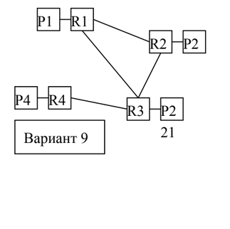
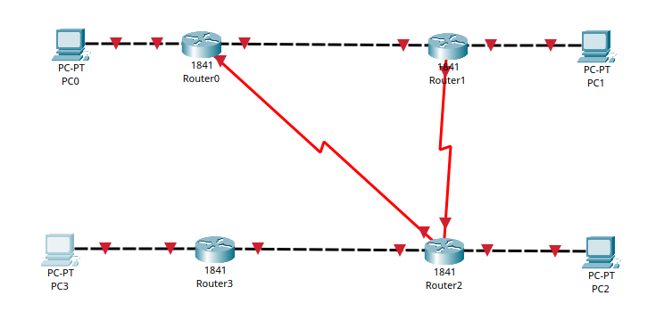
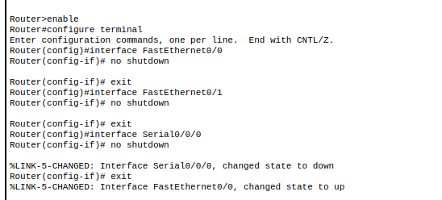
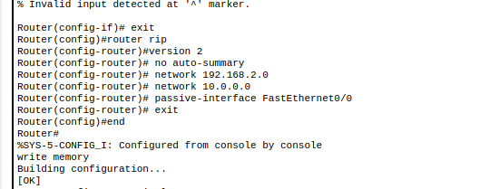
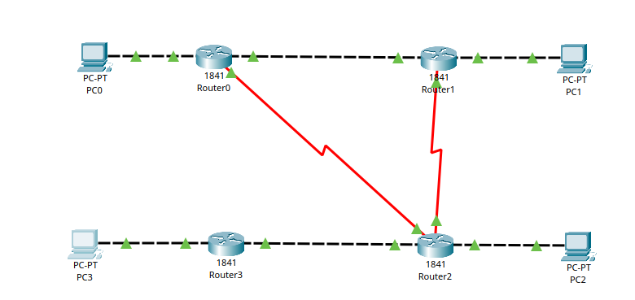
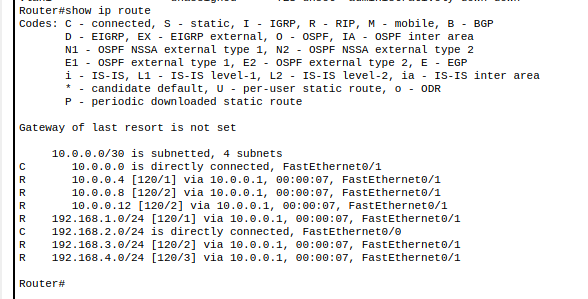
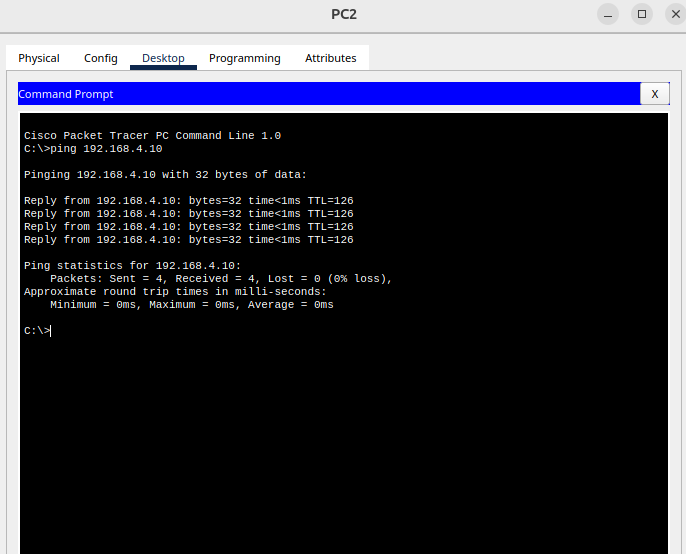
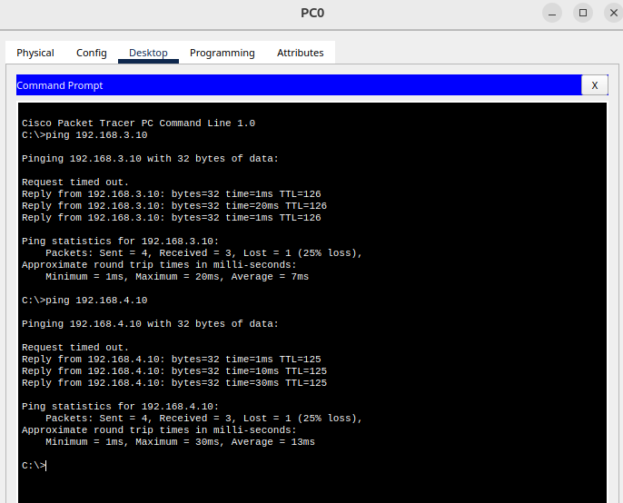

<p align="center">Министерство образования Республики Беларусь</p>
<p align="center">Учреждение образования</p>
<p align="center">“Брестский Государственный технический университет”</p>
<p align="center">Кафедра ИИТ</p>
<br><br><br><br><br><br><br>
<p align="center">Лабораторная работа №6</p>
<p align="center">По дисциплине “Аппаратное и Программное обеспечение сетей”</p>
<p align="center">Тема: “НАСТРОЙКА ДИНАМИЧЕСКОЙ МАРШРУТИЗАЦИИ С ПОМОЩЬЮ ПРОТОКОЛА RIP НА УСТРОЙСТВАХ CISCO”</p>
<p align="center">Вариант: 9</p>
<br><br><br><br><br>
<p align="right">Выполнил:</p>
<p align="right">Студент 3 курса</p>
<p align="right">Группы ИИ-27</p>
<p align="right">Юшкеич А.Ю.</p>
<p align="right">Проверил:</p>
<p align="right">Кулик А.Д.</p>
<br><br><br><br><br>
<p align="center">Брест 2026</p>

---

# Цель

Настроить динамическую маршрутизацию с помощью протокола RIP. Обеспечить возможность взаимодействия конечных устройств между собой. С помощью команд.

# Ход работы

**1.** Загрузив lab5-b.pdf, изучить материал; выполнить этапы настройки динамическоймаршрутизации с помощью протокола RIP на устройствах Cisco, изложенные в документе.По требованию преподавателя продемонстрировать правильность настройки.

**2.** Собрать схему сети согласно выданному варианту задания; распределить IP-адресапо аналогии с примером в lab5-b.pdf; составить таблицу сетевых адресов;сконфигурировать устройства.

**3.** Для собранной схемы сети выполнить настройку динамической маршрутизации спомощью протокола RIP.В отчете привести:- схему сети с IP-адресами - таблицу IP-адресов- ход настройки маршрута по протоколу RIP по методике, приведенной в Lab5-b.pdf- ход и результаты проверки и тестирования сети по методике, приведенной в lab5-b.pdf.

**4.** По требованию преподавателя продемонстрировать правильность настройки.

**5.** Подготовиться к защите работы.

## Практическая часть

Топология сети по варианту:



Реализовали сеть по данной в варианте топологии до настройки нашей сети: 



Таблица сетевых адресов для данной топологии (Для локальных сетей ПК используем сети /24 (маска 255.255.255.0), для соединений между маршрутизаторами — /30 (маска 255.255.255.252), чтобы не тратить адреса зря.): 

| Устройство | Интерфейс | IP-адрес | Маска подсети | Шлюз по умолчанию (Gateway) |
| --- | --- | --- | --- | --- |
| PC0 |	N/A	| 192.168.1.10 | 255.255.255.0 | 192.168.1.1 |
| Router0 |	Fa0/0 (к PC0) | 192.168.1.1 | 255.255.255.0	| N/A |
| --- | Fa0/1 (к Router1) | 10.0.0.1 | 255.255.255.252 | N/A |
| --- | Se0/0/0 (к Router2)	| 10.0.0.5 | 255.255.255.252 | N/A |
| PC1 | N/A | 192.168.2.10 | 255.255.255.0 | 192.168.2.1 |
| Router1 | Fa0/0 (к PC1) | 192.168.2.1 | 255.255.255.0 | N/A |
| --- | Fa0/1 (к Router0) | 10.0.0.2 | 255.255.255.252 | N/A |
| --- | Se0/0/0 (к Router2) | 10.0.0.9 | 255.255.255.252 | N/A |
| PC2 | N/A	| 192.168.3.10 | 255.255.255.0 | 192.168.3.1 |
| Router2 | Fa0/0 (к PC2) | 192.168.3.1 | 255.255.255.0 | N/A |
| --- | Fa0/1 (к Router3) | 10.0.0.13 | 255.255.255.252 | N/A |
| --- | Se0/0/0 (к Router0) | 10.0.0.6 | 255.255.255.252 | N/A |
| --- | Se0/0/1 (к Router1)	| 10.0.0.10	| 255.255.255.252 | N/A |
| PC3 | N/A	| 192.168.4.10 | 255.255.255.0 | 192.168.4.1 |
|Router3 | Fa0/0 (к PC3) | 192.168.4.1 | 255.255.255.0 | N/A |
| --- |	Fa0/1 (к Router2) | 10.0.0.14 | 255.255.255.252 | N/A |

## Включение интерфейсов

По умолчанию интерфесы выключены (down) и их необходимо включить на каждом маршрутизаторе командой: 
```cisco
enable
configure terminal
interface (FastEthernetX\X or SerialX\X\X)
exit
end
write memory
```



Далее на каждом маршрутизаторе необходимо настроить протоколы RIP. Для этого необходимо Определить сети, которые должны передаваться по протоколу маршрутизаци и иинтерфейсы, которые должны участвовать в обмене информацией между маршрутизаторами

```cisco
router rip
version 2
no auto-summary
network 192.168.1.0
network 10.0.0.0
passive-interface FastEthernet0/0
exit
```



На данном этапе наша сеть будет иметь следующее отображение:



## Проверяем корректность правильной настройки

В выводе вы должны увидеть строки, начинающиеся с буквы R. Например:
R 192.168.2.0/24 [120/1] via 10.0.0.2...
Это значит, что роутер выучил маршруты через RIP.



## Проверка связи




## Вывод
В ходе выполнения данной лабораторной работы была успешно настроена динамическая маршрутизация с использованием протокола RIP на устройствах Cisco (в среде Packet Tracer) для топологии, включающей 4 маршрутизатора и 4 конечных устройства.

В процессе работы были решены следующие задачи:

**1.** Выполнена базовая конфигурация маршрутизаторов: заданы имена устройств, отключен поиск DNS (no ip domain-lookup), настроены IP-адреса и маски на интерфейсах, а также активированы сами интерфейсы командой no shutdown.

**2.** Для соединения маршрутизаторов по WAN-технологии использовались последовательные интерфейсы (Serial). На стороне DCE (где установлен модуль WIC-2T) была корректно задана тактовая частота clock rate 64000.

**3.** На всех маршрутизаторах был сконфигурирован протокол RIP версии 2 с отключенным автоматическим суммированием (no auto-summary), что позволило корректно передавать информацию о подсетях с маской /30. Также с помощью команды passive-interface была отключена отправка обновлений в локальные сети (LAN), где нет других маршрутизаторов.

**4.** Работоспособность сети была проверена с помощью команды show ip route (на маршрутизаторах появились записи с меткой R) и команды ping с ПК.

Заключение: В результате работы была достигнута главная цель — обеспечено бесперебойное взаимодействие всех конечных устройств (PC0, PC1, PC2, PC3) между собой. Были получены практические навыки настройки, верификации и устранения неисправностей динамической маршрутизации по протоколу RIP, а также закреплено понимание принципов работы маршрутизаторов в сетях с несколькими путями передачи данных.